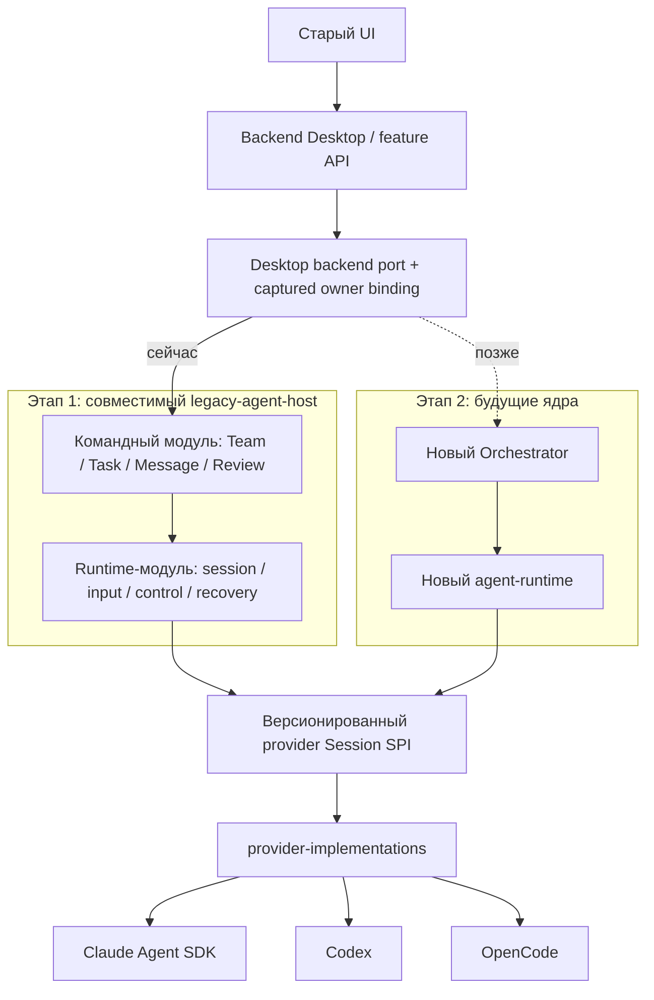

# Provider migration: двухэтапная программа

Обновлено: 21 октября 2026, Europe/Kiev.

**Направление согласовано владельцем. Сейчас оформляется спецификация этапа 1.**
Это не утверждение, что legacy-host уже реализован или полностью прошёл E2E.
Планирование и дальнейшая разработка ведутся изолированно от release-работы.
Merge, публикация и включение нового пути остаются отдельным решением после
проверок и ревью; прежнее общее разрешение автономного merge здесь не применяется.

## 1. Приоритет и результат

Главный поддерживаемый актив сейчас — `provider-implementations`: одна реализация
интеграции Claude/Codex/OpenCode, пригодная для разных host/runtime. Claude первым
использует официальный Agent SDK. При замене SDK/CLI меняется provider adapter,
а не команды, задачи или UI.

Нынешний `agent-runtime` может быть переписан с нуля. Поэтому работоспособность
первого этапа не зависит от его implementation, базы или embedded Host. Его
проверенные контракты и rejecting fixtures используются как исходный материал.
Будущий Orchestrator тоже не требуется для завершения первого этапа.

**Этап 1:** старый Desktop полноценно работает через выделенный `legacy-agent-host`
и provider library без запуска/import исходников старого Claude-форка.
Сохраняемые возможности перечислены в [матрице совместимости](compatibility-matrix.md).

**Этап 2:** командный и runtime-модули legacy-host независимо заменяются будущими
Orchestrator/runtime через уже определённые границы. Не обещается перенос native
checkpoints между разными движками или отсутствие любой миграционной работы.

Сплошные стрелки описывают этап 1; пунктир означает последующую замену. Это
логические границы: четыре новых сервиса или четыре отдельные базы не нужны.

## 2. Как читать документы

| Документ                                  | Единственная ответственность                                            |
| ----------------------------------------- | ----------------------------------------------------------------------- |
| Этот README                               | Направление, этапы, размещение, оценки и разрешения                     |
| [Этап 1](stage-1-legacy-host.md)          | Пошаговая реализация, invariants, переходы, зависимости и exit criteria |
| [Матрица](compatibility-matrix.md)        | Полный сохраняемый функционал и доказательства; не проценты готовности  |
| [Источники и reuse](sources-and-reuse.md) | Frozen donor, существующие результаты и ограничения их применения       |
| [Этап 2](stage-2-new-cores.md)            | Что стабилизируем сейчас и как заменяем владельцев позднее              |

Старый [A–F](../runtime-provider-extraction-and-claude-sdk-plan.md) сохраняет историю
первого направления и выполненных проверок. Его схема «сначала полностью новое
ядро» не является текущей последовательностью. Уже сделанные B/C/D/E не удаляются,
не переписываются под новую историю и не объявляются доказательством legacy-host.

## 3. Где находится код

| Часть                | Размещение и scope                                                                                                                                                 |
| -------------------- | ------------------------------------------------------------------------------------------------------------------------------------------------------------------ |
| Provider library     | Существующий `packages/platform/provider-implementations` в репозитории `agent-runtime`; независимые build/test/packed entrypoints, один источник алгоритмов       |
| Legacy-host          | Новый portable package `packages/legacy-agent-host` в изолированном frontend worktree; два внутренних модуля `team` и `runtime`, explicit composition              |
| Desktop connection   | Feature `src/features/agent-backend` с process-specific entrypoints по стандарту frontend; это host client/owner routing/projection, не второй Team store          |
| Provider Session SPI | Существующий curated `@agent-teams/agent-execution/interactive-contracts` на выбранном pin; только типовой контракт, без загрузки implementation нынешнего runtime |
| Будущие ядра         | Их собственные репозитории и worktrees; этап 1 не меняет их accepted ADR или implementation scope                                                                  |

Имена новых package/feature — выбранные рабочие имена спецификации, не заявление
об уже существующем npm-пакете. Если в выбранном baseline есть пригодная public
feature, P0 фиксирует её reuse вместо второго одинакового gateway.

Путь provider package внутри runtime repo не означает dependency на нынешний
runtime engine. Перед его rewrite package сохраняется отдельным ownership scope,
exact artifact и контрактным entrypoint. Если внешний packed consumer вынужденно
тянет implementation вместо типов, P1 выделяет **тот же** SPI в один минимальный
contracts package через штатные правила owning repo. Вторую редактируемую копию
SPI или отдельный contracts-репозиторий не заводим.

## 4. Разделение ответственности

| Владелец                   | Данные и решения                                                                                                                       |
| -------------------------- | -------------------------------------------------------------------------------------------------------------------------------------- |
| Team-модуль legacy-host    | Состав команды, задачи/назначения/зависимости, inbox/messages/groups, product approvals, task evidence/review, product retry policy    |
| Runtime-модуль legacy-host | Технические sessions/generations, durable input admission/handoff, control, event progress, custody, checkpoint compatibility/recovery |
| Provider driver            | SDK/protocol, нормализация событий, приватный native checkpoint, ограниченная volatile очередь; без product writers                    |
| Desktop                    | Представление, IPC/HTTP, private credential UI flow и host adapter; authoritative mutations делегируются владельцу                     |

У каждого бизнес-эффекта и технического handoff один writer. Указанные модули
могут жить в одном Node host process и используют собственные focused ports,
а не два конкурирующих manager/журнала одного назначения.

## 5. Изоляция и порядок допуска

1. Все изменения frontend, provider package и host делаются только в отдельных
   worktrees/ветках. Release checkout и чужие незакоммиченные изменения не меняются.
2. Переносятся выбранные Git blobs/проверенные patches и exact package artifacts,
   а не содержимое грязного соседнего checkout по случайному пути.
3. Один integration worktree собирает выбранные artifacts. Свои TEST roots,
   app userData, HOME/config/data/cache, БД, порты и process ownership обязательны.
4. Внутри веток можно делать локальные checkpoint commits. Push/PR/merge/release,
   переключение production default и обновление пользовательских данных не входят
   в текущую задачу документирования. К вопросу слияния возвращаемся после E2E/review.
5. Шаги допуска различаются: implemented → scoped-tested → integrated-E2E →
   reviewed → candidate. `candidate` не означает merged/activated/released.

## 6. Оценка объёма

Единица `k` — тысяча физических строк рукописного production-кода, которые нужно
создать или содержательно изменить **от текущего состояния**. Уже реализованную
provider library и существующие reusable tests не считаем написанными повторно.
Это инженерная оценка, а не измеренный diff или обещание точного итогового размера.

| Первый этап                                                | Production LOC |
| ---------------------------------------------------------- | -------------: |
| Границы подключения, SPI и package composition             |         0.5–1k |
| Командная механика, Task/Message tools, MCP                |           3–5k |
| Независимый runtime-host: launch, input, control, recovery |           3–5k |
| Desktop connection, inbox/logs/usage/readiness projections |           2–4k |
| Config, permissions, resume и provider compatibility gaps  |         2.5–5k |
| **Этап 1**                                                 |     **11–20k** |

| Этап                                    | Production | Tests/E2E |
| --------------------------------------- | ---------: | --------: |
| 1. Совместимый host без fork executable |     11–20k |     6–10k |
| 2. Подключение уже готовых будущих ядер |       4–8k |      3–6k |
| **Два этапа интеграции**                | **15–28k** | **9–16k** |

Предполагаемый преимущественно механический перенос: **20–40k существующих строк**.
Его точная dependency closure ещё не установлена. Изменяемая часть переноса —
подмножество 11–20k, её нельзя прибавлять второй раз. Generated/locks/docs и перенос
старых fixtures считаются отдельно в фактическом diff.

В 4–8k второго этапа не входит разработка новых ядер. Если они меняют смысл
identity, delivery, authorization или recovery, integration forecast возрастает
ориентировочно до 8–15k production и пересматривается до переключения. Будущая
разработка ядер пока не оценена: прежняя цифра 8–18k не применяется к неизвестному
rewrite. Оценка этапа 1: confidence 6/10, complexity 8/10; риск регрессий до проверок
7/10. Это шкалы инженерного суждения, не вероятность дефекта.

## 7. Что не считается завершением

Один работающий агент, успешный mock, наличие интерфейса, отсутствие imports форка
или ответ `unsupported` вместо прежней функции не закрывают этап 1. Его критерий —
вся сохраняемая матрица на новом пути и clean packed Desktop без fork executable.
Реальная model/auth qualification и OS packaging учитываются отдельно от synthetic
E2E; отсутствие тестового Claude-доступа не блокирует локальные fixtures и не
разрешает читать пользовательские credentials.
