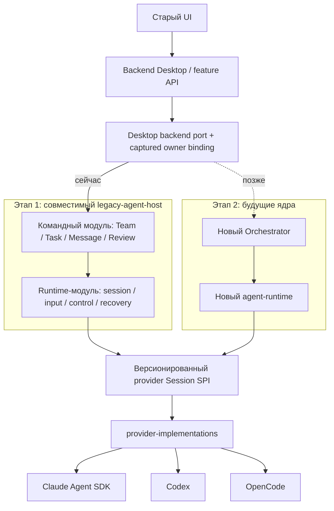

# Provider migration: двухэтапная программа

Обновлено: 21 октября 2026, Europe/Kiev.

**Направление согласовано владельцем. Реализация этапа 1 начата в изолированных lanes.**
Это не утверждение, что legacy-host уже реализован или полностью прошёл E2E.
Планирование и дальнейшая разработка ведутся изолированно от release-работы.
Merge, публикация и включение нового пути остаются отдельным решением после
проверок и ревью; прежнее общее разрешение автономного merge здесь не применяется.

P0–P3 находятся в работе; host CLI уже соединяет отдельного Claude-участника с
Team/Runtime/MCP и автоматическим dispatch, а bounded Task recovery и checkpoints
проверяются отдельно. Полный native Team workflow, IPC/UI cutover и P4–P8
ещё не завершены. Проверены отдельные Team/Runtime/MCP и Desktop owner-routing
slices, что не является приёмкой всей программы. Актуальные selected sources,
Node profile и ограничения доказательств — в
[selection manifest](stage-1-source-selection.json). Direct native capture source/
receipts сохранены в [P1 feasibility artifact](evidence/p1-native-capture-feasibility.tar.gz);
это ранняя проверка native mechanisms, без заявления M13 или полного Desktop E2E.

Первый связанный Claude slice сохранён в
[native Team/Runtime/MCP proof](evidence/p4-claude-team-native-v1.tar.gz): два
business inputs, canonical Task lifecycle и ответы участника человеку через
actual SDK/CLI/MCP с локальной моделью. Он проверяет in-process owners;
host stdio и Desktop/mixed-team приёмку не заменяет. Точные source/artifact hashes,
исходный неуспешный fixture-run и успешный receipt сохранены внутри.

Следующий [standalone-host Claude proof](evidence/p4-claude-host-native-v1.tar.gz)
прошёл уже через настоящий CLI stdio, production composition и выбранный D artifact:
два business inputs, canonical Task/MCP/native file effects, остановка и перезапуск
host с теми же receipts без повторного исполнения. Полные source/dist/artifact
digests сохранены в архиве. Это отдельный участник и локальная тестовая модель;
Desktop, mixed teams, native history restore и real-auth квалификация остаются впереди.

Отдельный [Codex Team proof](evidence/p4-codex-team-native-v1.tar.gz) проверяет
actual app-server 0.162.0, same-thread MCP discovery и два inputs через in-process
Team/Runtime. Шесть Team tools явно разрешены в TEST-конфигурации native provider;
это не проверка human approval UI. Архив сохраняет три неуспешные попытки,
различие external harness cleanup и Runtime custody, успешный receipt и source.
Standalone Codex host, mixed-team и Desktop qualification этим не закрыты.

## 1. Приоритет и результат

Главный поддерживаемый актив сейчас — `provider-implementations`: одна реализация
интеграции Claude/Codex/OpenCode, пригодная для разных host/runtime. Claude первым
использует официальный Agent SDK. При замене SDK/CLI меняется provider adapter,
а не команды, задачи или UI.

Нынешний `agent-runtime` может быть переписан с нуля. Поэтому работоспособность
первого этапа не зависит от его implementation, базы или embedded Host. Его
проверенные контракты и rejecting fixtures используются как исходный материал.
Будущий Orchestrator тоже не требуется для завершения первого этапа.

**Этап 1:** старый Desktop полноценно работает через выделенный `legacy-agent-host`
и provider library без запуска/import исходников старого Claude-форка.
Сохраняемые возможности перечислены в [матрице совместимости](compatibility-matrix.md), включая attachments, полный
review workflow, trash/restore/backup и используемый реестр фоновых services.

**Этап 2:** командный и runtime-модули legacy-host независимо заменяются будущими
Orchestrator/runtime через уже определённые границы. Не обещается перенос native
checkpoints между разными движками или отсутствие любой миграционной работы.

Сплошные стрелки описывают этап 1; пунктир означает последующую замену. Это
логические границы: четыре новых сервиса или четыре отдельные базы не нужны.

## 2. Как читать документы

| Документ                                  | Единственная ответственность                                                   |
| ----------------------------------------- | ------------------------------------------------------------------------------ |
| Этот README                               | Направление, этапы, размещение, оценки и разрешения                            |
| [Этап 1](stage-1-legacy-host.md)          | Пошаговая реализация, invariants, переходы, зависимости и exit criteria        |
| [Протоколы этапа 1](stage-1-contracts.md) | Recovery/RPC, MCP/config/attachments, capture/review, data lifecycle и приёмка |
| [Матрица](compatibility-matrix.md)        | Полный сохраняемый функционал и доказательства; не проценты готовности         |
| [Источники и reuse](sources-and-reuse.md) | Frozen donor, существующие результаты и ограничения их применения              |
| [Этап 2](stage-2-new-cores.md)            | Что стабилизируем сейчас и как заменяем владельцев позднее                     |

Старый [A–F](../runtime-provider-extraction-and-claude-sdk-plan.md) сохраняет историю
первого направления и выполненных проверок. Его схема «сначала полностью новое
ядро» не является текущей последовательностью. Уже сделанные B/C/D/E не удаляются,
не переписываются под новую историю и не объявляются доказательством legacy-host.

### Что выбрать при старте реализации

P0/P1 можно начинать по этой спецификации. Таблица ниже показывает оставшиеся
локальные решения исполнителя; их границы и acceptance заданы в фазах, а не требуют
новой архитектурной программы. Все перечисленные результаты пока planned.

| Решение                                                        | Кто и когда                                              | Конкретный результат                                                                                                                                                                       |
| -------------------------------------------------------------- | -------------------------------------------------------- | ------------------------------------------------------------------------------------------------------------------------------------------------------------------------------------------ |
| Какие bytes переносим и устанавливаем                          | Frontend/Provider owners, P0                             | Один selection manifest с выбранными refs/blobs/artifact digests; включённые donor deltas перечислены явно                                                                                 |
| Точные TypeScript shapes и profile limits                      | Владельцы consumer ports и Provider package, P1          | Public DTO/errors, SPI artifact/re-export, captured Node/provider profile и bounded transport limits; SDK types остаются private                                                           |
| Как хранить новые receipts/technical records и соединить locks | Team/Runtime owners, P1 contracts → P2/P3 implementation | Versioned records и reuse existing stores/helpers, удовлетворяющие §3–§5 протоколов; exact layout не навязывается будущим ядрам                                                            |
| Как доказать change capture конкретного provider               | Provider + capture adapter owner, P1; product wiring P6  | P1 native fixture подтверждает before/final bytes, immutable attribution и timeline/outcomes выбранного hooks/window/native-chain path; полный ledger/review и его guards проверяются в P6 |
| Что именно квалифицировано в тестовой среде                    | Integration owner, P0 profiles → P4/P7/P8 evidence       | Separate synthetic/native, real auth и OS tuple results на выбранной composition; отсутствующий доступ не записывается как PASS                                                            |

Точные имена файлов, внутренние record shapes и композиция пригодных helpers
определяются при реализации этих фаз. Материальная ошибка boundary/guarantee меняет
соответствующий контракт; обычный локальный выбор не расширяет scope программы.
Точки входа для работы: [P0](stage-1-legacy-host.md#p0-зафиксировать-source-и-недостающую-совместимость),
[P1](stage-1-legacy-host.md#p1-замкнуть-contractspackages-и-один-технический-walking-slice)
и [протоколы](stage-1-contracts.md).

## 3. Где находится код

| Часть                | Размещение и scope                                                                                                                                           |
| -------------------- | ------------------------------------------------------------------------------------------------------------------------------------------------------------ |
| Provider library     | Существующий `packages/platform/provider-implementations` в репозитории `agent-runtime`; независимые build/test/packed entrypoints, один источник алгоритмов |
| Legacy-host          | Новый portable package `packages/legacy-agent-host` в изолированном frontend worktree; два внутренних модуля `team` и `runtime`, explicit composition        |
| Desktop connection   | Feature `src/features/agent-backend` с process-specific entrypoints по стандарту frontend; это host client/owner routing/projection, не второй Team store    |
| Provider Session SPI | Curated Session SPI выделяется в минимальный contracts artifact того же workspace; старый entrypoint остаётся совместимым re-export, без копии типов         |
| Будущие ядра         | Их собственные репозитории и worktrees; этап 1 не меняет их accepted ADR или implementation scope                                                            |

Имена новых package/feature — выбранные рабочие имена спецификации, не заявление
об уже существующем npm-пакете. Если в выбранном baseline есть пригодная public
feature, P0 фиксирует её reuse вместо второго одинакового gateway.

Путь provider package внутри runtime repo не означает dependency на нынешний
runtime engine. Перед его rewrite package сохраняется отдельным ownership scope,
exact artifact и контрактным entrypoint. Нынешний packed test устанавливает весь
`agent-execution` с implementation dependencies: type-only import сам по себе
не обеспечивает независимый install/build. Поэтому P1 выделяет **тот же** SPI
в один минимальный contracts package по правилам owning repo; прежний
`agent-execution/interactive-contracts` re-export сохраняет совместимость.
Вторую редактируемую копию SPI или отдельный contracts-репозиторий не заводим.

## 4. Разделение ответственности

| Владелец                   | Данные и решения                                                                                                                       |
| -------------------------- | -------------------------------------------------------------------------------------------------------------------------------------- |
| Team-модуль legacy-host    | Состав команды, задачи/назначения/зависимости, inbox/messages/groups, product approvals, task evidence/review, product retry policy    |
| Runtime-модуль legacy-host | Технические sessions/generations, durable input admission/handoff, control, event progress, custody, checkpoint compatibility/recovery |
| Provider driver            | SDK/protocol, нормализация событий, приватный native checkpoint, ограниченная volatile очередь; без product writers                    |
| Desktop                    | Представление, IPC/HTTP, private credential UI flow и host adapter; authoritative mutations делегируются владельцу                     |

У каждого бизнес-эффекта и технического handoff один writer. Указанные модули
могут жить в одном Node host process и используют собственные focused ports,
а не два конкурирующих manager/журнала одного назначения.

## 5. Изоляция и порядок допуска

1. Все изменения frontend, provider package и host делаются только в отдельных
   worktrees/ветках. Release checkout и чужие незакоммиченные изменения не меняются.
2. Переносятся выбранные Git blobs/проверенные patches и exact package artifacts,
   а не содержимое грязного соседнего checkout по случайному пути.
3. Один integration worktree собирает выбранные artifacts. Свои TEST roots,
   app userData, HOME/config/data/cache, БД, порты и process ownership обязательны.
4. Внутри веток можно делать локальные checkpoint commits. Push/PR/merge/release,
   переключение production default и обновление пользовательских данных не входят
   в текущую задачу документирования. К вопросу слияния возвращаемся после E2E/review.
5. Шаги допуска различаются: implemented → scoped-tested → integrated-E2E →
   reviewed → candidate. `candidate` не означает merged/activated/released.

## 6. Оценка объёма

Единица `k` — тысяча физических строк рукописного production-кода, которые нужно
создать или содержательно изменить **от текущего состояния**. Уже реализованную
provider library и существующие reusable tests не считаем написанными повторно.
Это инженерная оценка, а не измеренный diff или обещание точного итогового размера.

| Первый этап                                                 | Production LOC |
| ----------------------------------------------------------- | -------------: |
| Границы подключения, SPI, workspace/package composition     |         1–1.5k |
| Team/Task/Message/MCP, product blobs и registry             |         3.5–6k |
| Runtime-host: launch/input/control/checkpoint/recovery      |           4–6k |
| Desktop routing, reads/logs/usage и полный review cutover   |         2.5–4k |
| D/private adapters: config/auth/attachments/capture/context |         4–7.5k |
| **Этап 1, округлённый диапазон**                            |     **15–25k** |

| Этап                                    | Production |  Tests/E2E |
| --------------------------------------- | ---------: | ---------: |
| 1. Совместимый host без fork executable |     15–25k |      7–12k |
| 2. Подключение уже готовых будущих ядер |       4–8k |       3–6k |
| **Два этапа интеграции**                | **19–33k** | **10–18k** |

Предполагаемый преимущественно механический перенос: **20–40k существующих строк**.
Его точная dependency closure ещё не установлена. Изменяемая часть переноса —
подмножество 15–25k, её нельзя прибавлять второй раз. Generated/locks/docs и перенос
старых fixtures считаются отдельно в фактическом diff.

В 4–8k второго этапа не входит разработка новых ядер. Если они меняют смысл
identity, delivery, authorization или recovery, integration forecast возрастает
ориентировочно до 8–15k production и пересматривается до переключения. Будущая
разработка ядер пока не оценена: прежняя цифра 8–18k не применяется к неизвестному
rewrite. Оценка этапа 1: confidence 6/10, complexity 8/10; риск регрессий до проверок
7/10. Это шкалы инженерного суждения, не вероятность дефекта.

Прежние 11–20k были оптимистичны: source review выявил text-only input,
потерянный compact event, fork management executor, pre/post capture seam и скрытые
MCP/review/blob writers. Это существующий product scope, не новые функции.
Пересмотренный диапазон включает эти доработки один раз: Team semantics/stores
во второй строке, durable technical state в третьей, UI routing в четвёртой,
provider protocol/config/capture observations в пятой. Boundaries/composition —
первая строка. Нового provider loop или generic artifact/process platform нет.
Pinned Node поставляется в candidate resources; lifecycle/backup reuse и точная
owner qualification TaskRefs входят в соответствующие composition/Team/Desktop
части. Достаточный capture mechanism для M13 — ещё недоказанная предпосылка оценки:
его узкий proof проводится в P1 до широкого extraction, без обязательного per-tool
interception для всех providers. Если подходящего механизма нет, пересматривают
конкретный seam и диапазон, сохраняя M13 открытым; fallback в fork parity не закрывает.

Диапазон ещё не measured diff: нижняя граница предполагает reuse существующих
stores/config/protocol code. P0/P1 уточняют closure и стоимость отсутствующих D
capabilities до широкого переноса; fixture PASS не доказывает, что эти gaps готовы.

## 7. Что не считается завершением

Один работающий агент, успешный mock, наличие интерфейса, отсутствие imports форка
или ответ `unsupported` вместо прежней функции не закрывают этап 1. Его критерий —
вся сохраняемая матрица на новом пути и clean packed Desktop без fork executable.
Реальная model/auth qualification и OS packaging учитываются отдельно от synthetic
E2E; отсутствие тестового Claude-доступа не блокирует локальные fixtures и не
разрешает читать пользовательские credentials.
