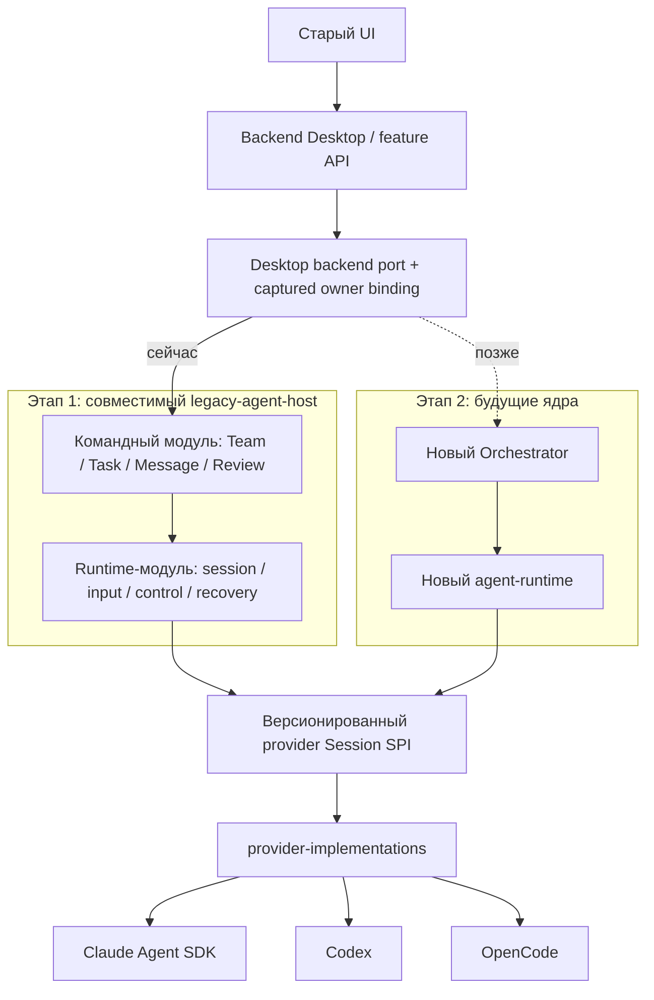

# Provider migration: двухэтапная программа

Обновлено: 24 октября 2026, Europe/Kiev.

**Направление согласовано владельцем. Реализация этапа 1 начата в изолированных lanes.**
Это не утверждение, что legacy-host уже реализован или полностью прошёл E2E.
Планирование и дальнейшая разработка ведутся изолированно от release-работы.
Merge, публикация и включение нового пути остаются отдельным решением после
проверок и ревью; прежнее общее разрешение автономного merge здесь не применяется.

**Обязательное правило UI (прямое указание владельца, 22 октября): использовать
только существующий UI. Не писать новые альтернативные формы/диалоги запуска,
создания команды, resume/relaunch, задач или review.** Сохраняются существующие
компоненты, поля и сценарии. Интеграция меняет backend/API adapters и необходимые
источники данных; недостающая поддержка доводится в backend. E2E проходит через
эти же пользовательские controls, прямой API setup не заменяет приёмку диалога.

**Текущий scope — только этап 1, P0–P8 / M01–M19.** По уточнению владельца
22 октября этап 2 сейчас **не выполняем**. Он означает последующее подключение
новых Orchestrator и agent-runtime после появления их готовых реализаций и
отдельного решения начать интеграцию. Их разработка, адаптеры и переключение
не входят в текущую задачу, оценку процентов, оставшийся LOC и Definition of done.
Сейчас сохраняем только необходимые границы замены; будущее ядро не проектируем.

[Доска задач и вложения через существующий UI](evidence/m03-existing-task-attachments-ui-handoff.json)
прошли свежий Electron E2E: создание, зависимости, назначение, сортировка мышью,
blocked/unblocked Start, загрузка и preview изображения Task, файл комментария,
renderer reload, точное скачивание и удаление изображения с сохранением комментария.
Байты сверены с canonical artifacts; исходные add/comment/remove завершены.
App exit0, Host отсутствует, группа пуста, writer освобождён; сохранены 2655 файлов.
Это offline Team owner и прежние controls: native/chat delivery, cold restart,
размерные границы и полные M03/M04 остаются открытыми. Прежние отказы сохранены.

[Pristine Claude Launch UI](evidence/m02-existing-pristine-claude-launch-ui-handoff.json)
прошёл с обычным Host и выбранной provider library: существующий диалог изменяет
модель/effort/prompt, native CLI выполняет задачи, сообщения и Bash, исходный Stop
освобождает custody, настройки сохраняются после reload. Один native input,
8 model steps, 2 read-only model checks, без ошибок; app exit0, Host отсутствует,
группа пуста, writer released. Это изолированный TEST HOME и localhost API,
без vendor credentials. Исправлен только ранний клик теста до hydration формы;
Resume/relaunch, packed приложение и полная Stage1 этим прогоном не закрыты.

[Холодный Resume через существующий UI](evidence/m16-existing-cold-resume-ui-handoff.json)
прошёл на выбранном provider00b: Launch, Stop, guarded Quit, холодное открытие того же
профиля, явный выбор checkpoint, новое сообщение с прежней native history и второй
Stop. Оба input succeeded, custody released; app exit0, Host отсутствует, writer
освобождён. Сохранены 2477 файлов; прежние отказы не изменены. Исправлено только
ожидание inherited fieldset disabledness в TEST controls. Это localhost SDK/CLI
proof, без vendor auth, multi-member Resume и automatic app.relaunch.

[Fresh relaunch существующей команды](evidence/m16-existing-fresh-relaunch-ui-handoff.json)
прошёл отдельно: после первого Stop прежний Launch-диалог создаёт новую беседу
с новым run/principal/generation, сохраняя участника, завершённую задачу и оба
ответа в существующем чате. Два native input, 11 model steps, два Stop с released
custody до app cleanup; Host отсутствует, writer released. Это fresh conversation
в одном Host, без восстановления checkpoint, cold Resume и vendor auth.

[Scoped Codex Question UI proof](evidence/m06-existing-codex-question-ui-handoff.json)
прошёл на настоящем Codex 0.162.0 с localhost inference/MCP: прежние Composer и
Question Sheet передали два исходных ответа — `accept` с выбранным значением и
`decline`. Получены два canonical receipt и видимые ответы агента; native custody
освобождена, Desktop/Host завершились без сигналов, writer lock отсутствует.
Первый отказ объяснён TEST policy `never`; исправлены только две policy фикстуры
на `on-request`, sandbox сохранён. Raw/source/bundle evidence сохранены отдельно.
Текущий полный Host gate: **734/734 PASS**, 97 файлов, без пропусков.
Новые изменения Resume и capture ещё проходят интеграционную проверку; вложения Task имеют отдельный scoped Electron proof. Это scoped M06 proof,
не vendor auth, не все формы вопросов и не завершение этапа 1.

[M19: существующий ProcessesSection и следующее сообщение](evidence/m19-existing-live-process-ui-handoff.json)
прошли отдельный Desktop E2E на provider dad39: один Kill исходного сервиса,
работающий сосед, native acknowledgment и второй успешный input в той же session,
видимый ответ человеку, затем Team Stop с released custody. Original job и retainer
завершились с кодом 0; сохранены 7997 файлов и исходные source/bundle pins.
App закрылась без harness signal, Host отсутствует, writer released. Это normal-live
proof; crash/cold, native Quit, whole-tree finality и полный M19 не заявляются.

[M19: live ancestry и штатный Stop](evidence/m19-native-live-registration-stop-handoff.json)
прошли kernel и actual SDK/MCP proof: исходный процесс из другой OS-сессии
зарегистрирован, Human Stop подтвердил его отсутствие, соседний сервис продолжил
отвечать, owner cleanup завершён. TEST-модель учитывает точное native completion
notification; ошибок нет. Прежний отказ сохранён отдельно; cold/crash и Desktop
Stop ещё не проверены.

[Scoped cross-Team UI proof](evidence/m05-existing-cross-team-ui-handoff.json)
подтвердил отправку, ответ и reload через существующие Messages/Composer с canonical
receipts обеих команд в одном Host. Exact source/bundle bytes и raw failures
сохранены локально и исключены из Git. Завершение тестовых процессов потребовало
scoped SIGTERM; естественный Quit, native reply и полный M05 этим не закрыты.

[Scoped OpenCode task capture](evidence/m13-opencode-native-task-capture-handoff.json)
подтверждён сверкой 1185 сохранённых файлов исходного native PASS: явный Start
задачи, actual OpenCode read/edit, один qualified ledger event и cold Reject
с восстановлением исходных dirty bytes без изменения index и посторонних файлов.
Все 50 OpenCode protocol JS совпадают с выбранной текущей provider library;
позднейшие Host wrapper/lifecycle изменения этим старым прогоном не проверены.
Исторический ENOENT остаётся отдельным failed outcome; причинный fix не заявляется.
Desktop Changes, failed/background capture и полный M13 остаются открытыми.

[Scoped Skills UI proof](evidence/m15-existing-skills-ui-handoff.json) прошёл через
существующие Import/Create/Edit/Delete: exact bytes, stale source/context, OS Trash
с сохранением замены по старому имени и удержание UNKNOWN. Приложение и Host вышли
с кодом 0; source/bundle evidence и скриншоты сохранены. Plugins/MCP, provider auth
и полный M15 остаются отдельными открытыми сценариями.

[Scoped Quit и cold-start proof](evidence/m18-existing-quit-ui-handoff.json)
подтвердил закрытие при активном input с очередью и во время native provider open.
Существующий Composer и public guarded Quit API сохраняют исходы UNKNOWN/cancelled;
Electron, Host и CLI завершаются без сигналов тестовой очистки, writer освобождён.
Оба прежних TEST-профиля открываются без native allocation/replay и сохраняют точные
Runtime/product records через второе закрытие, включая исходный pending-open debt.
Все четыре job PASS; прежние отказы сохранены. Это localhost SDK/CLI proof:
автоматический app.relaunch, vendor auth, другие providers/OS и полный M18 открыты.

Доставка по уточнению владельца: PR остаются **draft**; в основную/release ветку
их не мержим. Допустим стек небольших зависимых PR и объединение проверенных частей
только в отдельную изолированную integration-ветку. Это не разрешение включить путь
пользователям. Feature/business policy остаётся в Team/Runtime owners legacy-host;
UI сохраняет формы и presentation, Desktop backend — IPC/transport/composition.
**Переиспользуем существующие CreateTeamDialog/LaunchTeamDialog и остальные формы
со всеми полями и сценариями.** Отдельный урезанный Host UI не создаём. Подключение
делается через backend/API и данные существующих компонентов; отсутствие поддержки
поля исправляется в backend, а не обходится новым диалогом.

[Scoped M10 native proof](evidence/m10-native-compaction-handoff.json) подтвердил
настоящий manual compact в Claude CLI: после штатного Stop и cold recapture
следующий исходный input получает актуальные roster/Task context ровно один раз.
Проверены original identity/ASK, отсутствие скрытого input и cold proof без native
allocation. Три Host завершились, захваченные native processes отсутствуют.
Hot roster, automatic compaction, Desktop и полный M10 этим proof не закрываются.

[Scoped Codex appOnly proof](evidence/m02-codex-app-only-native-handoff.json)
прошёл на настоящем Codex 0.162.0 с localhost inference. Native catalog содержит
ровно захваченный Team MCP subset; выбранные внешние и ambient MCP не получили
initialize/list/call. Собственные loopback OAuth metadata GET учитываются отдельно:
это не утверждение об отсутствии HTTP. Изменение native catalog отказало следующему
input до отправки, исходный outcome не повторялся; cleanup подтверждён. `inheritLead`,
OpenCode и полный M02/M15 этим прогоном не закрываются.

[Scoped Codex inheritLead proof](evidence/m02-codex-inherit-lead-native-handoff.json)
подтвердил один исходный input/result и один настоящий read-only MCP echo при двух
model requests. Selected initialize/list/call: 4/4/1, ambient: 0/0/0; собственные
OAuth metadata GET: 24/96, поэтому zero-network не заявляется. Изменение выбранного
catalog отказало следующему distinct input как `known-not-sent`, без replay;
native permission policy не менялась, cleanup подтверждён.

[Scoped OpenCode appOnly proof](evidence/m02-opencode-app-only-native-handoff.json)
показал ровно 27 захваченных Team tools и один исходный успешный result: raw HTTP
attempt к local model endpoint и admitted request — по одному, external selected/
ambient MCP и OAuth counters — ноль. Это не общий HTTP census. После отзыва
исходного Team MCP endpoint следующий distinct input получил `known-not-sent`:
проверена потеря captured authority, не config-file drift. Этот appOnly case
использовал прежний provider baseline 49448 и остаётся отдельным доказательством.

[Scoped OpenCode inheritLead proof](evidence/m02-opencode-inherit-lead-native-handoff.json)
на D55/209 + SPI/12 подтвердил один исходный successful result, два local model
HTTP requests, exact27 Team tools + selected echo и selected initialize/list/call
1/1/1 при ambient 0/0/0; metadata GET отдельно: 1/0. После изменения captured
selected catalog следующий distinct input получил `known-not-sent`, без новых
requests/calls или replay. Native subprocess exit0, cleanup и полные afterpins
подтверждены. Product native PASS отделён от managed-wrapper observation UNKNOWN:
сохранён `running`, но записанный PID отсутствует; raw ошибка сохранена без retry
и ремонта metadata. Полные M02/M15 и этап 1 остаются открытыми; этап 2 исключён.

[Scoped M11 native proof](evidence/m11-ordinary-subagent-native-handoff.json) прошёл на
официальном SDK 0.3.305 и настоящем Claude CLI с локальной inference-фикстурой:
ASK/DO, дочерний Write и provenance, отсутствие Team grants у child,
остановка родителя и сохранение работы соседнего участника. Остановленный input
остаётся `unknown`; полный M11, UI logs, M13 child attribution и реальная авторизация
этим прогоном не закрываются. Raw отказы прежних test-oracle и успешный новый epoch
сохранены раздельно, без повторного выполнения эффектов при проверке evidence.

[Scoped M11 Logs/Stats UI proof](evidence/m11-existing-native-logs-stats-ui-handoff.json)
прошёл через прежний MemberDetailDialog и renderer reload на сохранённых native
child facts: original provenance и parent usage показаны без replay и сложения
child totals. После Host close исходные 24 canonical файла, profile и receipt
не изменились; raw PASS, screenshots и точный source/bundle epoch сохранены.
Task Activity/detail/logstream, полный M11 и этап 1 остаются открытыми; этап 2 исключён.

[Отмена saved-model probe после отзыва прав](evidence/p5-saved-model-revoke-cleanup-handoff.json)
исправлена: exact original context разрешает завершить уже запущенную проверку,
новые проверки и чтения по-прежнему требуют действующих прав. Owner/lease guards
сохранены. Регрессия RED → GREEN, шесть focused source-проверок, types/lint PASS;
это controlled-provider proof, без нового native запуска.

**Принят scoped Electron E2E импорта сохранённой legacy-команды через исходный
[LaunchTeamDialog](evidence/p6-existing-stopped-import-ui-v1/manifest.json).**
Прежняя кнопка Launch импортирует конфигурацию, задачи, комментарии, ссылки и
attachment bytes в canonical Host target. Сохранённые поля показаны в том же
диалоге; два настоящих SDK/CLI model-probe к localhost прошли и освободили ресурсы.
После Close и renderer reload прежняя карточка по точному Team ID открывает тот же
import/диалог без повторного model request. Исходные файлы не меняются, Runtime
sessions/captures и Team inputs отсутствуют: **Launch Submit здесь не выполняется**.
Managed job exit0/PASS, Host отсутствует, TEST process group пуста, sentinel
отказов нет; сохранены 458 файлов evidence. Ранее выявленные ошибки и неудачные
test-oracle попытки сохранены отдельно. Полный M16 и ранее запущенные native Teams
этот прогон не закрывает.

[Вложения исходного сообщения Task](evidence/m03-m04-source-message-attachments-handoff.json)
подключены к прежним AttachmentDisplay/Kanban controls через единый API. Чтение
привязано к exact owner/Team/Task и исходному message snapshot, ограничено по размеру
и проверяет итоговый SHA-256; private пути в renderer не передаются. Прошли восемь
current-source Host и 36 Main/renderer/UI проверок, types/lint/format PASS. Actual
Electron thumbnail/download acceptance ещё не выполнен; это не закрытие M03/M04.

[OpenCode native payload probe](evidence/p6-opencode-filechange-payload-probe-v1/manifest.json)
сохранён отдельным TEST tuple **1.19.4 / SHA `417af539…`**; отказ прежнего
1.18.35 pin сохранён без эффекта и не переобозначен как новый proof. Один native
read → edit сохранил исходный dirty marker, TEST process group пуста. Raw
`metadata.filediff` содержит `file/patch/additions/deletions`, а не полные
`before/after`; установленный V1 projector теряет metadata. Это payload probe,
без auth/UI parity; **M13 остаётся открытым**. Копии и hashes проверены без replay.

**[Scoped native → прежний Changes UI](evidence/p6-native-review-composite-v1/manifest.json)
подтверждён составным evidence без повторного native input.** Настоящие SDK/CLI
создают Task через MCP; исходный Task Start передаёт exact outbox/input, два
foreground Edit сохраняют dirty before/final bytes и immutable attribution.
Исходные Keep/Reject дают точные mixed bytes; после перезапуска Host/app прежние
Undo/Redo, History и renderer reload сохраняют решения и посторонние файлы.
Первый run остановился на ложном external-write guard, продолжение — на слишком
строгом сравнении вычисляемого cache. Guard исправлен, cache сверён с production
алгоритмом; отдельная read-only reconciliation проверила пропущенные инварианты.
**Обе raw-квитанции остаются INCOMPLETE.** При shutdown Runtime дописал по два
повторных closed-state events; остальные поля и исходные inputs сохранены.
Сохранены оба selected collection tree, source epochs, logs и screenshot.
Это выбранные успешные Claude Edit, не полный M13/этап 1 и не vendor inference.

[Дополнительный native Changes readback](evidence/p6-existing-native-review-history-ui-v1/manifest.json)
сохранён как отдельный **PASS/exit0**: прежний History показывает undo2/redo0,
renderer reload сохраняет точные mixed bytes и authoritative review snapshot;
Host отсутствует, TEST process group пуста. Этот run не повторяет ни native input,
ни Keep/Reject/Undo/Redo. Исходный native run (`6758429e…`) и отдельный run четырёх
review actions (`9b99345c…`) остаются **INCOMPLETE**; архив связывает три source epochs,
raw-квитанции, bundles, logs и screenshot. Предыдущая попытка keyboard-навигации
вставила 59 отступов по два пробела в editor draft: его точные bytes, SHA и inode
сохранены без discard или применения к файлу. Отдельный pre-app job `fa0d1b4d…`
отказал из-за ошибки helper mode до создания raw-квитанции и запуска приложения;
этот отказ не переобозначен как PASS. Это scoped Claude Changes evidence,
**не полная M13/этап 1 приёмка**.

**Принят scoped Electron E2E исходного Changes UI:**
[решения и renderer reload](evidence/p6-existing-review-ui-v1/manifest.json),
[отдельный перезапуск Host/app и внешняя правка](evidence/p6-existing-review-readback-ui-v1/manifest.json).
Оригинальные hunk-controls сохраняют первый hunk, отклоняют второй и немедленно
записывают точные смешанные bytes на диск; Undo/Redo и история сохраняются после
reload и полного перезапуска. Git index и посторонний untracked-файл не меняются.
После внешней TEST-правки прежний Changes показывает Changed on disk и блокирует
Undo, сохраняя внешние bytes. Оба managed job завершились exit0/PASS;
Host отсутствует, TEST process groups пусты, selected sources не менялись.
Сохранены 413 + 416 файлов evidence. Исправлена реальная гонка: параллельные
чтения hydration больше не создают user-mutation receipts; неизвестные реальные
записи по-прежнему удерживаются. Регрессия воспроизведена RED → GREEN, 164 теста.
**Это fixture-ledger → настоящий Desktop/Main/Host/filesystem, не native M13
attribution.** Agent-wide changes, другие workspace/provider profiles, direct-edit
crash с недоказанным commit и полный этап 1 остаются открытыми.

[Настоящий Host/native capture](evidence/p6-host-native-capture-handoff.json)
подтвердил цепочку MCP task_create → человеческий task.start → TaskRecovery outbox
→ native input → четыре partial ledger rows: failed Bash, Edit, Write и отдельный
файл delayed post-hook. Original owner/input/generation сохранены; background и
grouped overlap дают gaps. Native runner exit1 сохранился как исходный результат:
ошибка была в terminal-ID oracle теста. Read-only reconciliation проверил исходные
records/bytes и physical cleanup без повторных effects; Host exit0, custody released.
Это подтверждает partial capture, **не полноту M13 и не Desktop review этого capture**.

[Native Codex file-change payload](evidence/p6-codex-filechange-payload-probe-v2/analysis.json)
проверен на выбранном app-server 0.162 и localhost fixture: native apply_patch
через поддерживаемый exec_command возвращает exact unified diff по dirty bytes.
Forward/reverse преобразования совпали с actual before/final файлами,
item/thread/turn correlation сохранена, TEST процессы завершены. Первый отказ
из-за отсутствия отдельного apply_patch tool сохранён. Это достаточность payload
для следующего bounded input-baseline slice, не готовый Host capture и не M13 parity.

[Agent-wide evidence](evidence/p6-agent-evidence-handoff.json) теперь включает
обычные сообщения без Task: исходный Runtime input и Team outbox связывают запись
с неизменным ID участника. История задач агрегируется по этому ID, включая
переназначенные задачи; фиктивные Task ID не создаются. Cold reads/content прошли
focused проверки, partial/unknown stats отображаются через прежний toolbar.
В handoff раздельно указаны 45 проверок по нескольким прогонам, три UI-проверки и
пересекающиеся финальные rechecks. Это **не native/Electron приёмка всего M13**.

[Исторические workspace и review](evidence/p6-captured-review-roots-handoff.json)
прошли 17 Host и 23 transport-проверки: контент, watch и Git используют исходный
workspace capture после смены рабочего каталога и выбранного restore. Actor ID и
исходные события сохраняются. Замена каталога, отзыв прав и смена контекста дают
отказ. Исправлено повторное ручное сохранение: завершённая самостоятельная
транзакция освобождает свою ссылку на файл; parent WAL сохраняет отдельный порядок
финализации. Это focused проверки с controlled provider, **не весь M13 E2E**.

[Освобождение старого CLI перед импортом](evidence/m16-native-stop-handoff.json)
подключено к существующему Stop для ограниченного solo Unix-варианта. Проверены
настоящие TEST Node-процессы: остановлен только исходный child, посторонний sentinel
сохранён, birth/group отсутствуют, durable proof прочитан холодным exporter.
Исходный job завершился exit1 из-за неполной TEST-оболочки exporter; отдельная
read-only сверка того же proof прошла без повторного Stop. OpenCode/tmux/Windows,
другие участники и неизвестные native obligations остаются HOLD. Это **не полная
приёмка Desktop Stop/provider и не закрытие M16**.

**Принят scoped E2E выбранного checkpoint через исходный
[LaunchTeamDialog](evidence/p5-existing-resume-ui-v1/manifest.json).**
После Launch → Stop → reload пользователь явно выбирает Resume и опубликованный
checkpoint. Сохраняется один product launch, создаётся новая technical generation;
Resume не отправляет prompt. Следующее сообщение через прежний Composer использует
исходную native историю и завершает три actual SDK/CLI запроса к localhost fixture.
Задача и оба ответа сохранены, второй Stop освобождает native child. Исправлено
сравнение старой roster revision с новым техническим поколением: готовность теперь
проверяется по точному исходному resume intent/member command map.
**Ограничение cleanup:** raw runner завершился exit 1 / INCOMPLETE, потому что
один Electron dev helper оставался после 30 секунд scoped SIGTERM. Отдельное
read-only наблюдение подтвердило его последующий выход, отсутствие Host/native
PIDs и пустую TEST process group. Исходная квитанция сохранена без изменений;
повтора native effects не было. Сохранены 276 файлов evidence. Это один Claude
lead, не полный M09 и не весь этап 1; multi-member/provider UI, legacy import,
review/apply и остальные обязательные пункты остаются открытыми.

**Принят E2E двух последовательных fresh Launch через исходный
[LaunchTeamDialog](evidence/p5-existing-relaunch-ui-v1/manifest.json).**
Первый запуск выполняет восемь настоящих SDK/CLI запросов к localhost fixture;
после Stop и renderer reload тот же диалог запускает новую техническую session
с сохранённой командой. Второй запуск выполняет три запроса без native history
первого; прежняя задача и сообщения остаются в UI. Оба Stop подтверждают release
до Quit; после cleanup Host отсутствует и TEST process group пуста. Сохранены
228 файлов evidence с проверкой исходных hashes. Исправлены регистрация captured
model-probe profile и гонка переключения модели при незавершённой отмене предыдущей
проверки. **Это fresh запуск остановленной Host-команды, не checkpoint Resume и
не импорт legacy Team.** Resume, review/apply и остальные P0–P8/M01–M19 остаются
открытыми; этап 2 не выполняется.

**Принят E2E создания с немедленным запуском через исходный
[CreateTeamDialog](evidence/p5-existing-create-launch-ui-v1/manifest.json).**
Обычные controls задают TEST workspace, Opus 4.6 / Medium и lead prompt.
Один submit создаёт одну команду, fresh capture и native input. Настоящий
SDK/CLI с localhost inference выполняет MCP-задачу, Bash с exit 7 и ответ,
видимый в существующем чате. Исходный Stop освобождает native child до Quit;
после renderer reload команда и настройки сохранены. Проверены source hashes,
strict sentinel без legacy команд, отсутствие Host и пустая TEST process group.
Исправлены потеря scoped proof из-за отложенного React ref и изменение модели
при фоновом обновлении каталога; реальный SDK envelope принят TEST oracle.
Это один Claude lead на Node 24.21 / macOS arm64, **не весь этап 1**:
полные составы/providers/settings, Resume/relaunch, review/apply и P6–P8 открыты.
Избыточные model checks при изменении нерелевантных полей остаются отдельным
известным риском до проверки с vendor API; данный прогон выполнил один model probe.

**Дополнительно принят E2E сохранения новой команды через исходный
[CreateTeamDialog](evidence/p5-existing-create-config-ui-v1/manifest.json).**
Пользовательские controls задают TEST workspace и отключают немедленный запуск;
один Save создаёт одну durable registry/Team запись. Существующий Team view
открывается по canonical owner-qualified selection; после реального reload
команда доступна через прежний список Teams, настройки не перезаписаны.
Исправлена блокировка save-only после отмены незавершённого launch preflight.
Strict sentinel без legacy команд, TEST process group пуста; Host PID до Quit
в этом save-only proof не захвачен, поэтому отдельного physical-Host-exit claim нет.
Это сохранение конфигурации; Create с запуском проверяется отдельно.

**Принятый E2E запуска сохранённой Claude-команды через исходный
[LaunchTeamDialog](evidence/p5-existing-launch-ui-v2/manifest.json).** В реальном
Electron изменены модель/effort/prompt, выполнены scoped preflight, сохранение и
fresh capture, настоящий SDK/CLI выполнил MCP-задачу и Bash; ответ виден в прежнем
чате. Исходный Stop освободил native child до Quit; после reload исходный диалог
показал сохранённые настройки без нового agent input. Sentinel не зафиксировал
legacy status/agent команд до или после Quit. Фоновый legacy warmup отключён при
выбранном Host. Проверены source hashes до/после; Host отсутствует и тестовая
process group пуста после cleanup. Dev wrapper потребовал scoped SIGTERM — это
не доказательство его естественного выхода. Inference — localhost fixture;
реальная vendor auth отдельно. **Это один сценарий, не весь этап1:** полные Create/Launch составы,
selected Resume/relaunch, новые участники/provider recipes, остальные settings,
review/apply и оставшиеся P0–P8/M01–M19/owning gates ещё обязательны. История
предыдущих scoped proofs ниже сохраняет их исходные границы.

[Team model test](evidence/p5-team-model-probe-handoff.json) теперь проверяет модель
конкретного captured member через тот же Host owner. Actual SDK/CLI использовал
отдельный Team endpoint и effort `medium`; проверены отмена, warm/cold replay без
нового model request, stale roster и revoke/regrant без оживления старого proof.
Прошли234 Host и170 frontend тестов. Это положительный backend prerequisite;
на момент того capture обычный `prepareProvisioning` ещё не был подключён.

[Captured Team preflight](evidence/p5-existing-team-preflight-handoff.json) теперь
подключает model-часть существующего `prepareProvisioning` к Host. Исходный ID
проверки сохраняется через reload/UNKNOWN, полный выбор моделей — через cached
runtime-only вызов; warm/cold replay не отправляет второй model request. Прошли
506 frontend/IPC тестов и actual SDK/CLI с localhost API.

[Повтор preflight](evidence/p5-team-preflight-renewal-handoff.json) теперь сохраняет
original intent каждого открытия/явного обновления через cold reload. Новый intent
может заменить только подтверждённо освобождённую проверку; UNKNOWN/неизвестные
ресурсы не получают новый UUID. Две одновременные новые подготовки используют один
successor, после revoke/regrant требуется fresh probe. Прошли540 frontend/IPC,
235 Host тестов и actual SDK/CLI с localhost API. Следующий model-only slice описан
ниже; полный launch/create/resume ещё впереди.
**E2E существующих диалогов не закрыт**; model-preflight не означает готовность команды.

[Точный выбор моделей участников](evidence/p5-team-member-model-mapping-handoff.json)
связывает выбор в существующем диалоге с authoritative lead/member через Host,
включая rename по исходному имени и наследование настроек. Перестановка одинаковых
моделей/effort между участниками инвалидирует cache. Actual SDK/CLI с localhost API
проверил двух участников с отдельными account/workspace/config: сохранённый effort
`low` заменён на `medium` у lead и `high` у worker. Прошли235 Host и257 фокусных
frontend тестов. Это model-preflight: dynamic roster/provider/workspace configuration,
ordinary launch/create/resume и E2E исходных диалогов ещё не завершены.

[Обычный provisioning progress](evidence/p5-existing-provisioning-progress-handoff.json)
теперь читает состояние и отменяет captured launch через прежний Teams API.
Run key привязан к handle/launch/roster revision; отмена фиксирует поколения
участников до первого эффекта. Existing callback использует тот же цикл Team
наблюдений, включая долгий bootstrap, partial/human/unknown состояния и отбрасывание
поздней готовности после stop. Время берётся из Host. Прошли238 Host тестов,
170 frontend тестов, включая15 progress-тестов; реальный NDJSON
Host/Runtime проверен с controlled provider. Это **не actual SDK/Electron dialog
приёмка progress**. Ordinary launch submission, dynamic roster settings и оставшиеся
P0–P8/M01–M19 по-прежнему обязательны.

[Team-owned saved roster](evidence/p5-team-roster-owner-handoff.json) добавляет
реальное сохранение состава и всех teammate-настроек с revision/original intent,
устойчивыми product IDs и восстановлением controller projection после сбоя.
Live/unknown ресурсы не переоформляются; после подтверждённого release старые
runtime targets/grants не оживают от восстановления имени. Прошли254 Host и170
frontend тестов, включая13 roster cases и3 controlled-provider NDJSON сценария.
**Desktop facade/ordinary `replaceMembers`, fresh native capture и Launch submit
ещё не подключены**; это обязательная оставшаяся работа этапа1, а не этап2.

[Desktop roster facade](evidence/p5-desktop-roster-facade-handoff.json) теперь
передаёт read/replace/original lookup через существующие Main/preload/HTTP операции
с исходными handle/command/revision и ограниченными DTO. Исправлена проверка после
завершённого сообщения: immutable admission receipt Team не заменяет текущую
input/custody-проверку Runtime. Прошли254 Host и178 frontend тестов, включая Main →
real NDJSON сохранение/lookup/replay и stale refusal после сообщения/stop.
**Existing `replaceMembers`/диалоги ещё не приняты:** сначала нужны сохранённые
lead/global settings, точные default/clear/CAS semantics и fresh native capture.
Это оставшаяся реализация этапа1; SDK/Electron UI proof здесь не объявляется.

[Configured Team settings](evidence/p5-team-saved-settings-handoff.json) закрывает
следующий пробел: исходные общие/lead choices теперь сохраняются у того же Team
owner вместе с составом, CAS revision и original receipt. Defaults/clear/false/off,
prompt, worktree/args и local-model opt-in не подменяются effective Runtime values.
Trusted descriptor задаёт их только при первом bootstrap. Existing `getSavedRequest`
и `getData` читают этот источник; исходный `LaunchTeamDialog` заполняет прежние поля
и сохраняет пользовательский ввод при поздней hydration/local draft.
Прошли256 Host и267 frontend тестов; после исправления stable callback dependencies
повторно прошли99 относящихся к форме тестов (они входят в267, не суммируются).
Это сохранение/hydration, **не завершённый Create/Launch/Resume Electron E2E**.
Следующие обязательные шаги: ordinary `replaceMembers` с исходной revision/intent и
member-settings CAS, trusted fresh native capture, затем submit прежних диалогов.
Остальные P0–P8/M01–M19 сохраняются полностью; этап2 не выполняется.

[Existing roster submission](evidence/p5-existing-roster-submission-handoff.json)
подключает обычный `replaceMembers` исходного `LaunchTeamDialog` к тому же Team owner.
Форма сохраняет исходную hydrated revision и ID первого submit независимо от
обновлений model-preflight. После UNKNOWN неизменённый retry остаётся тем же intent,
изменённый payload требует заново открыть форму. Один verified read-only lookup
может подтвердить commit без повторной мутации. Member-settings CAS проверяется
внутри прежнего roster transition по owner-issued tokens и canonical identity.
Прошли260 Host и129 frontend/интеграционных тестов, включая submit исходной кнопкой
React-диалога и actual Main → NDJSON с потерей ответа. **Это ещё не Electron
Launch/Create/Resume E2E**: далее нужны fresh native capture, обычный launch/create
и приёмка исходных controls через CDP. Полный P0–P8/M01–M19 остаётся обязательным.

[Ordinary launch integration](evidence/p5-ordinary-launch-handoff.json) добавляет
fresh capture из сохранённого roster intent и private recipes: новые sessions,
bindings/grants регистрируются у прежнего Team owner до native allocation.
Обычный `launchTeam` использует исходный command; первый prompt проходит через Team
message, повтор после потери ACK не дублирует allocation/input. Historical reads
сохраняют исходные run/generation. Relaunch прежнего диалога удерживает исходный run,
member-settings baseline и подтверждённые stop/save, поэтому retry не останавливает
успешную замену. Прошли276 Host и132 различных frontend/интеграционных теста,
production typecheck, scoped fast lint и frozen guards; критик повторно проверил
исправления. **Actual SDK/Electron Launch/Create/Resume E2E ещё не закрыт.**
Новые участники/provider recipes, worktree/args/MCP, Create и остальные обязательные
сценарии остаются в этапе1. Отказы compiler не уменьшают сохраняемый scope.

[Fresh capture через actual SDK/CLI](evidence/p5-fresh-capture-native-v1/manifest.json)
теперь подтверждён отдельно: сохранённый roster command создаёт новую привязку и
principal, prompt проходит через Team, модель/effort доходят до native HTTP requests.
Native MCP выполнил task lifecycle/comment/message, а Bash записал TEST-файл и
вернул exit7. Warm/cold replay не создал повторного input/allocation; физический
cleanup подтверждён. Прошли278 Host тестов и отдельный native proof. Read projection
effective permissions теперь берётся из compiled profile и для fresh capture.
Это localhost inference через настоящий SDK, **не Electron dialog или vendor auth
приёмка**; Launch/Create/Resume и весь оставшийся scope этапа1 остаются открытыми.

[Native probe + fresh capture](evidence/p5-fresh-capture-native-v2/manifest.json)
дополнительно проверяет исходный `team.launch.probe` до сохранения состава: настоящий
SDK отправляет единственный no-tool input, затем выполняется тот же fresh launch
с MCP/Bash и восстановлением без повторного input. Исправлена TEST-фикстура полного
probe prompt с добавляемыми CLI reminder blocks; каталог не считается доказательством
авторизации. Прошли три проверки oracle и native proof1/1, cleanup подтверждён.
Это отдельное backend evidence; Electron Launch/Create/Resume по-прежнему требуют
приёмки исходных диалогов.

[Existing preflight context](evidence/p5-existing-preflight-context-handoff.json)
передаётся из исходных Create/Launch диалогов через preload к Main. Контекст команды
отделяет request/model-proof cache от другой команды и Create. Host-намерение больше
не запускает fork preflight; первоначальный guard возвращал `ready:false`, теперь
model-проверка captured Team подключена описанным выше adapter. Create/draft-only отказывают до legacy writers,
чтобы `Skip preflight` не запускал старый owner. Прошли513 тестов и2 дополнительных assertion-сценария
существующих форм; финальный guard создания проверен239 IPC-тестами. Это
prerequisite, **не завершённый preflight или E2E диалогов**.

[Claude model test](evidence/p5-claude-model-probe-handoff.json) проверен через
Main → standalone Host → actual SDK/CLI с локальным inference API: успех выбранной
модели, отказ при ответе другой модели, отмена и повтор исходного command ID после
перезапуска Host без нового model request. Прошли231 Host и169 frontend тестов,
strict typechecks и отдельный packed consumer. Это backend prerequisite:
**E2E существующих Launch/Create/Resume ещё не закрыт**, auth/team-launch authority
не выводится из metadata или одного model test. Новые формы не добавляются.

[Claude metadata](evidence/p5-claude-metadata-handoff.json) добавляет native SDK
catalog/status через public provider library и captured Host/Main к существующему
model selector. Actual SDK/CLI и standalone Host прошли metadata-сценарии без
model requests; configured hooks отключены, native cleanup подтверждён отдельно.
Источник `claude-sdk` не выдаётся за vendor auth/model proof. **Обычные
Launch/Create/Resume ещё не приняты:** нужны интеграция model/auth checks и полная
preflight/roster/launch/progress цепочка. Общий provider gate сохраняет29 Darwin
fixture failures; FMS/scoped types/lint и отдельный packed consumer прошли.

[Existing launch data](evidence/p5-existing-launch-data-handoff.json) подключает
сохранённые Host settings к `getSavedRequest` и metadata существующего Team view,
без нового диалога. Альтернативная экспериментальная форма удалена по указанию
владельца. Прошли 118 frontend тестов и Electron Composer/Task/replies/Stop с
actual SDK/CLI и localhost inference. **Initial launch остаётся TEST API setup;
existing Launch/Create/Resume пока не приняты.** Host-набор —231 на сохранённом tuple.
Три неуспешные попытки другого UI сохранены как abandoned, без Launch/model effects.
Native и Host остановлены; dev wrapper очищен guarded SIGTERM, не объявлен exit0.
Основной следующий участок — existing preflight/roster/launch/progress chain,
описанный в [P5](stage-1-legacy-host.md#подключение-существующих-launchcreateresume-форм).

[Initial launch configuration](evidence/p5-launch-configuration-handoff.json) теперь
записывает выбранные параметры до allocation и восстанавливает их из того же launch
record. Выбор Opus/medium подтверждён actual native HTTP через standalone Host и
Electron IPC; после checkpoint/restore в смешанной Claude/Codex/OpenCode-команде
он сохранился. Прошли 231 Host и 108 frontend тестов, обычные Composer/Task/replies/Stop
в Electron и mixed native restore. Найден и исправлен отказ Main на новой configured
revision; исходная неуспешная попытка и её фактические эффекты сохранены.
Это finite backend API: обычные Launch/Resume dialogs, изменение состава и остальные
поля/сценарии этапа ещё в работе. Ошибки unsupported не считаются parity.

[Request-shaped routing](evidence/p5-host-request-routing-handoff.json) закрывает
обход renderer-перехвата через `{teamName: …}` в Launch/create/config/member settings
и через notification target. Прошли 106 frontend тестов и actual Electron regression
Composer→Claude SDK/CLI→MCP→Task/replies→Stop. Шесть отрицательных API probes
проверяют точный отказ до legacy dispatch; положительная реализация этих операций
и обычные Launch/Resume остаются обязательной следующей работой. Ошибка пути
тестового import первой попытки сохранена отдельно; Native в ней не запускался.

Отдельный [Team read/feed v3](evidence/p5-team-read-feed-handoff.json) проверил
согласованные state+cursor под одним Team lock, source replay/retention/restart gaps,
дедупликацию и защиту UI от поздних ответов. Обычный Claude Composer/Task/reply/Stop
прошёл на actual Electron/SDK/CLI с localhost inference. Полные scoped наборы —
228 Host и103 frontend теста; последующий lint-отказ и его исправление сохранены
раздельно. Это приёмка Team product resource; обычные Launch/Resume, другие feeds
и остальные P0–P8/M01–M19 остаются незавершёнными. Ниже сохранена история отдельных
proofs с их собственными source tuples и границами.

Последний [selected native restore proof](evidence/p4-mixed-native-restore-handoff.json)
прошёл на Claude/Codex/OpenCode: checkpoint, released stop, перезапуск Host,
восстановление выбранной истории в новую generation и второй input в прежней native
session/thread. Одновременные дубли resume получают один результат; устаревшие
stop-команды отклоняются. Полный Host-набор — 226/226; отдельный frontend-набор —
27/27. Это scoped проверка с localhost inference, без обычных Desktop Resume controls
и без заявления завершения P0–P8/M01–M19. Точные pins, ошибки предыдущих попыток
и незакрытые owning gates сохранены в handoff.

Следующий [native peer proof](evidence/p4-mixed-native-peers-handoff.json) проверяет
все шесть направлений Claude↔Codex↔OpenCode и шесть ответных подтверждений внутри
того же Team после восстановления. Все 25 native inputs завершились успешно;
67 localhost model requests, 15 completed peer-команд, три Host exit0 и отсутствие
оставшихся TEST-процессов подтверждены. Group/cross-Team, второй Team и обычный
Desktop workflow этим доказательством не закрыты.

В [Native Desktop Stop attempt](evidence/p5-desktop-native-stop-handoff.json)
через обычные controls созданы Task и проверено сохранение после reload; Claude
запущен через явную TEST API setup-команду. Обычный Stop нажат один раз, но
ошибка сборщика не позволила зафиксировать отсутствие native PID **до Quit**.
Исходный результат остаётся INCOMPLETE; read-only reconciliation подтвердил
финальное closed/released состояние без повтора действий. Strict sentinel
отказов не обнаружил; разрешённая legacy `--version` зависимость ещё остаётся.
Обычные launch/resume controls и полный P5/P8 этим не приняты.

Следующий [ordinary Composer/native proof](evidence/p5-desktop-native-conversation-handoff.json)
прошёл: два Send, actual Claude/MCP/Bash/Task lifecycle, два ответа в обычном thread
и один Stop с отсутствием exact native PID **до Quit**. Модель localhost scripted;
первоначальный launch — TEST API setup. Исправлен реальный Send focus/layout дефект.
226 Host и47 focused frontend проверок прошли на закреплённом Node24.21.
Native Task пока не обновляет Kanban/sidebar автоматически; body-text observer
также не квалифицирует viewport/auto-scroll последнего ответа. Эти пробелы,
обычные Launch/Resume controls и весь оставшийся этап не объявлены закрытыми.

[Product-updates v2](evidence/p5-desktop-native-product-updates-handoff.json) закрыл
следующий UI slice: Native Task автоматически появился в Kanban/sidebar, оба ответа
подтверждены в видимой области, два inputs и обычный Stop до Quit прошли. После
исправления поздней подписки прошли98 frontend тестов; полный Host-набор —227.
Отдельный saved-state readback сохранил исходный Runtime без новых native inputs.
Первоначальная ошибка text-node collector и transient zombie cleanup сохранены,
успешные команды в прежней Team не повторялись. Это snapshot-invalidation slice;
полный согласованный snapshot/feed§6, обычные Launch/Resume и остальные сценарии
этапа остаются открытыми.

P0–P5 имеют реализованные и отдельно проверенные slices; host CLI уже соединяет отдельного Claude-участника с
Team/Runtime/MCP и автоматическим dispatch, а bounded Task recovery и checkpoints
проверяются отдельно. Полный native Team workflow, UI cutover и приёмка P4–P8
ещё не завершены. Проверены отдельные Team/Runtime/MCP и Desktop owner-routing
slices, что не является приёмкой всей программы. Актуальные selected sources,
Node profile и ограничения доказательств — в
[selection manifest](stage-1-source-selection.json). Direct native capture source/
receipts сохранены в [P1 feasibility artifact](evidence/p1-native-capture-feasibility.tar.gz);
это ранняя проверка native mechanisms, без заявления M13 или полного Desktop E2E.

**Evidence в репозитории и локальные архивы.** Raw captures, сохранённые копии
source/bundles/state и новые tar-архивы сохранены локально и исключены из будущего
PR через `.gitignore`; это не удаление доказательств. Для review остаются компактные
[handoffs и manifests](evidence/README.md) с исходными статусами, scope и hashes.
Ниже ссылка на handoff заменяет ссылку на ignored архив только при наличии его
точной identity; иначе архив указан как локальный файл, без обещания GitHub-ссылки.
Уже tracked artifacts сохраняют прежние ссылки. Исторический LOC census включает
эти retained копии и не означает предполагаемый размер PR.

Первый связанный Claude slice сохранён в
[native Team/Runtime/MCP proof](evidence/p4-claude-team-native-v1.tar.gz): два
business inputs, canonical Task lifecycle и ответы участника человеку через
actual SDK/CLI/MCP с локальной моделью. Он проверяет in-process owners;
host stdio и Desktop/mixed-team приёмку не заменяет. Точные source/artifact hashes,
исходный неуспешный fixture-run и успешный receipt сохранены внутри.

Следующий [standalone-host Claude proof](evidence/p4-claude-host-native-v1.tar.gz)
прошёл уже через настоящий CLI stdio, production composition и выбранный D artifact:
два business inputs, canonical Task/MCP/native file effects, остановка и перезапуск
host с теми же receipts без повторного исполнения. Полные source/dist/artifact
digests сохранены в архиве. Это отдельный участник и локальная тестовая модель;
Desktop, mixed teams, native history restore и real-auth квалификация остаются впереди.

[Следующий Claude proof с prepared human messages](evidence/p5-claude-rich-host-native-v1-handoff.json) (локальный архив `evidence/p5-claude-rich-host-native-v1.tar.gz`)
проверяет текущий Host/D tuple и обязательный visible-reply contract нового Composer:
все 11 actual native model requests получили его, два ответа опубликованы через
настоящий MCP в canonical human inbox. Два inputs, Task lifecycle, Bash effects,
stop/restart и receipt replay без нового native submit прошли; оба Host exit0 и
released custody подтверждены. Модель локальная scripted, поэтому это не обещание
соблюдения инструкций произвольной реальной моделью и не Desktop UI acceptance.

Отдельный [Codex Team proof](evidence/p4-codex-team-native-v1.tar.gz) проверяет
actual app-server 0.162.0, same-thread MCP discovery и два inputs через in-process
Team/Runtime. Шесть Team tools явно разрешены в TEST-конфигурации native provider;
это не проверка human approval UI. Архив сохраняет три неуспешные попытки,
различие external harness cleanup и Runtime custody, успешный receipt и source.
Этот архив не закрывает standalone Codex host, mixed-team и Desktop qualification.

Отдельный [standalone-host Codex proof](evidence/p5-desktop-backend-bridge-handoff.json) (локальный архив `evidence/p5-codex-host-native-v1.tar.gz`)
прошёл через production CLI/Team/Runtime/D: два business inputs, Task lifecycle,
MCP replies, native file effects и durable text/tool activity. Host restart возвращает
явный incarnation gap старому cursor и не повторяет inputs. Оба Host завершились
с кодом 0 при closed/released custody. Это один участник и localhost модель;
полный mixed-team/bootstrap и Desktop workflow ещё не квалифицированы.

Отдельный [Desktop backend bridge proof](evidence/p5-desktop-backend-bridge-handoff.json) (локальный архив `evidence/p5-desktop-backend-bridge-v1.tar.gz`)
проверяет 15 диагностических вызовов через actual Electron preload/main и standalone
Host: Task lifecycle, receipt replay/lookup, conflict и forged-handle rejection.
Guarded Quit остановил captured Host до внешней очистки TEST process group.
Это prerequisite для UI cutover: пользовательские controls и native sessions в Desktop
здесь не проверялись. Полный sentinel census сохраняет отклонённый старый OpenCode
maintenance-вызов при Quit; fork-free cutover ещё открыт. Архив хранит все три
попытки и ограничения provenance; [handoff](evidence/p5-desktop-backend-bridge-handoff.json)
связывает digests и границы проверки.

Текущий production path дополнен OpenCode V1 adapter через публичный D и
контролируемыми проверками config/tool/context/custody. Первый native Host attempt (локальный архив `evidence/p5-opencode-host-native-attempt1.tar.gz`)
завершился INCOMPLETE до business inputs: selected native создал session, но
adapter ошибочно искал MCP tools в builtin-only `/experimental/tool` catalog.
Discovery proof исправлен и прошёл следующий actual native запуск. Во
второй попытке (локальный архив `evidence/p5-opencode-host-native-attempt2.tar.gz`) инструмент реально
создал задачу, но тестовый parser потерял верхний уровень receipt; parser исправлен.
Третья попытка (локальный архив `evidence/p5-opencode-host-native-attempt3.tar.gz`) выполнила первый
input целиком на native стороне, но выявила public-D несовместимость: OpenCode
не включает idle sessions в `/session/status`, а driver ожидает явный idle row.
Исправление внесено в provider library; исходный unknown третьей попытки
сохранён, второй input в ней не отправлялся. Host exit0/cleanup подтверждены
отдельно для попыток 2/3.
Исходные Host exit1 и UNKNOWN custody первой попытки остаются неизменными;
отсутствие listener не объявлено доказательством её полной очистки.
Свежий standalone-host OpenCode proof (локальный архив `evidence/p5-opencode-host-native-v1.tar.gz`)
прошёл с новым D artifact: два inputs, 11 localhost model requests, Task/MCP/Bash
effects, 2 text/18 tool activity events, closed/released custody и два Host exit0.
После перезапуска receipts/outbox не исполняются повторно. Exact source/dist,
portable controller и artifact pins сохранены; mixed teams, shared backing,
positive native restore и Desktop этим proof не закрыты. Owning aggregate gates
provider repo остаются отдельно неуспешными/незавершёнными; native PASS их не отменяет.
На том source tuple интегрированный Host suite прошёл целиком: 172/172 на Node24.21.

Aggregate launch теперь сохраняет весь static roster
до allocation и отделяет native readiness от доказанного initial context; полный
retry с заменой generation ещё впереди. Обычный UI получает Host product snapshots
и поддерживаемые Task mutations; partial-outage global listing пока остаётся
явным ограничением, без legacy fallback. Prepared Composer metadata уже проходит
focused/native Host проверки; actual Composer/native UI ещё открыт.

**Обычный Task UI workflow прошёл** в [actual Electron proof](evidence/p5-desktop-team-ui-attempt11-handoff.json) (локальный архив `evidence/p5-desktop-team-ui-attempt11.tar.gz`):
sidebar → Open team → Create Task, ровно одна completed human command/Task,
та же доска, ID и поля после настоящего renderer reload и повторной навигации.
UI mutations исполнялись только обычными controls через CDP Input. TEST renderer
использует focus emulation: на macOS occlusion после reload скрытый Chromium
подтверждал Input, но не доставлял DOM events; с focus emulation записаны trusted
pointer/click events и повторное открытие прошло. Это тестовая настройка фокуса,
не обход application API. Captured Host и TEST app group остановлены.

**Общий proof остаётся INCOMPLETE:** неизменённый strict sentinel выявил 12
отклонённых legacy provider catalog/status попыток CLI. Native provider execution
не было; shutdown через обычный Quit после этого отказа не проверялся. Полный
cutover, native Desktop launch/messaging и P8 не приняты. Предыдущие ошибки
contextBridge Proxy, TEST pnpm route, dev dependency reload, hook-scaffold census
и automation focus сохранены с точными source/receipt hashes в
[selection manifest](stage-1-source-selection.json). Исходные неуспешные receipts
не переписаны; business mutations в прежние TEST runs повторно не отправлялись.

User/legacy Task start теперь направляются в Host с правдивым `notifiedOwner`:
Task, inbox и original-generation outbox публикуются по durable recovery plan;
отсутствие owner и legacy lead-self skip возвращают false. Тексты уведомлений
переиспользуют portable helper; Host примеры tools используют его strict schema.
6 Task-start и 8 rich-message проверок, 27 focused feature/golden проверок и
176 top-level Host тестов прошли; actual UI start notification ещё не принят.
В реальном Desktop пути обнаружен необработанный EPIPE старого JSON-RPC client;
focused actual-subprocess red/green регрессия подтверждает исправление без
uncaught main-process exception. Aggregate provider repo gates по-прежнему
не объявляются зелёными по этим frontend/Host результатам.

Management OpenCode теперь имеет собственный captured native path внутри Host,
отдельный от conversation SPI. [Native adapter proof](evidence/p5-opencode-management-handoff.json) (локальный архив `evidence/p5-opencode-management-native-v1.tar.gz`)
проверил каталог и запись/удаление dummy credential в выбранном TEST namespace;
[Host catalog proof](evidence/p5-opencode-management-handoff.json) (локальный архив `evidence/p5-opencode-management-host-native-v1.tar.gz`) — actual
stdio, profile/config refusals и безопасную проекцию моделей. Следующий
[credential/restart proof](evidence/p5-opencode-management-handoff.json) (локальный архив `evidence/p5-opencode-credential-host-native-v1.tar.gz`)
проверил durable command IDs, conflict и lookup: повтор старого set после forget
и перезапуска **не восстановил удалённый ключ и не запустил новый native server**.
Оба Host exit0. Последующий controlled Host + model-oracle suite прошёл 202/202 на Node24.21;
точные source/dist и исторические результаты указаны в manifest.

[OAuth process E2E](evidence/p5-oauth-host-synthetic-handoff.json) (локальный архив `evidence/p5-oauth-global-host-synthetic-v1.tar.gz`) прошёл без
Team bootstrap (`teams: []`): code/auto, физическая отмена исходного процесса,
reconnect и restart/replay без нового login или восстановления удалённых credentials.
URL/instructions остаются в Main; journal и progress проверены на отсутствие secrets.
Это синтетический TEST HTTP server через actual Host/D, без реального vendor login.
[Handoff](evidence/p5-oauth-host-synthetic-handoff.json) сохраняет обе source-bound
попытки и первоначальную ошибку Desktop TEST fixture с отдельным успешным исправлением.

В Main подключены catalog/models, native auth options/prompts, API-key form и
set/forget к новому Host. Следующий IPC OAuth proof (локальный архив `evidence/p5-main-oauth-ipc-v1.tar.gz`)
прошёл целую цепочку IPC → Main → Host → отдельный TEST HTTP process: code submit,
auto cancel с физической остановкой, restart Main с восстановлением исходного intent,
stale-code refusal и отсутствие secrets в progress/journals. Повторный connect с тем
же ID читает исходное состояние, не запускает второй login. После мутации каталог
обновляется у того же captured owner. 27 focused Host и 28 frontend/IPC тестов,
root TS7, строгая проверка Host test sources, affected fast lint и архитектурные guards
прошли. Это текущий отдельный прогон, а 202/202 выше относится к предыдущему полному
Host tuple; результаты разных запусков не складываются.

Следующий model-probe proof (локальный архив `evidence/p5-model-probe-integration-v1.tar.gz`)
прошёл с настоящим OpenCode/D и standalone Host: ровно один запрос в локальную
scripted модель без offered tools, ответ от exact provider/model/session, физический
stop и повтор receipt после Host restart без нового inference. Отдельный actual
IPC/Main/Host/TEST-server сценарий проверяет успешную пробу и физическую отмену
зависшего запроса. Native permission policy запрещает все tools; management
catalog/auth по-прежнему не создаёт session, она создаётся только explicit model-test.

На этом tuple полный Host + model-oracles прогон прошёл 212/212. После consumer
cancel refinement отдельный frontend/IPC прогон прошёл 33/33: отмена до завершения
lazy Host startup предотвращает сам `probe.start`, а late native success не становится
UI availability. Cancellation proof (локальный архив `evidence/p5-model-probe-cancel-v1.tar.gz`) хранит
его source/receipt. Последующая малая правка recovery schema запрещает противоречивый
cancelled receipt с unknown custody; build и6 focused проверок прошли отдельно,
без повтора уже успешного inference. Эти прогоны не складываются в искусственный aggregate.

Defaults proof (локальный архив `evidence/p5-model-defaults-v1.tar.gz`) проверяет actual Main IPC → Host → TEST native process:
project/global default, clear/inheritance, probe-before-save и сохранность legacy v1/v2
preferences/limits/extensions после restart. На этом отдельном tuple прошли 213 Host
и41 frontend/IPC проверки. Preference roots задаются private descriptor; renderer их
не получает. Сломанные/symlink preferences не сбрасываются в пустые настройки.

Controlled limits proof (локальный архив `evidence/p5-model-limits-controlled-v1.tar.gz`) проверяет
применение exact context/output pair перед no-tool probe, запись project override
только после success и чтение после restart: 217 Host и33 frontend/IPC проверки.
Первый actual OpenCode limit-прогон остановился до session/inference: ноль запросов
в TEST model endpoint и ноль Native sessions; его INCOMPLETE receipt сохранён.
Он не объявляется native qualification. Последующая правка читает private effective
provider config, потому что official catalog может не содержать custom npm/options.
[Main delta](evidence/p5-model-limits-main-import-order.patch) после controlled proof
содержит только import ordering; successful business effects ради этого не повторялись.

[Limits integration v2](evidence/p5-model-limits-handoff.json) (локальный архив `evidence/p5-model-limits-integration-v2.tar.gz`) связывает
текущий Host tuple с двумя отдельными проверками. Настоящий pinned OpenCode/D
применил context4096/output128 к модели, ранее имевшей context200000/output2000/
input100000, до единственного запроса в localhost scripted model; actual request
содержал `max_tokens:128` и не предлагал tools. Native process завершён, replay и
Host restart вернули прежний receipt без нового inference. Второй IPC/Main/Host/
TEST-native сценарий проверяет, что обычный Test model использует сохранённую пару
3072/192, а project/global preferences переживают restart. 34 frontend/IPC и4 focused
Host policy проверки прошли; root TS7, Host test-source strict, affected fast lint,
size/provisioning guards зелёные. Полный217/217 выше относится к предшествующему
Host tuple; результат не переносится на новый tuple как повторный полный прогон.
История native failure и обе успешные конфигурации сохранены, эффекты не replay-ились
ради metadata. [Текущий handoff](evidence/p5-model-limits-handoff.json) сохраняет полный
незакрытый scope.

Новый источник `RuntimeProviderStatusPort` отделяет статус Desktop от наличия
бинарника форка: readiness подтверждает handshake исходного Host, каталог OpenCode
читает его native adapter. Каталог не выдаётся за auth/execution proof. Непрозрачная
presentation-метка не позволяет UI унаследовать модели другого profile; IPC проверяет
исходные frame/context и обходит прежний общий TTL cache. Status attempt1 (локальный архив `evidence/p5-native-status-attempt1.tar.gz`)
сохраняет completed Main/IPC/Host/TEST-native scenario receipt и полный218/218 Host
прогон, но его test process был FAIL: ожидаемый отказ sender попал в error-log,
а legacy IPC suite имела неполный module mock. Repair proof (локальный архив `evidence/p5-native-status-repair-v1.tar.gz`)
фиксирует отдельные35/35 проверок и зелёные root TS7/lint/guards после ремонта.
Успешные credential/model effects ради исправления логирования не повторялись.
Claude/Codex native status/account adapters остаются незавершёнными.

[Electron attempt12](evidence/p5-desktop-team-ui-attempt12-handoff.json) (локальный архив `evidence/p5-desktop-team-ui-attempt12.tar.gz`) прошёл обычные
sidebar/Open Team/Create Task и проверку того же канонического Task после reload.
Прежние fork `runtime status` отказы исчезли, но строгий неизменённый sentinel
нашёл ещё два отдельных Codex nonversion вызова. Общий результат INCOMPLETE.
Тестовый Host остановлен; orphan TEST Electron пришлось закрыть по отдельно
подтверждённой custody этого процесса, поэтому штатный Quit не квалифицирован.
[Handoff](evidence/p5-desktop-team-ui-attempt12-handoff.json) сохраняет исходный отказ
и отдельное cleanup evidence; повтор бизнес-операций не выполнялся.

Обычные Electron controls этими proofs не квалифицированы; browser opening заменён
TEST callback. Native instructions/device-code presentation, применение сохранённых defaults/limits
к новым ordinary launches, полная UI-интеграция model-test/default/limits, companion/local-provider cutover, Claude/Codex status/account и два оставшихся
Codex sentinel refusals остаются открытыми. Полная P0–P8/M01–M19 цель не сужена. Наличие
credential или native connected не объявляется успешной authentication/model proof.

[Codex metadata и Electron attempt13](evidence/p5-codex-metadata-handoff.json) (локальный архив `evidence/p5-codex-metadata-and-desktop-attempt13-v1.tar.gz`)
добавляют конечные account/config/model чтения в public D Codex adapter. Host
выбирает executable/HOME/CODEX_HOME, проверяет namespace из native initialize и
подтверждает остановку процесса до ответа. Desktop больше не запускает свой
ambient app-server для этих чтений. Разные runtime/profile выбираются явно;
late reply после смены окна/контекста не публикуется. Native0.162.0 вернул11 моделей,
не отправил ни одного inference запроса и не создал conversation store.

Electron Task UI/Create/reload теперь PASS при неизменённом строгом sentinel:
nonversion обращений0, прежние2 Codex вызова устранены. Версионный preflight ещё
остаётся. Это узкий Task/source-cutover proof. В app log сохранены2 отказа
автоматического Codex refresh с includeRateLimits: чтение rate limits и остальные
auth-операции ещё нужно перенести. Они не заменены fake success. Dev wrapper
после закрытия Host остановлен узким SIGTERM cleanup; это не packaged
Quit/Relaunch proof. [Текущий handoff](evidence/p5-codex-metadata-handoff.json)
сохраняет незавершённый полный scope и следующий шаг.

[Следующий quota/read proof](evidence/p5-codex-metadata-handoff.json) (локальный архив `evidence/p5-codex-quota-and-desktop-read-v1.tar.gz`)
закрывает два includeRateLimits отказа: существующий read-only renderer API теперь
проходит preload/Main/Host/D/native Codex, а отсутствие ChatGPT account возвращает
честный null quota. Отдельный synthetic subprocess проверил настоящий quota0%
и custody fence. Новый Electron прогон не повторял Task mutation; refresh handler
ошибок0, nonversion sentinel вызовов0. Пакет D прошёл180 тестов, Foundation/FMS/lint;
Host custody3 и frontend Codex4. Vendor quota/auth не проверялись.
Полный fast gate ещё красный: canonical test:ci на Node24.21 дал288 pass/1 fail/1 skip
на aggregation fixture (foundation-fixture-sharding.test.ts:219); direct-file retry
не был квалификацией всех зарегистрированных сценариев. Gate не ослаблялся.

[Codex auth и защита refresh](evidence/p5-codex-auth-handoff.json) добавляют
refresh/logout через public D и durable Host, original intent/recovery в Main.
Повторное обновление использует исходный результат в течение существующих30с
для всего credential namespace, включая alias-профили и restart; logout сбрасывает
это окно. Native proof и настоящий Electron API прошли на TEST dummy API key.
Host224 теста, текущие Main8 и focused Host11 — PASS. Политика preferred auth
теперь поступает из Desktop composition; неподдержанный native named profile
не принимается как работающий. Browser/device login/cancel, реальная ротация
ChatGPT token, ordinary account controls и остальная программа ещё не закрыты.
Предыдущие quota/metadata архивы сохраняют свои исторические ограничения;
[новый source-bound proof](evidence/p5-codex-auth-handoff.json) (локальный архив `evidence/p5-codex-auth-namespace-reuse-v2.tar.gz`)
ссылается на [полный D/auth predecessor](evidence/p5-codex-auth-handoff.json) (локальный архив `evidence/p5-codex-auth-native-and-desktop-v1.tar.gz`).

[Смешанная native Team](evidence/p4-mixed-host-handoff.json) прошла общий
bootstrap трёх providers, параллельную работу, три canonical Task, шесть ответов
человеку, уведомления и restart без повторных inputs. Все агенты настоящие,
модельные ответы локальные. [Handoff архива](evidence/p4-mixed-host-handoff.json) (локальный архив `evidence/p4-mixed-host-native-v2.tar.gz`)
сохраняет первый неуспешный прогон, failed read-only reconciliation и исправленный
прогон. Ошибка MCP tool теперь проваливает fixture, даже если сам native turn
мог бы закончиться успешно. Текущий Host suite225/225 и root TS7 — PASS.
Это один static Team через Host; ordinary Desktop launch, второй Team,
group/cross-Team, native restore и вся остальная приёмка ещё впереди.

## 1. Приоритет и результат

Главный поддерживаемый актив сейчас — `provider-implementations`: одна реализация
интеграции Claude/Codex/OpenCode, пригодная для разных host/runtime. Claude первым
использует официальный Agent SDK. При замене SDK/CLI меняется provider adapter,
а не команды, задачи или UI.

Нынешний `agent-runtime` может быть переписан с нуля. Поэтому работоспособность
первого этапа не зависит от его implementation, базы или embedded Host. Его
проверенные контракты и rejecting fixtures используются как исходный материал.
Будущий Orchestrator тоже не требуется для завершения первого этапа.

**Этап 1:** старый Desktop полноценно работает через выделенный `legacy-agent-host`
и provider library без запуска/import исходников старого Claude-форка.
Сохраняемые возможности перечислены в [матрице совместимости](compatibility-matrix.md), включая attachments, полный
review workflow, trash/restore/backup и используемый реестр фоновых services.

**Этап 2:** командный и runtime-модули legacy-host независимо заменяются будущими
Orchestrator/runtime через уже определённые границы. Не обещается перенос native
checkpoints между разными движками или отсутствие любой миграционной работы.



Сплошные стрелки описывают этап 1; пунктир означает последующую замену. Это
логические границы: четыре новых сервиса или четыре отдельные базы не нужны.

## 2. Как читать документы

| Документ                                  | Единственная ответственность                                                   |
| ----------------------------------------- | ------------------------------------------------------------------------------ |
| Этот README                               | Направление, этапы, размещение, оценки и разрешения                            |
| [Этап 1](stage-1-legacy-host.md)          | Пошаговая реализация, invariants, переходы, зависимости и exit criteria        |
| [Протоколы этапа 1](stage-1-contracts.md) | Recovery/RPC, MCP/config/attachments, capture/review, data lifecycle и приёмка |
| [Матрица](compatibility-matrix.md)        | Полный сохраняемый функционал и доказательства; не проценты готовности         |
| [Источники и reuse](sources-and-reuse.md) | Frozen donor, существующие результаты и ограничения их применения              |
| [Этап 2](stage-2-new-cores.md)            | Что стабилизируем сейчас и как заменяем владельцев позднее                     |

Старый [A–F](../runtime-provider-extraction-and-claude-sdk-plan.md) сохраняет историю
первого направления и выполненных проверок. Его схема «сначала полностью новое
ядро» не является текущей последовательностью. Уже сделанные B/C/D/E не удаляются,
не переписываются под новую историю и не объявляются доказательством legacy-host.

### Что выбрать при старте реализации

P0/P1 можно начинать по этой спецификации. Таблица ниже показывает оставшиеся
локальные решения исполнителя; их границы и acceptance заданы в фазах, а не требуют
новой архитектурной программы. Все перечисленные результаты пока planned.

| Решение                                                        | Кто и когда                                              | Конкретный результат                                                                                                                                                                       |
| -------------------------------------------------------------- | -------------------------------------------------------- | ------------------------------------------------------------------------------------------------------------------------------------------------------------------------------------------ |
| Какие bytes переносим и устанавливаем                          | Frontend/Provider owners, P0                             | Один selection manifest с выбранными refs/blobs/artifact digests; включённые donor deltas перечислены явно                                                                                 |
| Точные TypeScript shapes и profile limits                      | Владельцы consumer ports и Provider package, P1          | Public DTO/errors, SPI artifact/re-export, captured Node/provider profile и bounded transport limits; SDK types остаются private                                                           |
| Как хранить новые receipts/technical records и соединить locks | Team/Runtime owners, P1 contracts → P2/P3 implementation | Versioned records и reuse existing stores/helpers, удовлетворяющие §3–§5 протоколов; exact layout не навязывается будущим ядрам                                                            |
| Как доказать change capture конкретного provider               | Provider + capture adapter owner, P1; product wiring P6  | P1 native fixture подтверждает before/final bytes, immutable attribution и timeline/outcomes выбранного hooks/window/native-chain path; полный ledger/review и его guards проверяются в P6 |
| Что именно квалифицировано в тестовой среде                    | Integration owner, P0 profiles → P4/P7/P8 evidence       | Separate synthetic/native, real auth и OS tuple results на выбранной composition; отсутствующий доступ не записывается как PASS                                                            |

Точные имена файлов, внутренние record shapes и композиция пригодных helpers
определяются при реализации этих фаз. Материальная ошибка boundary/guarantee меняет
соответствующий контракт; обычный локальный выбор не расширяет scope программы.
Точки входа для работы: [P0](stage-1-legacy-host.md#p0-зафиксировать-source-и-недостающую-совместимость),
[P1](stage-1-legacy-host.md#p1-замкнуть-contractspackages-и-один-технический-walking-slice)
и [протоколы](stage-1-contracts.md).

## 3. Где находится код

| Часть                | Размещение и scope                                                                                                                                           |
| -------------------- | ------------------------------------------------------------------------------------------------------------------------------------------------------------ |
| Provider library     | Существующий `packages/platform/provider-implementations` в репозитории `agent-runtime`; независимые build/test/packed entrypoints, один источник алгоритмов |
| Legacy-host          | Новый portable package `packages/legacy-agent-host` в изолированном frontend worktree; два внутренних модуля `team` и `runtime`, explicit composition        |
| Desktop connection   | Feature `src/features/agent-backend` с process-specific entrypoints по стандарту frontend; это host client/owner routing/projection, не второй Team store    |
| Provider Session SPI | Curated Session SPI выделяется в минимальный contracts artifact того же workspace; старый entrypoint остаётся совместимым re-export, без копии типов         |
| Будущие ядра         | Их собственные репозитории и worktrees; этап 1 не меняет их accepted ADR или implementation scope                                                            |

Имена новых package/feature — выбранные рабочие имена спецификации, не заявление
об уже существующем npm-пакете. Если в выбранном baseline есть пригодная public
feature, P0 фиксирует её reuse вместо второго одинакового gateway.

Путь provider package внутри runtime repo не означает dependency на нынешний
runtime engine. Перед его rewrite package сохраняется отдельным ownership scope,
exact artifact и контрактным entrypoint. Нынешний packed test устанавливает весь
`agent-execution` с implementation dependencies: type-only import сам по себе
не обеспечивает независимый install/build. Поэтому P1 выделяет **тот же** SPI
в один минимальный contracts package по правилам owning repo; прежний
`agent-execution/interactive-contracts` re-export сохраняет совместимость.
Вторую редактируемую копию SPI или отдельный contracts-репозиторий не заводим.

## 4. Разделение ответственности

| Владелец                   | Данные и решения                                                                                                                       |
| -------------------------- | -------------------------------------------------------------------------------------------------------------------------------------- |
| Team-модуль legacy-host    | Состав команды, задачи/назначения/зависимости, inbox/messages/groups, product approvals, task evidence/review, product retry policy    |
| Runtime-модуль legacy-host | Технические sessions/generations, durable input admission/handoff, control, event progress, custody, checkpoint compatibility/recovery |
| Provider driver            | SDK/protocol, нормализация событий, приватный native checkpoint, ограниченная volatile очередь; без product writers                    |
| Desktop                    | Представление, IPC/HTTP, private credential UI flow и host adapter; authoritative mutations делегируются владельцу                     |

У каждого бизнес-эффекта и технического handoff один writer. Указанные модули
могут жить в одном Node host process и используют собственные focused ports,
а не два конкурирующих manager/журнала одного назначения.

### Описание каждого draft PR

В описании обязательны прямые Markdown-ссылки на основной план этапа 1,
`stage-1-contracts.md` и релевантные строки `compatibility-matrix.md` **на exact
head commit этого PR** (GitHub `blob/<head-sha>/docs/plans/provider-migration/...`).
Не ссылаться только на локальный путь или `main`, где текущего плана может ещё
не быть. Для stacked PR указать dependency/base и явно ограничить покрываемые
P/M-пункты, проверки и остающиеся gaps; полный этап не объявлять завершённым по
одному slice. В description повторить правило переиспользования существующего UI.

Минимальный блок для описания PR (заменить `HEAD_SHA` фактическим head этого PR):

```markdown
План: [этап 1](https://github.com/777genius/agent-teams-ai/blob/HEAD_SHA/docs/plans/provider-migration/stage-1-legacy-host.md).
Контракты: [stage-1-contracts](https://github.com/777genius/agent-teams-ai/blob/HEAD_SHA/docs/plans/provider-migration/stage-1-contracts.md).
Приёмка: [compatibility-matrix](https://github.com/777genius/agent-teams-ai/blob/HEAD_SHA/docs/plans/provider-migration/compatibility-matrix.md).

UI: только существующие формы и сценарии; новые альтернативные диалоги запрещены.
Scope: указать покрытые P/M-пункты, проверки и оставшиеся gaps.
Доставка: draft, без merge в основную/release ветку. Для стека указать base/dependency.
```

После обновления head обновить эти ссылки и проверить, что документы доступны
на указанном commit. Ссылки не заменяют конкретное описание поведения и проверок.

## 5. Изоляция и порядок допуска

1. Все изменения frontend, provider package и host делаются только в отдельных
   worktrees/ветках. Release checkout и чужие незакоммиченные изменения не меняются.
2. Переносятся выбранные Git blobs/проверенные patches и exact package artifacts,
   а не содержимое грязного соседнего checkout по случайному пути.
3. Один integration worktree собирает выбранные artifacts. Свои TEST roots,
   app userData, HOME/config/data/cache, БД, порты и process ownership обязательны.
4. Внутри изолированных веток допустимы checkpoint commits и draft stacked PR
   для небольших проверяемых частей. Объединение частей допустимо только в отдельную
   integration-ветку. Merge в основную/release ветку, публикация, переключение
   production default и обновление пользовательских данных сейчас не выполняются.
5. Шаги допуска различаются: implemented → scoped-tested → integrated-E2E →
   reviewed → candidate. `candidate` не означает merged/activated/released.

## 6. Оценка объёма

Единица `k` — тысяча физических строк рукописного production-кода, которые нужно
создать или содержательно изменить **от текущего состояния**. Уже реализованную
provider library и существующие reusable tests не считаем написанными повторно.
Это инженерная оценка, а не измеренный diff или обещание точного итогового размера.

| Первый этап                                                 | Production LOC |
| ----------------------------------------------------------- | -------------: |
| Границы подключения, SPI, workspace/package composition     |         1–1.5k |
| Team/Task/Message/MCP, product blobs и registry             |         3.5–6k |
| Runtime-host: launch/input/control/checkpoint/recovery      |           4–6k |
| Desktop routing, reads/logs/usage и полный review cutover   |         2.5–4k |
| D/private adapters: config/auth/attachments/capture/context |         4–7.5k |
| **Этап 1, округлённый диапазон**                            |     **15–25k** |

| Этап                                    | Production |  Tests/E2E |
| --------------------------------------- | ---------: | ---------: |
| 1. Совместимый host без fork executable |     15–25k |      7–12k |
| 2. Подключение уже готовых будущих ядер |       4–8k |       3–6k |
| **Два этапа интеграции**                | **19–33k** | **10–18k** |

Предполагаемый преимущественно механический перенос: **20–40k существующих строк**.
Его точная dependency closure ещё не установлена. Изменяемая часть переноса —
подмножество 15–25k, её нельзя прибавлять второй раз. Generated/locks/docs и перенос
старых fixtures считаются отдельно в фактическом diff.

В 4–8k второго этапа не входит разработка новых ядер. Если они меняют смысл
identity, delivery, authorization или recovery, integration forecast возрастает
ориентировочно до 8–15k production и пересматривается до переключения. Будущая
разработка ядер пока не оценена: прежняя цифра 8–18k не применяется к неизвестному
rewrite. Оценка этапа 1: confidence 6/10, complexity 8/10; риск регрессий до проверок
7/10. Это шкалы инженерного суждения, не вероятность дефекта.

Прежние 11–20k были оптимистичны: source review выявил text-only input,
потерянный compact event, fork management executor, pre/post capture seam и скрытые
MCP/review/blob writers. Это существующий product scope, не новые функции.
Пересмотренный диапазон включает эти доработки один раз: Team semantics/stores
во второй строке, durable technical state в третьей, UI routing в четвёртой,
provider protocol/config/capture observations в пятой. Boundaries/composition —
первая строка. Нового provider loop или generic artifact/process platform нет.
Pinned Node поставляется в candidate resources; lifecycle/backup reuse и точная
owner qualification TaskRefs входят в соответствующие composition/Team/Desktop
части. Достаточный capture mechanism для M13 — ещё недоказанная предпосылка оценки:
его узкий proof проводится в P1 до широкого extraction, без обязательного per-tool
interception для всех providers. Если подходящего механизма нет, пересматривают
конкретный seam и диапазон, сохраняя M13 открытым; fallback в fork parity не закрывает.

Диапазон ещё не measured diff: нижняя граница предполагает reuse существующих
stores/config/protocol code. P0/P1 уточняют closure и стоимость отсутствующих D
capabilities до широкого переноса; fixture PASS не доказывает, что эти gaps готовы.

## 7. Что не считается завершением

Один работающий агент, успешный mock, наличие интерфейса, отсутствие imports форка
или ответ `unsupported` вместо прежней функции не закрывают этап 1. Его критерий —
вся сохраняемая матрица на новом пути и clean packed Desktop без fork executable.
Реальная model/auth qualification и OS packaging учитываются отдельно от synthetic
E2E; отсутствие тестового Claude-доступа не блокирует локальные fixtures и не
разрешает читать пользовательские credentials.
