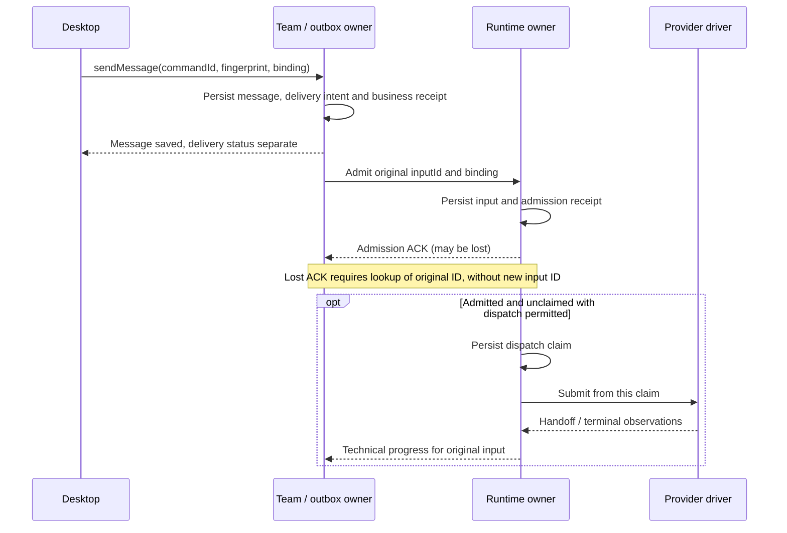

# Этап 1: протоколы реализации и восстановления

**Провайдеры физически отделены:** исходники `provider-implementations` и Session SPI
находятся в [old-provider-implementations](https://github.com/agent-teams-ai/old-provider-implementations),
без зависимости от движка старого `agent-runtime`. Host/Team/Runtime owner и адаптеры
Desktop остаются во frontend. Актуальные выбранные архивы, CI и границы приёмки
зафиксированы в [сводке программы](README.md); PR остаются Draft, этап 2 исключён.

**Обязательное правило UI (прямое указание владельца, 22 октября): использовать
только существующий UI. Не писать новые альтернативные формы/диалоги запуска,
создания команды, resume/relaunch, задач или review.** Сохраняются существующие
компоненты, поля и сценарии. Интеграция меняет backend/API adapters и необходимые
источники данных; недостающая поддержка доводится в backend. E2E проходит через
эти же пользовательские controls, прямой API setup не заменяет приёмку диалога.
Для Launch/Create используются именно `LaunchTeamDialog` и `CreateTeamDialog`:
полноценный E2E включает ввод/изменение значений, submit существующей кнопкой,
наблюдение progress и проверку сохранённых/effective настроек через backend.
Сохранение проверяется повторным открытием того же диалога после reload; ошибки
валидации, отмена и отказ backend показываются его существующими controls.
Тестовая альтернативная форма также запрещена: автоматизация работает с теми же
компонентами и пользовательским маршрутом, которые будут доступны пользователю.
Ссылка на этот план обязательна в описании каждого draft PR; формат закреплён
в [правилах доставки программы](README.md#описание-каждого-draft-pr).

Это детали [основного плана](stage-1-legacy-host.md), а не новый этап или public
runtime framework. P1 закрепляет точные TypeScript shapes и profile limits;
ниже фиксируется необходимая семантика. Имена полей рабочие. Готовые DTO, locks,
atomic-write helpers и stores переиспользуются, если выполняют этот контракт.

**Граница OpenCode (указание владельца, 25 октября): только V1.** Все требования
ниже к OpenCode, его lifecycle, capture, restore и UI относятся к выбранному V1
profile (`createOpenCodeV1DriverFactory`, текущая CLI 1.19.4). Интеграция и ремонт
V2, отдельная V2-приёмка и автоматический V2 fallback исключены из текущей работы
и оценки готовности. V2-код/exports в библиотеке и ссылки в frozen source inventory
сохраняют статус описи, а не обязательств реализации. Форматы сохранённых данных
с обозначениями v1/v2 этим решением не отменяются.

## 1. Identity, привязка и полномочия

| Значение                 | Кто задаёт                                      | Где сохраняется и зачем                                                                             |
| ------------------------ | ----------------------------------------------- | --------------------------------------------------------------------------------------------------- |
| Backend binding          | Desktop composition при выборе target           | Backend ID/revision, protocol, profile/storage root; повтор и lookup всегда идут исходному owner    |
| Team/run/member          | Team owner                                      | Stable IDs, workspace, role/membership revision; display name не используется для authority         |
| Session generation       | Runtime owner до allocation                     | Одна incarnation технической session; старая generation не оживает после crash                      |
| Host incarnation         | Host startup                                    | Отличает новый процесс от прежнего; не даёт автоматически присвоить прежние children                |
| Command ID + fingerprint | App caller до первого dispatch; host валидирует | Повтор intent, immutable operation/payload/resource binding; новый payload с прежним ID конфликтует |
| Delivery/input ID        | Team/outbox до admission; Runtime валидирует    | Stable intent→session/operation; технические IDs связывает Runtime; retry сохраняет input ID        |
| Interaction/control ID   | Runtime из provider observation                 | Exact generation/operation/request и expiry; reply не может превратиться в grant другому turn       |
| Checkpoint reference     | Runtime после durable publication               | Private opaque bytes и native store binding; renderer получает handle/status без native paths       |

Trusted actor берётся из captured IPC/MCP connection, а не из tool arguments.
Scope команды проверяется при admission и внутри relevant mutation fence;
replay/lookup результата тоже проверяет **текущие** grants. Потеря права не меняет
сохранённый outcome, но запрещает его раскрытие или новый effect. Raw credentials,
native session IDs и private checkpoint не попадают в app DTO/logs.

Не создаётся единый глобальный generation counter. Team revision, runtime
generation и host incarnation различаются; mapping хранится вместе с handle.
Новые default settings влияют на новые intents, не переназначают уже accepted.

Backend default выбирает owner только при создании нового unbound handle. Любая
операция над retained team/run handle, включая сообщение/review/stop с **новым**
command ID, идёт исходному owner. Его недоступность даёт explicit unavailable/HOLD;
текущий default не заменяет этот binding. Явный import/relaunch в новый namespace
создаёт новый handle по §6; настройки нового target не мигрируют старый handle.

## 2. Соединение и ошибки

Один Desktop profile управляет одним captured child host. Startup последовательно:
проверка Node/executable → isolated paths → host handshake → чтение persisted
obligations → готовность к новым commands. `ready` host означает готовность API,
но не готовность всех members. Unresolved session блокирует свой resource, а не
объявляет пустой весь roster. Второй writer того же profile/store не допускается.

Handshake возвращает protocol/build identity, capabilities и согласованные limits.
Mismatch отказывает до mutations. Stdout содержит только framed RPC, stderr имеет
отдельный bounded diagnostic tail. Decoder ограничивает frame **до** JSON parse;
также ограничены pending requests, queued inputs и retained notifications/bytes.
Числа задаются trusted TEST/production profile на P1 и проверяются limit/limit+1;
большие observations разбиваются штатным stream API, а не отключением bounds.

Выбранная policy для медленного UI: data notifications имеют bounded очередь;
при переполнении клиент получает gap и восстанавливается через snapshot/replay.
RPC responses/control имеют отдельный bounded budget и приоритет перед data;
provider read/control loop и durable запись terminal/interaction state не ждут
освобождения UI очереди. Одного приоритета недостаточно, если уже заблокирован
stdout: после конечного write timeout connection закрывается, obligations остаются
у owner. К stdio живого child повторно не подключаются: transport failure запускает
bounded disposal именно captured host, Desktop ждёт его подтверждённый exit и
освобождение single-writer lock. Только затем запускается recovery incarnation,
которая читает durable state без replay native effects. Неизвестный exit удерживает
новый writer; выход host не доказывает stop provider children, их custody остаётся
отдельной obligation/HOLD. Чужие процессы/shared provider host не завершаются.
Notification не является единственной квитанцией mutation. Diagnostic без operation
attribution остаётся session-level. Credentials/raw payload не выводятся в ошибку.

| Ответ/ситуация                                                     | Действие клиента                                                                 |
| ------------------------------------------------------------------ | -------------------------------------------------------------------------------- |
| Rejected до admission: invalid/conflict/forbidden/unsupported/busy | Показать точный safe reason; прежняя функция с unsupported ещё не принята        |
| Accepted/in-progress                                               | Сохранить receipt/binding; ждать/читать progress исходного owner                 |
| Completed с receipt                                                | Использовать результат при совпадении owner/generation и current authority       |
| UNKNOWN/partial effect                                             | Lookup/reconcile по исходному ID; не генерировать заменяющий intent              |
| Timeout/EOF/aborted RPC                                            | Outcome неизвестен, пока original owner не дал proof; timeout не cancel          |
| Wrong protocol/oversized frame                                     | Закрыть broken connection; удержать obligations, не переключаться в fork         |
| Cursor expired/gap                                                 | Перечитать snapshot того же owner; поздний snapshot прежнего target игнорируется |

Control/reply отдельны от prompt admission queue. Abort ожидания RPC не вызывает
provider interrupt; interrupt/close требуют явного scoped запроса. После EOF
Desktop не запускает replacement с предположением, что child providers умерли:
recovery сначала проверяет прежнюю custody. Нужен конечный startup/control timeout,
но истечение времени меняет здоровье/наблюдение, а не доказанный исход effects.

### Штатные Quit и Relaunch Desktop

После existing window-close readiness, когда выход действительно принят, existing
shutdown coordination обращается к captured backend owners. До первого await
закрываются admission новых work intents и автоматический recovery/restart host;
позднее завершение startup/open handler не обходит этот shutdown fence. Отменённый
Quit не переводит backend в shutdown. Pending opens и active sessions входят в
scoped stop исходного owner, queued inputs завершаются по §4 без dispatch.

Необходимые cleanup/control callbacks и MCP authority сохраняются до окончания
scoped cleanup либо его конечного budget; затем закрываются transport и captured
host. Ошибка/задержка одного resource не пропускает cleanup остальных. Timeout
ожидания не отменяет прежний handler и не означает physical stop: unresolved
obligations остаются durable, поздние writes учитывают те же fences. Relaunch
допускает нового writer только по exit/lock/custody протоколу выше. Legacy shutdown,
tracked-process и OpenCode fallback cleanup обслуживают только свои old-owner
resources, не новый host или чужой shared backing.

Проверка переиспользует `index.shutdown-order.test.ts` и `ShutdownMcpTransport.test.ts`:
Quit при pending open и active input с очередью, один cleanup задержан; остальные
targets обработаны, recovery host не стартует, очередь не исполняется, timeout
сохраняет debt. В P8 этот же lifecycle связывается с app Quit/Relaunch и следующим
startup; отдельный shutdown manager/harness не добавляется.

## 3. Команда и частичная запись

Существующий app command ledger сохраняется как client intent/outcome mechanism.
Authoritative host receipt хранится рядом с owner state; это не второй dispatcher.
Минимум receipt: schema version, owner/resource binding, command ID, operation,
canonical payload fingerprint, подготовленные effect IDs, phase/result/evidence.
Private payload/results не раскрываются другим actors через duplicate lookup.
Fingerprint включает смысл операции; не зависит от порядка JSON keys или UI label.

Пример `sendMessage` с двумя файловыми эффектами, без фиктивной общей транзакции:

1. Под resource/authority fence проверить grants, duplicate/conflict и current
   versions. Сохранить intent с message/delivery IDs **до** записи inbox/outbox.
2. Записать business message по original ID и delivery intent по original ID.
   Existing format guards/atomic write сохраняются. Не генерировать новые IDs
   при exception между файлами. Native dispatch сюда не добавляется вторым путём.
3. Сохранить completed receipt после доказанных effects. UI получает projection;
   отдельно runtime принимает delivery input по тому же intent.
4. После response loss повтор возвращает тот же receipt при current authority.
   Нет receipt, но intent есть: census exact IDs/versions различает applied,
   частично applied, доказанно not-applied и неопределённое состояние.
5. Recovery дописывает только доказанно отсутствующую часть. Несовпадающие bytes/
   versions или ещё живой прежний writer удерживают UNKNOWN/HOLD. Удаление ресурса
   требует tombstone/version proof, отсутствие файла само по себе недостаточно.

Execute, census, reconcile/retry и revoke сериализуются тем же authority/resource
fence. Прежний handler не должен дописать effect после решения `not_applied`:
нужно дождаться его terminal либо доказанно закрыть его право записи. Один stale
timeout этого не делает. На filesystem-пути используется существующий lock/
revision protocol; generic distributed lease engine не добавляется.

Долгий native turn не держит общий Team lock. Его отдельный runtime obligation
не позволяет повтор handoff; per-session fence защищает короткие admission,
control/claim и publication переходы. Team business receipt и native input receipt
связаны IDs, но не обязаны одновременно стать completed.

Практический reuse: `taskCreationIdempotency.ts` даёт deterministic Task-create IDs
и creation metadata, но его no-key branch создаёт новый task. На новом mutating
host path command ID обязателен; create-only helper не заменяет outcomes для
update/delete/messages/control. В existing `ApplicationCommandRunner` защита
authority оборачивает также completed replay и stale reconciliation, поскольку
они могут обойти обычный execute handler.

### Delivery после business commit

Completed business receipt означает сохранённое сообщение, а не завершённую
доставку. Existing outbox/delivery owner при startup и восстановлении соединения
перечитывает незавершённые intents, включая записанные до последнего completed
receipt. Он передаёт Runtime **тот же** delivery/input ID и binding; durable runtime
admission receipt подтверждает передачу ответственности. Только после его записи
outbox может отметить admission; terminal/read/reply остаются отдельными фактами.

Crash после business commit до admission оставляет доставляемый intent. Crash после
runtime admission до outbox ACK разрешается lookup того же ID: known admitted
возвращает исходный receipt, proven not-admitted допускает admission того же intent,
UNKNOWN удерживается. Native submit при этом выполняет только Runtime; recovery
outbox не вызывает provider и не зависит от повторного UI/MCP handler. Отменённая
доставка имеет durable tombstone, поэтому replay outbox её не воскресит. Второй
broker/планировщик не добавляется.

Одна допустимая последовательность ниже иллюстрирует этот протокол. Участники —
логические роли; Team/outbox и Runtime остаются модулями одного host. Запись Team
использует partial-write recovery §3, общей транзакции с Runtime здесь нет.

Получение outbox ACK не является условием native dispatch: при потере ACK provider
уже мог получить input. Lookup после restart возвращает исходный admission/outcome;
uncertain dispatch claim удерживается без нового submit. Business receipt, admission,
terminal и доказанный read/reply остаются разными фактами; provider result сам не
завершает Task. Порядок UI response и runtime progress может различаться.

## 4. Native allocation, input и control

Runtime private composition для каждого provider создаёт ровно нужные ports:

| Provider | Что готовит runtime adapter до factory/open                                                                                                         |
| -------- | --------------------------------------------------------------------------------------------------------------------------------------------------- |
| Claude   | Captured SDK/CLI/config, isolated HOME/native session store, MCP transport, trusted tool/permission settings, launch/custody и session-exists proof |
| Codex    | Captured app-server process/transport и version, initialize/thread/turn config, MCP, private checkpoint/custody binding                             |
| OpenCode | Captured HTTP/ACP profile/version, native backing process/session/endpoint, workspace/config/MCP, ownership references для shared host              |

SDK/protocol алгоритм остаётся в D. Host не обходит SPI ради второго raw client.
Probe/version пригоден только до allocation; фактическая native identity и tools
подтверждаются после handshake. Factories сами по себе не обеспечивают поиск
executable, user login или durable ownership всех созданных native resources.

### Readiness при потере обязательной зависимости

Host API ready, native session ready и member ready — разные факты. Для рабочего
handoff требуется актуальный proof endpoint + mandatory tool set + effective config
того же run/member/generation. Один successful boolean probe, health URL или файл
MCP config не доказывает discovery обязательных tools. Private adapter связывает
native status/discovery с read-only owner handshake; модельный prompt не нужен.

Потеря обязательного MCP/tool или истечение trusted proof инвалидирует member
readiness и удерживает следующие native handoffs. Admitted input сохраняет исходную
identity; active input учитывается отдельно и не replay после reconnect. Control
и reconciliation остаются доступны. Timeout `checkReadiness` не превращает уже
admitted input в terminal success/cancel: он остаётся held/not-dispatched до proof
или явного stop/discard. Свежий same-binding proof восстанавливает
готовность; сам reconnect/новый PID этого не делает. При readiness timeout — typed
dependency failure, без fallback. Политика свежести/инвалидации фиксируется на P1
для выбранного profile; не требуется полный discovery всех tools на каждом input,
если native revision/invalidation даёт доказанно актуальный bounded proof.

### Team bootstrap и частичный запуск

До allocation Team сохраняет expected roster, launch/roster revision и member
bindings. Summary считает весь этот набор, включая members без созданной session;
его нельзя уменьшать по timeout/ошибке. Existing launch policy задаёт skipped
members явно; skipped не является подтверждением готовности.

Member usable требует native readiness и доказанной установки обязательного
initial role/team/workspace context в **той же generation**. Proof может быть
trusted effective native configuration либо delivery исходного bootstrap input
с подтверждением его применения. Старый fork check-in ритуал не обязателен;
model-text ACK и один read `member_briefing` не доказывают весь bootstrap. До usable
разрешены scoped bootstrap/control, обычные work deliveries ждут. Bootstrap имеет
свои stable input IDs/binding; purpose задаёт Team owner, не tool payload модели.

Раздельно сохраняются ready, pending bootstrap, pending human permission,
definitive failed и skipped; UNKNOWN allocation/custody не превращается в failed.
Team ready требует готовности всех expected members. Иначе UI показывает partial/
pending/failed summary по actual facts; healthy member не считается сломанным из-за
соседа. Existing policy продолжения/cleanup сохраняется, whole-team retry не
подставляется автоматически. Bootstrap deadline не делает pending human decision
ошибкой старта; native interaction expiry/control имеет отдельный исход.

Повтор launch command возвращает его receipt/progress, не запускает roster снова.
Явный scoped retry задаёт только допустимые failed members, original launch/revision
и новый стабильный attempt ID; до allocation проверяется terminal/no-allocation
либо cleanup proof старой попытки. Healthy/pending/UNKNOWN members сохраняют binding.
Новая конфигурация/roster требует нового явного intent; late signals прежнего
attempt/generation не исправляют статус новой попытки.

Host crash сохраняет эти records, но не восстанавливает volatile permission
callbacks. После restart прежний pending request виден как retained obligation
с unavailable/expired control до reconciliation, а не свежий отвечаемый grant.
Без custody proof старые ready members также не объявляются автоматически usable.

Состояния ниже не требуют отдельных классов/таблиц; Session.ready означает native
readiness, а не aggregate Team bootstrap completion:

| Resource    | Допустимая последовательность                                                  | Crash/неопределённость                                                                          |
| ----------- | ------------------------------------------------------------------------------ | ----------------------------------------------------------------------------------------------- |
| Session     | opening intent → allocated → ready ↔ dependency-unavailable → closing → closed | Readiness recovery остаётся той же generation; unknown allocation/stop сохраняет debt           |
| Input       | admitted → dispatch claimed → consumed/handoff → terminal                      | После uncertain claim не повторять submit; известный not-sent допускает тот же intent по policy |
| Interaction | pending → ответ принят → provider outcome/expired                              | Не восстанавливать volatile callback после restart и не отвечать другому request                |
| Close       | admission sealed → outstanding reconciled → drain/custody proof                | Logical closed отдельно от physical stopped; unresolved записывается явно                       |

Один активный input на session, порядок queued inputs устойчив к reconnect.
Следующий handoff не пересекает unresolved input/control. Result A и interrupt A
проверяются под session fence; после terminal A control не переадресуется на B.
Delivery/Task policy может создать новое намерение только при доказанном исходе
старого; автоматический новый UUID после transport error запрещён.

### Очередь, discard и stop

Один per-session fence сериализует admission/dispatch claim, targeted discard, seal/stop и
revoke-check. Перед claim Runtime повторно проверяет актуальный authority binding;
при revoke unclaimed input получает durable rejected/not-sent. Уже claimed input
проходит control/reconcile; revoke не обещает отменить совершённые native effects.

Stop seals admission и завершает ещё не claimed inputs durable cancelled/not-sent;
active/uncertain input проходит обычный targeted control и custody reconciliation.
Ожидание drain не запускает queued prompts. Очередь сохраняет original generation;
restart/replacement не переносит её на новую. Возобновление недоставленного сообщения
в новом run требует явного нового intent после доказанного исхода прежнего.

Existing UI listing/discard сохраняет точные `messageIds` показанных пользователю
user messages; нет операции «удалить всю очередь» или trim/перегенерации IDs. Team
через Runtime сначала отменяет только названные **доказанно unclaimed** deliveries,
затем обновляет inbox projection. Подтверждённая отмена/tombstone предшествует удалению
строки; crash между ними оставляет восстанавливаемую проекцию, а не исполнимый prompt.
Если Runtime ещё не видел intent, отмена резервирует его exact ID/binding как
cancelled/not-sent; более поздний outbox admission получает этот же outcome.
Listing не выдаёт unread за доказательство not-sent. Claimed/consumed, уже отменённые
и UNKNOWN IDs различаются в результате, поздние новые сообщения не затрагиваются.
`discarded` считает только подтверждённые отмены; UNKNOWN UI показывает явно.
Это один use case с исходным command ID/partial recovery §3, не отдельный queue store.

Shared OpenCode host хранит exact session references: close A закрывает A, не
host B. Physical stop backing разрешён только владельцу captured process и после
закрытия его references. Ошибка одного cleanup не пропускает cleanup остальных.
Stop обычного subagent принадлежит родительскому provider scope, а не Team roster.

## 5. Checkpoint и положительный restore

Checkpoint token не является сохранённой history. Runtime сохраняет и ссылку на
native backing store/config/engine/account/workspace, и proof завершения прежней
custody. Эти данные private; owner storage root не берётся из модели или renderer.

Публикация выполняется так:

1. Дождаться idle вне session fence, чтобы terminal/control transitions могли
   завершиться. Затем взять admission/control fence, атомарно перепроверить idle
   и доказанный исход предыдущих inputs; при изменении состояния отпустить fence
   и ждать заново. До конца capture/publication следующий submit не допускается.
   Текущий SPI `Session.checkpoint()` захватывает idle state до `close`;
   `readCheckpoint(reference, request)` — другой, host-owned port загрузки уже
   сохранённых bytes при restore, не операция capture.
2. Получить opaque value через SPI и сохранить versioned payload в private store
   с source generation/config/native binding. Не переписывать internal hash/token.
3. Закончить durable write payload по гарантиям existing store, затем атомарно
   опубликовать reference в session record. До этого UI не видит resumable handle.
   Atomic rename не объявляется power-loss durability: если профиль обещает её,
   helper должен обеспечить соответствующий flush/commit.
4. После publication разрешить следующий input или close. Сохранённый checkpoint
   отражает конкретный completed operation; дальнейший uncertain input блокирует
   replay этой history, даже если прежний checkpoint корректен.
5. Для stop сначала seal admission; если session уже idle, capture до provider
   close. Для busy/unknown сначала normal control/reconciliation. Не обещать
   resumable stop, если provider не даёт доказанного checkpoint/history.

Crash до payload write не создаёт reference. Crash после payload, но до publication
оставляет orphan, который recovery не подставляет автоматически вместо selected
checkpoint; cleanup возможен позже при доказанном отсутствии references/obligations.
Crash после publication не требует заново отправлять последний input. Неизвестная
custody или subsequent input держит restore blocked, а не выбирает last-good token.

Restore проверяет explicit selected reference, readable payload/native history,
engine/profile/config/account/workspace compatibility и закрытие предыдущего owner.
Новая runtime generation допускается только после этого; source generation остаётся
в checkpoint binding. Если SPI не поддерживает такой переход, он требует scoped
provider доработки, а не подделки generation/hash. OpenCode endpoint/backing change
не маскируется исправлением opaque compatibility hash.

Для каждого заявленного provider profile acceptance содержит: input A с уникальным
history marker → completed/capture → close/proven custody → host restart → restore
выбранной session → input B, использующий marker A. Assert берётся из реального
SDK/CLI transcript/protocol request к localhost fixture и exact native identity;
совпадение UI текста само по себе недостаточно. Дополнительно проверяются missing
payload/history, incompatible config и uncertain later input. Одни отказы не PASS.

Native store сохраняется, пока есть resumable references/обязательства. Cleanup
TEST run удаляет только его собственный store после завершения проверок; нельзя
получить положительный restore за счёт случайной history из user HOME.

## 6. Subagents, reads и cutover

Обычный Claude SDK subagent без `team_name` сохраняется в solo DO. Native Team/
Task/SendMessage writers остаются закрыты; создание persistent teammate идёт
через Team owner/MCP. DO/action-mode gate и child grants проверяются до execution.
Subagent не выбирает actor/Team authority аргументами `Agent` tool.

D должен сохранить parent/child/tool/operation provenance в нейтральной observation
capability или provider-owned extension; raw SDK envelope не становится Team DTO.
Дополнение SPI совместимо для consumers без этой capability; consumer, заявляющий
subagent parity, требует её при readiness. Логи/usage/evidence не приписываются
родителю или соседнему teammate догадкой. Parent stop охватывает только его owned
descendants. Nested execution не создаёт вторую durable Team dispatch queue.

Desktop cutover делается на одном host-owned handle целиком: launch/mutations,
query/log feeds, approvals и evidence. Sentinel старого writer/reader должен падать
при его случайном вызове в TEST, а не возвращать совместимые данные. Старые archive
readers разрешены только для явно archive/old-owner handles. Отдельно проверяется
late notification старого target после переключения и reconnect с gap/snapshot.

### Согласованный snapshot и feed

Snapshot возвращает state и high-water cursor **того же** resource/feed и owner
incarnation, полученные согласованно под existing state lock/revision protocol.
Subscribe/replay продолжает строго после этого cursor. Mutation между snapshot и
subscribe обязана попасть в replay; при истёкшей retention приходит новый explicit
gap. Клиент rehydrates тот же owner и не заменяет уже принятый более новый state
поздним snapshot; duplicate events фильтруются по source sequence/event ID.
Новый host incarnation инвалидирует volatile cursor и требует snapshot, сохраняя
durable command/interaction outcomes. Data feed не становится вторым business log.

Active old-owner inventory read-only: launch/bootstrap/lane/session/stop/command
records перечисляются без repair/quarantine. Corrupt/unreadable census = HOLD.
New host не забирает processes/receipts; rollback defaults касается новых intents.
Cross-owner обмен и live import не входят в этот cutover. Этот запрет не уменьшает
обязательный cross-team сценарий между двумя host-owned командами.

### Явный relaunch остановленной сохранённой команды

Read-only archive не заменяет существующую кнопку Relaunch. Для остановленной
legacy команды выбран отдельный offline путь: явный user intent принимает
проверенный product snapshot в **новый host-owned storage namespace**, после чего
создаёт новый run/generations. Это не native resume и не in-place передача живых
writers. Active/UNKNOWN command, delivery, stop или custody в исходном census
блокирует этот переход; corrupt/unreadable census также HOLD.

Snapshot получают согласованно существующими locks/revisions, затем работают с
detached bytes. Переносятся saved config/roster/settings, tasks/comments/dependencies,
TaskRefs, нужные blobs и retained history/evidence. Stable product IDs сохраняются
в новом backend namespace. Import map переводит в destination binding только refs
на ресурсы **внутри импортируемого snapshot**. Внешние TaskRefs сохраняют точный
source-owner/archive target либо explicit unresolved gap; одноимённая host-команда
не становится их адресатом. Это относится к structured полям и encoded metadata/
`task://` links. Existing `{taskId, displayId, teamName}` не содержит backend:
feature projection/navigation дополнительно несёт owner qualification из сохранённого
import/source context, без путей/credentials и без выбора по текущему default.
Old-run/receipt links также остаются явно archive-bound. Conflict IDs/неподдержанные
settings/неполный обязательный blob mapping отказывают до публикации нового handle.
Уже отсутствующая history/evidence сохраняет явный gap, не становится новым proof.
History не подделывается новым native transcript; credentials, checkpoints,
pending native callbacks и executable commands не копируются как live state.

Import intent фиксирует source snapshot digest/versions и destination IDs до
записи; retry продолжает тот же незавершённый import. Новый handle публикуется после
полного product state, отдельно от runtime launch. Потеря launch ACK разрешается
по исходному run/opening intent, не повтором импорта или запуском второй команды.
Task policy/state сохраняются; новые bootstrap/work actions получают новые intents
нового run, прежние inputs/outcomes не replay. Исходные файлы/receipts остаются
неизменными и доступными как архив; old/new UI handles и writers не разделяют root.
Existing import/store helpers используются за Team port, без общего migration engine.

## 7. Фокусные проверки отказов

Это scenarios для существующих suites, а не девять новых harness/CI gates.
Один proof закрывает несколько M-строк; Electron не дублирует все injection points.

| ID  | Injection / проверка                                                                                                     | Где достаточно доказать                             | Ожидаемый результат                                                                                               |
| --- | ------------------------------------------------------------------------------------------------------------------------ | --------------------------------------------------- | ----------------------------------------------------------------------------------------------------------------- |
| F01 | Response loss после business commit; повтор ID, затем payload conflict и revoke перед lookup                             | P2 actual owner store/MCP + existing command ledger | Один effect; прежний receipt только при authority; conflict без новых writes                                      |
| F02 | Crash между message/delivery write, после business receipt до admission и после admission до outbox ACK; stale reconcile | P2/P3 actual stores + delivery owner                | Missing часть дописана; startup доставляет original intent один раз, живой writer не допускает not-applied/replay |
| F03 | Crash до/после native dispatch claim; missing receipt после create                                                       | P3 runtime + packed D fixture                       | Proven not-sent отличается от UNKNOWN; нет второго native create/submit                                           |
| F04 | Полные input/data-notification budgets + pending permission/control; revoke/late reply; interrupt A после result A       | P3/P4 provider control + stdio                      | Control продвигается, state доступен после gap/reconnect; stale grant/отмена B отсутствуют, память ограничена     |
| F05 | Capture/write/publication crash; native history missing; compatible selected restore после restart                       | P3/P4 actual native store + localhost inference     | Reference не раньше bytes; положительный restore каждого profile; uncertain input held                            |
| F06 | Mixed team A=Claude/B=Codex/C=OpenCode; A↔B/B↔C/C↔A, group, task per provider, stop/restart одного member                | P4 actual host/MCP/native paths                     | Exact recipients/replies/task effects; остальные members продолжают работу; cross-team со второй host-owned team  |
| F07 | Solo DO subagent effect; запрещённый mode; parent/child logs и parent stop при соседней session                          | P4 native SDK + P6 projections                      | Реальный child effect и provenance; mode/grants соблюдены; сосед не остановлен                                    |
| F08 | Mutation между snapshot и subscribe, reconnect/gap, поздний snapshot/ответ прежнего target; legacy sentinels             | P5/P8 Electron через CDP                            | Mutation видна один раз либо explicit повторный gap; cache не откатывается, active legacy fallback отсутствует    |
| F09 | Packed Electron startup/input/control/close без fork, source checkout и ambient config                                   | P7 installed candidate                              | Работает actual artifact; resolved paths/digest сохранены; cleanup только TEST-owned                              |

Отдельный existing shared-OpenCode сценарий с двумя native sessions подтверждает
reference custody; mixed team с одним OpenCode member его не заменяет. Faults
используют реальные TEST files/processes на relevant boundary; localhost inference
скриптует модель, но не подменяет host, native SDK/CLI, MCP или Desktop.
В F04 отдельно удерживается заблокированный stdout: bounded disposal дожидается
captured host exit до recovery startup; provider children не считаются stopped,
pending effects не replay. Простое переполнение data queue должно разрешить control
без disposal; этот случай и недоступный transport имеют разные ожидаемые исходы.

Existing workflows дополняют F-строки в тех же suites:

- **Owner routing/F08:** при handle команды у A сменить default на B и выполнить
  новую mutation с новым command ID: она идёт A, вновь создаваемая unbound Team — B.
  При недоступном A mutation остаётся у A с unavailable/HOLD, B не получает effect.
  Rollback default сохраняет тот же invariant для уже созданных handles обоих owners.
- **Partial launch/F06:** A usable, B pending human permission, C known failure до
  allocation. После startup grace summary остаётся partial, A работает по existing
  launch policy, B не объявляется failed. Scoped retry C не создаёт второй A/B.
  При отдельном host crash/restart B сохраняет original obligation, callback не
  оживает; A/B не объявляются заново usable без актуального ownership/bootstrap
  proof. Пустая in-memory map не уменьшает expected roster.
- **Readiness/F04:** после initial ready потерять обязательный MCP/tool при active
  A и queued B. Native B не начинается до свежего same-binding discovery/handshake;
  readiness timeout виден, A не replay. Восстановление не создаёт новую generation.
- **Очередь:** A active, B/C queued; после listing приходит D. Discard B/C гоняется
  с claim C. B не исполняется, D остаётся, C имеет один truthful outcome. Отдельный
  stop/revoke при queued input и restart сохраняет cancelled/rejected, не переносит
  intent в replacement generation. Crash после cancel до inbox update не воскресит
  сообщение; legacy discard writer sentinel не вызывается.
- **Saved relaunch:** stopped legacy TEST team с settings/tasks/TaskRefs/blobs
  запускается через host при недоступном fork. Product state сохранён, run новый,
  source/archive bytes неизменны. Повтор import/launch после response loss не
  создаёт второй ресурс; active/UNKNOWN census не проходит этот путь.
  Internal ref открывает imported host team, внешний ref на неимпортированную
  команду — точный old-owner archive либо gap. Совпадающие team/display/task IDs
  у другого backend, structured поля и encoded metadata не меняют этот выбор.

## 8. MCP и полный cutover владельцев

Нынешний `mcp-server/src/controller.ts` создаёт файловый `agent-teams-controller`;
`taskTools`/`messageTools` вызывают его напрямую. Перенаправления Desktop IPC
недостаточно: такой MCP остаётся вторым writer. В новом host handlers получают
injected Team/Runtime ports. Из controller извлекаются используемые business
use cases/stores; старый `getController(teamName, claudeDir)` не вызывается для
host-owned handles. Catalog/schema/text helpers переиспользуются отдельно. Все десять existing groups
(team/task/lead/kanban/review/message/process/runtime/workSync/crossTeam) получают
явный handler disposition на P2: Team use case, private runtime callback либо
explicit old-owner-only route. Используемая product функция не исчезает при этом
из нового host path; callback не получает authority обычного user tool.

Host владеет MCP lifecycle и trusted member binding. Существующий loopback HTTP
transport пригоден для native clients; stdio-вариант при необходимости остаётся
тонким proxy в те же handlers. Это endpoint инструментов внутри host, не ещё один
владелец данных. SDK client не должен ждать долгий turn с заблокированным обработчиком
своих MCP callbacks. Tool reply/permission/control не проходят через prompt queue.

Actor привязан к authenticated MCP session/captured private capability, проверяемой
host. Сам localhost, health response, tool argument `from`, `teamName`, `claudeDir`
или `controlUrl` не подтверждают полномочия. Connection фиксирует допустимый
owner/run/member/generation; чужие root/endpoint overrides отвергаются. Reconnect
не переиспользует истёкший grant прежней generation. Новый auth service не нужен.

Все mutating tools имеют stable intent identity. При доступном trusted native
tool-call ID boundary сохраняет mapping до эффекта; иначе schema требует явный
`commandId`/`idempotencyKey` и prompt protocol объясняет его повторное использование.
Transport request ID и новый UUID при каждом retry не заменяют identity. Одинаковый
текст двух разных tool calls сам по себе не duplicate. Read-only tools не создают
intent/effect. Native Team/Task names при compatibility mapping вызывают те же handlers.

| Нынешний вход                                                 | Cutover для host-owned handle                                    | Что исключается                                                              |
| ------------------------------------------------------------- | ---------------------------------------------------------------- | ---------------------------------------------------------------------------- |
| Desktop Team IPC/HTTP и MCP task/message/kanban/review tools  | Те же Team use cases, captured actor, общие receipts/guards      | Отдельный controller/filesystem writer в MCP или Desktop                     |
| Runtime tools, launch/member mutations, inbox bridges         | Team policy → Runtime port; native callbacks привязаны к session | Возврат в Desktop bootstrap CLI и второй inbox dispatcher                    |
| Queued-message list/discard IPC                               | Team intent → Runtime targeted cancellation → inbox projection   | Прямой inbox rewrite при ещё живом durable delivery/input                    |
| Relaunch stopped saved team                                   | Explicit product snapshot import/new host run, §6                | Launch исходным fork, adoption native session или shared writable root       |
| `TeamDataService` reads/watchers/process-health timer         | Host query/feed; health maintenance явно у owner                 | Read, который незаметно чинит host-owned state                               |
| `ChangeExtractorService`, task/member log sources             | Host evidence/log projection; archive отдельно                   | Native backfill, warning-recovery и transcript fallback при открытии Changes |
| `review.ts`: mutations/recovery/history/edit/rename/decisions | Host-owned review use cases + existing Git/filesystem adapters   | Старый независимый apply/Undo/Redo/save/delete writer                        |
| Task/comment attachment IPC                                   | Scoped blob + metadata operations того же Team owner             | Ambient module-level appData blob store при новом backend                    |
| Backup startup/reconcile/restore/periodic/prune               | Owner-scoped existing backup adapters, §11                       | Legacy background publication/cleanup в новом namespace                      |
| App Quit/Relaunch и shutdown coordination                     | Captured owners, admission/recovery fence и bounded cleanup, §2  | Pending open вне cleanup, ранний MCP teardown или recovery при выходе        |
| Provider management CLI client                                | Существующий management port → native provider adapter, §9       | `fork runtime providers ...` даже до первого team launch                     |

Cutover проверяется sentinel на **старых** entries для этих handles; новый host
может reuse extracted helpers, но не whole-service entry с legacy fallback.
Archive/old-owner routes сохраняют собственный explicit binding. Эта таблица
дополняется только реально используемыми входами, не всеми скрытыми CLI командами.

### Фоновые services отличаются от teammate runtime

`process_*` tools и `ProcessesSection` уже используются приложением. Team owner
сохраняет registry/metadata/history фоновых dev servers/watchers; это не roster
и не доказательство готовности агента. `process_stop` в нынешнем MCP помечает
registry stopped; UI `killProcess` отдельно выполняет OS stop. Эти действия не
сливаются в одну неоднозначную операцию.

OS effect проходит через runtime/process adapter с current authority и captured
identity зарегистрированного TEST-owned процесса; один PID/label из tool payload
не даёт custody и не защищает от PID reuse. Unknown/stale identity не превращается
в successful kill. Dedicated general process supervisor не добавляется. Приёмка:
register/list → host restart → UI stop своего test child → stopped history;
отдельно metadata-only stop и отказ stale/чужому process binding.

## 9. Config, auth, context и attachments

### Сохранённый выбор и effective настройки — разные данные

Владелец сохранённых общих/lead-настроек и состава — тот же Team owner. Его
`savedSettings` содержит application choices, включая prompt, worktree/custom args,
presentation и local-model opt-in. Отсутствие объекта означает неизвестный источник,
а `{ cwd }` — известную конфигурацию без явных overrides. Отсутствие `model`/`effort`
в ней не заполняется observed runtime моделью, предыдущим запуском или localStorage.
Явные `false`/off сохраняются. В replace omission внешнего объекта сохраняет прежние
settings; переданный объект заменяет их полностью и очищает пропущенные overrides.

Состав и эти choices входят в одну CAS revision и атомарную публикацию с исходным
receipt. Settings-only edit требует той же проверки released Runtime custody,
что изменение состава. Trusted descriptor задаёт начальные choices только при
первом создании owner; reopen не переписывает их. Текст extra args сам по себе не
разрешает запуск executable, доступ к account/environment или обход native capture.

Существующий диалог получает эту revision вместе с configured значениями;
правки во время async hydration и поздняя загрузка local draft не затирают ввод.
Прочитать более свежую revision перед сохранением устаревшей формы и молча
использовать её вместо исходной запрещено. Snapshot/configuration mismatch
не смешивает roster одного состояния с настройками другого.

Обычный `replaceMembers` передаёт command/idempotency identity первого submit и
именно эту исходную revision. Обновление model-preflight не заменяет ID сохранения.
После UNKNOWN неизменённый submit остаётся тем же intent; изменение payload требует
закрыть и заново открыть форму. Один read-only lookup исходного ID с ожидаемым
исходным payload может подтвердить commit; отсутствие/недоступность результата
оставляет UNKNOWN и не запускает повторный effect с новым ID.
Member-settings editor передаёт owner-issued version tokens всего исходного состава,
target kind и исходную Team revision. Team проверяет их в своём CAS fence; такой
intent не добавляет/удаляет/переименовывает участников. Descriptive role не меняет
canonical lead identity. Это тот же roster receipt/state, без второго owner.

### Выбранное значение должно стать effective configuration

На P0 заполняется небольшой mapping **используемых** `TeamLaunchRequest` и extension
settings. Для каждого поля: product source/revision → private provider option →
effective observation или явная incompatible причина. Включаются model/effort,
fast/context limits, action/permission mode, context reset, workspace/worktree,
поддерживаемые extra args, project instructions, skills/plugins/hooks и MCP.
Метаданные UI не доказывают, что provider применил настройку.

Composition разрешает настройки последовательно: выбранный profile/account и
workspace → сохранённые launch settings → явные overrides текущего intent.
Обязательные owner tools/identity guards и integrity rules capture не ослабляются overrides;
конфликт отказывает до allocation. Два источника одной настройки не включаются
одновременно с неявным приоритетом. Hooks пользователя компонуются с mandatory
provider hooks, не заменяют их целиком. Где используются tool-bound hooks, порядок:
owner checks/required preimage → user pre-hook → native effect → user post-hook →
final capture. Required preimage относится к выбранному capture path из §10;
window/native snapshot path не изображает отсутствующий per-tool callback.
Error/cancel path сохраняет partial effects и исход ошибки. Другие hooks
не получают выдуманную task attribution. Raw SDK/CLI
mapping остаётся в D/private adapter; parser всех возможных vendor flags не строится.

Изменение config действующей session требует явного relaunch/new binding, кроме
конкретной capability, доказанно поддерживающей update. Existing D фиксирует
`permissionMode: default`/`settingSources: []` и собственный PreToolUse hook;
это baseline, который нужно доработать для используемых settings, не готовая parity.
Проверка использует actual native options/request и один разрешённый hook/instruction
с наблюдаемым TEST effect; неизвестное поле не исчезает при сериализации.

### Management отделён от conversation Session SPI

Сохраняется existing `RuntimeProviderManagementPort`; его executor заменяется
provider-native adapters вместо fork CLI. Connect/status/test/models/defaults,
OAuth progress/submit-code/cancel/forget остаются своими user workflows. Session
driver не получает management methods ради удобства и не создаёт auth daemon.
Desktop сохраняет свои product settings/UI state; host adapter владеет native
auth action и возвращает safe progress по captured request/profile binding.

Login, status и launch используют **один явно выбранный** account/config/credential
namespace. TEST всегда имеет собственные roots и dummy auth. В production profile
может явно выбирать штатный native namespace; это не разрешение читать случайный
ambient чужой profile. В частности, frozen frontend намеренно не устанавливает
default `CLAUDE_CONFIG_DIR` из-за Keychain namespace, а D сейчас требует его.
P3/P5 исправляют этот контракт частной конфигурации; принудительный custom dir или
API-key вместо прежнего login не является решением совместимости.

После cancel/reconnect поздний auth progress не меняет новый target; response loss
проверяется по исходному request, без повторного OAuth flow. Forget не отменяет
молча уже accepted input и не перепривязывает его account. Synthetic adapter
проверяет progress/code/cancel и shared binding status→session без настоящих
credentials. Реальный login→status→session остаётся отдельной qualification,
когда доступен выделенный тестовый аккаунт.

### Compaction требует observation и одного reminder owner

Frozen Desktop видит compact boundary и в idle восстанавливает актуальный roster;
нынешний D преобразует такое событие в unknown-event. Добавляется provider-neutral
compaction/context-reset observation с session/operation/source identity. Team
решает, какой **текущий** role/roster/task context восстановить; Runtime доставляет
его через существующий admission. Второй idle poller/скрытый writer не запускается.

Reminder не прерывает active turn: перед следующим допустимым input, после
нормального idle/control fence, он получает stable dedup identity compaction epoch.
Повтор observation не создаёт второго input; pending reminder после restart
сохраняется, uncertain handoff не повторяется. Если следующий input уже включает
тот же reminder, отдельно он не отправляется. Internal/isMeta semantics сохранены.
Один actual native compact → изменение roster → next input доказывает актуальный
context и отсутствие duplicate injection.

### Native message attachments и product blobs

Нынешний SPI `Input.content: string` и text-only submit Claude/Codex не передают
image/document blocks. Сначала фиксируется существующий supported MIME/model/
recipient denominator: frontend уже различает online lead/OpenCode и запрещённые
пути. Не требуется расширить attachments на каждого provider/member сверх него.

Минимальное совместимое расширение SPI сохраняет text `content` и добавляет
capability ordered attachment references для текущего UI: artifact ID, MIME,
byte length и digest; native bytes/path разрешаются private runtime port. Legacy
text-only consumer работает как прежде. D переводит references в нужные native
image/document/file parts, не Team/UI. Input fingerprint включает порядок и
digests вложений; missing artifact/неподдержанный MIME/model отвергается до handoff.
Текстовый путь к файлу и successful storage metadata не доказывают native delivery.

Existing `agent-attachments` adapters/storage переиспользуются. Host-owned store
удерживает bytes/metadata до terminal/recovery, runtime custody удерживает нужные
native artifacts; cleanup не удаляет вложения unresolved input. Native request
проверяется на каждом **существующем поддерживаемом** attachment path; unsupported
recipient/MIME сохраняет явный отказ без тихого удаления вложения.

Task/comment attachments сохраняются отдельно от input lifecycle. Их blob root
сейчас находится под appData; новый owner binding включает этот storage adapter.
Blob ID/digest и metadata ref записываются по durable intent, partial write
reconcile следует §3. Create → restart/read → remove сохраняет Task/comment refs;
orphan blob не означает completed attachment. Новый blob service не создаётся.

## 10. Task lifecycle и evidence/review

Canonical donor Task policy — `agent-teams-controller` taskBoard/tasks/review/kanban,
а не только низкоуровневый `TeamTaskWriter`. Сохраняется сочетание status,
reviewState, kanban, history и workIntervals. `completed + review/needsFix` остаётся
открытой работой; review requires completed. Завершение/delete сохраняет действующие
dependency/board notifications с original effect IDs, не по одному provider result.

Один acceptance workflow проходит assign/start → complete → request review →
request changes → исправление/start/complete → повторный request review → approve,
включая blocked dependency, reassignment/stale actor и duplicate notification. Точные переходы/history берутся
из existing policy, не вводится новая state machine будущего Orchestrator.
Task approval и Accept/Reject file changes остаются разными решениями.

Change capture сохраняет доказанные before/final bytes, tool/window timeline и
исход выполнения; failed tool и relevant post-hooks сохраняют partial/final effects,
background tool — eventual outcome того же execution. Способ получения preimage
зависит от profile: awaited tool hooks, подготовленный input/window baseline либо
проверенная native snapshot/change chain. Provider-owned observations/capture seam
находятся в D, product evidence writer — у host. Один turn-end diff или сообщение
о tool result сами по себе не доказывают авторство изменений.

Runtime сопоставляет exact input/tool execution с immutable task/window/session/
member/workspace binding. Host evidence writer использует existing Git capture/
ledger adapters с этим binding вместо fork globals `getSessionId/getCwd/task scope`.
D не пишет Task ledger. Перекрывающиеся окна/внешние edits не присваиваются задаче
по одному path/time interval; при недоказанной attribution остаётся gap/nonreviewable.
Provider без достаточного capture получает explicit capability gap до приёмки.

В P1 для каждого выбранного profile узкий native proof проверяет **достаточный**
capture mechanism до широкого extraction P2/P3: известный initial dirty файл,
native modification/failed outcome, точные before/final bytes,
immutable task/window binding и gap для недоказанного overlap/external edit.
Window/native-snapshot путь требует authored tool anchors/validated chain и
нужной timeline/outcome информации; snapshot-only authorship недостаточна.
Post-hook включается в proof тех paths, где он входит в сохраняемый denominator
по P0 mapping; отсутствие нужного hook в новом driver остаётся capability gap.
Для остальных profiles final bytes/outcome подтверждает выбранный capture mechanism.

Если выбранному пути нужен новый preimage прямо перед tool effect, callback обязан
завершиться до effect; для такого пути проверяется ordering с задержанным callback.
Это условие конкретного механизма, не универсальное требование к каждому native
tool. Existing fork capture best-effort: capture failure не обязана запрещать
обычную работу агента. При отсутствии доказанных bytes/attribution host помечает
gap/nonreviewable и запрещает unsafe review/apply; fabricated preimage недопустим.

Codex item notifications и OpenCode snapshots нынешнего D ещё не доказывают полную
M13 parity. Выбранный безопасный механизм подтверждается на actual native fixture;
новый SPI метод, prompt-инструкция или permission dialog не заменяет proof. Если
его нет, пересматриваются конкретный seam/оценка, M13 остаётся открытым. P6 подключает
доказанный механизм к attribution/review; новый fail-closed tool policy сверх
действующих authorization guards в существующий scope не добавляется.

Проверка: native command меняет TEST файл и завершается ошибкой; на сохраняемом
hook path post-hook меняет его ещё раз. Ledger сохраняет корректные before/final
bytes, failed outcome и task/window binding. Background completion проверяется existing relevant fixture;
полного fork toolExecution/QueryEngine ради capture не переносим.

Все review mutations из `review.ts` направляются одному owner: Apply/Reject,
mutation recovery, Undo/Redo/history restore, edited-file save/delete, rejected
rename restoration и revisioned decisions. Existing snapshot/reviewKey/revision
guards сохраняются до filesystem effects. Acceptance включает успешный Apply
на host-owned task с двумя независимыми hunks: accepted hunk сохраняет modified
bytes, rejected hunk восстанавливает before bytes. После reconnect и отдельного
host restart повторное открытие Changes сохраняет decisions/history и согласованную
revision без нового filesystem effect; старый review writer sentinel не вызывается.
Используются existing `review.test.ts`/`ReviewApplierService.test.ts` oracles и
один P6/P8 review workflow, без новой suite. Также проверяются Reject → Undo/Redo,
stale snapshot/revision refusal без изменения bytes и interrupted mutation recovery.
Открытие Changes при missing/degraded ledger показывает gap, не запускает старый
OpenCode backfill/transcript repair. Это проверяется одним read-side sentinel.

## 11. Trash, restore, backup и окончательное удаление

Здесь сохраняются existing lifecycle rules, а не вводится единый новый delete
workflow. Team soft delete/restore/permanent delete, Task restore и member restore
остаются разными use cases того же Team owner.

- **Team trash:** reversible product tombstone и best-effort scoped stop. Failed/
  UNKNOWN stop не запрещает убрать команду в корзину и не означает physical stop.
  Runtime debt/receipts/native custody сохраняются, admission новых work intents
  закрывается; UI отличает корзину от подтверждённой остановки/удаления данных.
- **Team restore:** снимает product tombstone, сохраняет tasks/comments/blobs.
  Не resume старой generation, не возвращает revoked grants/callbacks и не replay
  pending inputs. Unresolved debt продолжает блокировать новый execution;
  Relaunch следует отдельному §6 или обычному host path.
- **Member restore:** reuse `TeamMemberRestorePlan`: старые runtime `agentId/joinedAt`
  не восстанавливаются как authority, хотя бы один durable removed marker сохраняется
  до завершения multi-file записи. Task restore использует existing controller policy:
  pending с очисткой review/kanban state; не новый dispatch по старому assignment.
- **Permanent delete:** отдельный durable intent с target identity и proof removal
  для team-data, task-data, message/task attachments. Reuse existing permanent-deletion
  coordinator, detached-path checks и backup-publication fence. Retry после crash
  продолжает тот же intent, не удаляет replacement team с тем же именем. Минимальные
  unresolved runtime/control/command records сохраняются вне удаляемого product root;
  если adapter этого не обеспечивает, final purge удерживается до closure. Нельзя
  удалить последнее evidence долга и объявить cleanup завершённым.

`TeamBackupService` — активный startup/periodic writer, а не archive reader.
Для host-owned roots его нужные backup/reconcile/restore/prune helpers работают
как scoped adapters Team owner с injected roots/identity и existing locks/guards;
Electron globals/whole-service instance в portable package не переносятся. Legacy
service обслуживает только old-owner roots. Нового backup store/планировщика нет.

При startup сначала читаются current deletion/runtime/recovery obligations, затем
разрешается owner-scoped product restore. Восстановление missing product files
сохраняет существующие identity/version guards и не откатывает более новые файлы.
Под тем же resource fence из §3 backup bytes сверяются с current completed outcomes/tombstones
того же resource и его version, включая missing destination: отсутствие файла
или его mtime не доказывает отсутствие более поздней mutation. После доказанного
delete старый Task/member не восстанавливается. Для более позднего update owner
восстанавливает доказанное актуальное состояние по имеющимся receipt/store facts
либо оставляет этот resource degraded/HOLD. Completed handler, notifications и
native effects не повторяются; остальные resources/команды продолжают работу.
Backup launch-state/native-member files — архивные факты, не право на execution.
Restore не заменяет current command/outbox/runtime journals, cancellation tombstones
или checkpoints старыми copies; missing authoritative recovery state остаётся HOLD.
Member-work-sync восстановление проходит через existing feature port с тем же
backend/identity fence, не через независимый startup writer.

Retention/prune сохраняет existing policy для product archives, но не удаляет
unresolved obligations, referenced native stores/input blobs или данные, которые
ещё обещаны retained handle. Истечение допустимой archive retention даёт явный gap,
не перенаправление в одноимённую новую команду. Публикация backup и permanent deletion
сериализуются по exact owner identity; соседний backend/root не затрагивается.

Приёмка в existing lifecycle/backup suites: trash при UNKNOWN stop → host restart →
restore сохраняет product data и debt без dispatch; interrupted permanent delete
не удаляет replacement namespace. Missing product file после restart восстанавливает
host owner, legacy publication sentinel не вызывается; backup/prune различает
одноимённые old/new roots и удерживает unresolved references. Один Electron сценарий
проверяет видимый trash/restore, без повторения всей filesystem fault suite.
В той же backup suite: backup Task до delete → completed delete receipt → missing
Task file → restart не воскрешает задачу и сохраняет original receipt; соседняя
команда работает. Аналогичный newer update не публикует старую backup revision:
получается доказанно актуальное состояние либо scoped degraded/HOLD.
