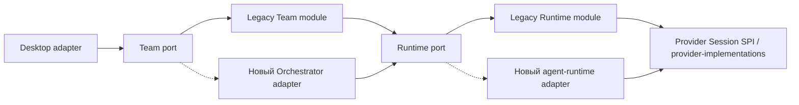

# Этап 2: замена legacy-host будущими Orchestrator и agent-runtime

Статус: future scope. Его границы фиксируются сейчас для уменьшения повторной
работы; нынешний runtime implementation не считается неизменяемым основанием.
[Программа](README.md) · [этап 1](stage-1-legacy-host.md).

## 1. Что сохраняем

- Одну provider library и один versioned provider Session SPI.
- Desktop feature API, UI и captured backend identity для существующих handles.
- Явные границы Team→Runtime и Runtime→Provider, без vendor DTO в Team/UI.
- Behavioral fixtures M01–M19, exact identities и раздельную классификацию
  admission/handoff/result/cleanup, unknown/recovery/control, positive restore и parent/child subagent scope.
- Existing provider-management port и profile binding, attachment references,
  capture/context observations и полный review/process-registry consumer scope.
- Read-only доступ к архивным данным и завершённым legacy receipts.

Сохраняем семантику используемых операций, а не обещание никогда не менять метод
или native checkpoint format. Новые capabilities добавляются версионированно;
incompatible semantics получают adapter/version, а не скрыто меняют старый intent.

## 2. Две независимые замены

Схема показывает точки замены, не разрешает два writer одного run. Комбинация
выбирается до создания session/run и хранится в binding. Новый runtime можно
подключить раньше нового Team owner, если его adapter выполняет нужные guarantees.
Если новый Orchestrator не умеет использовать legacy Runtime port, сначала
доводится runtime adapter; одновременная замена обоих ядер не является правилом.

## 3. Порядок реализации

### S2.0. Зафиксировать реальные новые contracts

Взять approved public API новых ядер и составить delta только для используемых
портов. Сравнить identity/generation, accepted/unknown/rejected, scope/grants,
ordering, independent replies/control, feeds/gaps, cleanup, durable checkpoint/history
publication и ordinary subagent provenance/custody. [Протоколы этапа 1](stage-1-contracts.md)
задают требуемое поведение, не структуру будущих stores. В delta включаются
management/auth namespace, attachment custody, pre/post capture, compaction reminder,
review history/edit mutations и background service registry, когда их заменяет новое ядро.
Также сохраняются readiness invalidation/recovery, trash/restore и identity-fenced
purge, backup ownership и owner-qualified внешние TaskRefs из §11/§6 протоколов.
TypeScript assignability не доказывает Liskov compatibility.

Выход: таблица exact-compatible / translated / requires new capability / incompatible.
Отсутствующая обязательная возможность сначала реализуется либо откладывает
переключение этой комбинации; молчаливый fallback не считается adapter.

### S2.1. Adapter к переписанному runtime

Runtime adapter переводит Team port в public runtime API, сохраняет исходные
command/input identities и scope, подключает существующую provider library.
Не содержит Task/inbox policy, новой durable очереди или второго recovery journal.

Проверяются existing session/control/unknown fixtures на реальном новом store/Host,
затем выбранные native provider tuples. Ранее завершённая generation не запускается
заново; lost restore receipt не создаёт новую generation/native process.
Unknown old custody удерживает старый binding, пока старый owner не разрешит его.

### S2.2. Adapter нового Orchestrator

Desktop consumer port переводится в canonical Team/Run/Task/Message/Observation API.
Legacy resource IDs не маскируются под новые canonical identities; retained handles
сохраняют backend binding. Входящие events проходят generation/scope/cursor checks.

Новые команды создаются у нового owner. Незавершённые legacy команды продолжают
завершение/stop у legacy-host; команды, callbacks и effects между owners не
дублируются. Cross-team между разными owners требует отдельного принятого bridge
scope; silent relay не добавляется в этот migration adapter.

### S2.3. Данные, settings и архив

По умолчанию нет live migration активного run или native session. Завершённые
данные доступны read-only через legacy archive adapter. Если нужен import в новую
модель, он отдельный idempotent workflow с исходной identity, field mapping,
проверкой количества/связей/TaskRefs/evidence и без запуска работы.

При несовместимом engine/history/checkpoint показывается explicit new-session
continuation с заново собранным product context. Это не native resume и не способ
повторно отправить uncertain старый input. Смена auth/account/config не скрывается
под тем же immutable checkpoint binding.

### S2.4. Приёмка и retirement

Сценарии M01–M19 выполняются через новую композицию, включая mixed providers,
normal Electron UI, fault/restart и packed candidate. Сравниваются observable
результаты и side effects, а не только happy-path screenshot.

Перед удалением legacy-host: нет active/unknown obligations; все retained bindings
имеют working read/reconcile/stop/archive путь; новые workflows не используют
legacy writers/CLI/readers. Сначала удалить неиспользуемую execution composition,
архивный read adapter сохранять по retention policy. Retire не удаляет user data.

Review/required CI/отдельное решение владельца о delivery сохраняются. Отказ нового
backend после accepted/unknown не включает прежний backend для того же intent.
Rollback меняет default для **новых** intents, сохраняет обслуживание старых owners.

## 4. Контрактные гарантии, которые нельзя потерять

| Граница              | Обязательная сохранённая семантика                                                                  |
| -------------------- | --------------------------------------------------------------------------------------------------- |
| Identity / authority | Trusted scope/member/session generation до эффектов; current grants, original owner при retry       |
| Command / input      | Stable IDs+fingerprint, duplicate/conflict, durable intent до handoff, no replay UNKNOWN            |
| Control              | Reply вне prompt queue, exact interrupt, stale replies не дают grant, no next handoff до fence      |
| Events               | Source attribution, bounded retention/gap, неизвестное не success, не один cursor для всех feeds    |
| Close / restore      | Logical и physical closure различаются; unknown debt удерживается; explicit compatible session only |
| Provider             | Одна implementation library; SDK/native details private; unsupported не изображает parity           |
| Data / rollout       | Один owner, active old runs не adopted, archive read-only, no destructive reset/import execution    |

## 5. Цена перехода и ограничения прогноза

Подключение **уже готовых** будущих ядер: 4–8k production, 3–6k tests/E2E.
Это новые/изменяемые строки integration/adapters/retirement относительно этапа 1,
без повторного подсчёта сохранённого gateway/provider кода. Разработка ядер и
универсальный перенос пользовательских данных не входят в эту оценку.

Если contracts существенно меняют semantics, диапазон production становится
ориентировочно 8–15k и пересчитывается по S2.0. Нельзя заранее обещать, что будущий
rewrite сохранит нынешние guarantees. Основной способ уменьшить повторную работу —
стабилизировать проверенные consumer contracts, а не заморозить всё внутреннее
устройство старого или будущего runtime.
