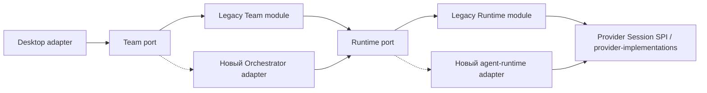

# Этап 2: замена legacy-host будущими Orchestrator и agent-runtime

Статус на 4 ноября 2026: **новое поручение владельца начать Stage 2 и OpenCode V2**.
Начат этап **S2.0: проверка текущих публичных контрактов и зависимостей**.
Переключение владельцев, миграция активных сессий, удаление legacy-host и
production activation пока **не разрешены технической готовностью** новых ядер.
Остальная последовательность S2.1–S2.4 ниже остаётся критериями допуска, а не
утверждением о реализованной миграции. Предыдущее решение от 22 октября об
отложенном Stage 2 относилось к прежнему scope; Stage 1 P0–P8/M01–M19 не
расширяется задним числом. Для OpenCode V2 — отдельный
[план Host-интеграции](opencode-v2-host-integration.md).
[Программа](README.md) · [этап 1](stage-1-legacy-host.md).

## 0. Актуальный S2.0: contract/readiness audit (4 ноября 2026)

Фиксируем **реальные**, а не будущие public APIs до написания адаптера.
Операционный [S2.0 delta-аудит M01–M19](stage-2-contract-delta.md) фиксирует
текущие границы и обязательные недостающие E2E, не подменяя их PASS.
Baseline Desktop/legacy-host: `999c468e3f4f09a5e5eb1655f6b97a64e046c55e`
в PR #982; его [Full CI](https://github.com/777genius/agent-teams-ai/actions/runs/41906833145),
[CodeQL](https://github.com/777genius/agent-teams-ai/actions/runs/41906839469)
и [пять packaged smoke](https://github.com/777genius/agent-teams-ai/actions/runs/41905798052)
прошли на этом SHA. Один root-test shard потребовал retry без изменения кода;
это наблюдаемая нестабильность, а не доказательство исправленного flaky test.
Нативные Stage 1 11/11 Desktop и процессный proof прошли на `d0d30e3`,
после него до `999c468` изменены только три тестовых файла. Эти proofs
переиспользуются **только для неизменённых границ**, не для новых ядер.

| Граница                          | Проверенный источник                                                             | Текущий результат S2.0                                                                                                                    | Требование до подключения                                                                                                                                 |
| -------------------------------- | -------------------------------------------------------------------------------- | ----------------------------------------------------------------------------------------------------------------------------------------- | --------------------------------------------------------------------------------------------------------------------------------------------------------- |
| Desktop → backend, owner binding | `src/features/agent-backend` PR #982, immutable handle and lookup                | **exact-compatible candidate** внутри Stage 1, новый backend ещё не проверен                                                              | Не менять публичные UI/IPC DTO; проверить pinned owner после default switch, unknown и rollback                                                           |
| Team owner → Orchestrator        | `agent-teams-ai/agent-teams-orchestrator` main `981dd836`, README и contracts    | **requires new capability**: репозиторий описывает architecture-definition stage, а не production Team/Task/Message/Review implementation | Published versioned API с actual writers, authority, grants, inbox, review, archive и native TEST consumer                                                |
| Runtime owner → agent-runtime    | `agent-teams-ai/agent-runtime` main `4e12b68b`, `docs/architecture/readiness.md` | **requires new capability**: interactive contract без qualified production Host; OpenCode ACP contract-only                               | Реальный Host/SDK: session/submit/observe/reply/interrupt/reconcile/checkpoint/stop, durable receipts, independent controls и scoped native qualification |
| Runtime → provider Session SPI   | `agent-teams-ai/old-provider-implementations` PR #1 `7573a508` (Draft)           | **translated** для V1 SPI, не доказывает V2 Host                                                                                          | Выбранный pinned provider artifact, private adapter, exact-sha tests, без второго session implementation в Desktop                                        |
| Data/retained ownership          | Stage 1 `BackendOwnerRouter`, `HandleBindingStore`, stopped archive              | **translation required**; live state не имеет честной общей migration receipt                                                             | Старый owner обслуживает retained handles, включая UNKNOWN исход операции; новые handles только unbound; архив read-only                                           |
| OpenCode V2                      | [V2 план](opencode-v2-host-integration.md)                                       | **incompatible until qualified** в новом Host; V1 работает отдельно                                                                       | Точный V2 binary/engine/SDK, новая plugin/API семантика, полноценные negative/native E2E                                                                  |

Ключевые источники: [Orchestrator README](https://github.com/agent-teams-ai/agent-teams-orchestrator/blob/981dd836ca3d35b764561bdc11dc2e0544d83416/README.md),
[agent-runtime readiness](https://github.com/agent-teams-ai/agent-runtime/blob/4e12b68b751d0b6fbb1e629235f789d01aa910b2/docs/architecture/readiness.md),
[проверенный Stage 1](https://github.com/777genius/agent-teams-ai/pull/982).
**Текущий отдельный upstream increment:** [Agent Runtime Draft PR #253](https://github.com/agent-teams-ai/agent-runtime/pull/253)
исправляет строгую read-only проверку PostgreSQL `CHECK`-ограничений generation/revision
и добавляет TEST/CI PostgreSQL proof. Пока PR не замёрджен и его проверки не
закрыты, это **не** published dependency, production Host или S2.1 PASS.
Владелец Runtime остаётся в собственном репозитории; Stage 1 и Desktop не меняются.

Не приравнивать принятые ADR, схему Protobuf или synthetic conformance к готовому production API.

**Решение по зависимостям.** При отсутствии квалифицированного Orchestrator/Runtime
не создавать в Desktop фиктивный API, dummy owners или второй durable журнал,
чтобы объявить Stage 2 завершённым. Сначала довести публичные capabilities
**в их собственных репозиториях**, потом небольшие adapters на consumer ports.
Существующий Stage 1 сохраняется как E2E oracle, не как цель массового refactor.

**Порядок инкрементов (отдельные небольшие Draft PR):**

1. S2.0: таблица exact/translated/missing/incompatible по операциям M01–M19,
   контрактные негативные fixtures для owner/UNKNOWN/recovery и E2E profiles.
2. S2.1: один runtime adapter с native contained session + stop/readback; только
   после implementation-qualified API, затем permissions, history и fault recovery.
3. S2.2: один Orchestrator adapter к Team/Task/Messages, после готовых writers.
   Проверять retained old/new owner без cross-owner relay.
4. S2.3–S2.4: read-only архив, dry-run data mapping, полная M01–M19 UI E2E
   на новой композиции, resource/process cleanup и независимое code/security review.

Это **порядок**, а не новые feature flags или разрешение на частичную production
активацию. Детальные правила S2.1–S2.4 и retirement остаются ниже.

## 1. Что сохраняем

- Одну provider library и один versioned provider Session SPI.
- Desktop feature API, UI и captured backend identity для существующих handles.
- Явные границы Team→Runtime и Runtime→Provider, без vendor DTO в Team/UI.
- Behavioral fixtures M01–M19, exact identities и раздельную классификацию
  admission/handoff/result/cleanup, unknown/recovery/control, positive restore и parent/child subagent scope.
- Existing provider-management port и profile binding, attachment references,
  capture/context observations и полный review/process-registry consumer scope.
- Read-only доступ к архивным данным и завершённым legacy receipts.

Сохраняем семантику используемых операций, а не обещание никогда не менять метод
или native checkpoint format. Новые capabilities добавляются версионированно;
incompatible semantics получают adapter/version, а не скрыто меняют старый intent.

## 2. Две независимые замены

Схема показывает точки замены, не разрешает два writer одного run. Комбинация
выбирается до создания session/run и хранится в binding. Новый runtime можно
подключить раньше нового Team owner, если его adapter выполняет нужные guarantees.
Если новый Orchestrator не умеет использовать legacy Runtime port, сначала
доводится runtime adapter; одновременная замена обоих ядер не является правилом.

## 3. Предварительный порядок будущей интеграции (сейчас не исполняется)

### S2.0. Зафиксировать реальные новые contracts

Взять approved public API новых ядер и составить delta только для используемых
портов. Сравнить identity/generation, accepted/unknown/rejected, scope/grants,
ordering, independent replies/control, feeds/gaps, cleanup, durable checkpoint/history
publication и ordinary subagent provenance/custody. [Протоколы этапа 1](stage-1-contracts.md)
задают требуемое поведение, не структуру будущих stores. В delta включаются
management/auth namespace, attachment custody, pre/post capture, compaction reminder,
review history/edit mutations и background service registry, когда их заменяет новое ядро.
Также сохраняются readiness invalidation/recovery, trash/restore и identity-fenced
purge, backup ownership и owner-qualified внешние TaskRefs из §11/§6 протоколов.
TypeScript assignability не доказывает Liskov compatibility.

Выход: таблица exact-compatible / translated / requires new capability / incompatible.
Отсутствующая обязательная возможность сначала реализуется либо откладывает
переключение этой комбинации; молчаливый fallback не считается adapter.

**Критическая граница S2.0:** `BackendOwnerRouter` имеет только
конкретный `CapturedHostClient`; сохранённый `schemaVersion: 1` binding требует
Node/Host SHA и storageRoot. Новый Orchestrator/Runtime нельзя легально
«подменить» Host-клиентом или подставить фиктивные SHA. До S2.1 требуется
проверенный узкий новый target transport и versioned owner record с
сохранением чтения всех старых immutable bindings. Подробное source-доказательство
и смешанный negative E2E: [S2.0 delta](stage-2-contract-delta.md#critical-s20-boundary-bound-host-transport-is-not-a-generic-owner-port).

### S2.1. Adapter к переписанному runtime

Runtime adapter переводит Team port в public runtime API, сохраняет исходные
command/input identities и scope, подключает существующую provider library.
Не содержит Task/inbox policy, новой durable очереди или второго recovery journal.

Проверяются existing session/control/unknown fixtures на реальном новом store/Host,
затем выбранные native provider tuples. Ранее завершённая generation не запускается
заново; lost restore receipt не создаёт новую generation/native process.
Unknown old custody удерживает старый binding, пока старый owner не разрешит его.

### S2.2. Adapter нового Orchestrator

Desktop consumer port переводится в canonical Team/Run/Task/Message/Observation API.
Legacy resource IDs не маскируются под новые canonical identities; retained handles
сохраняют backend binding. Входящие events проходят generation/scope/cursor checks.

Новые unbound Team handles создаются у нового Team owner. Любая операция на
retained team/run handle, в том числе с новым command ID, сохраняет исходного owner
по §1 протоколов этапа 1. Незавершённые legacy intents продолжают завершение/stop
у legacy-host; команды, callbacks и effects между owners не дублируются.
Cross-team между разными owners требует отдельного принятого bridge
scope; silent relay не добавляется в этот migration adapter.

### S2.3. Данные, settings и архив

По умолчанию нет live migration активного run или native session. Завершённые
данные доступны read-only через legacy archive adapter. Если нужен import в новую
модель, он отдельный idempotent workflow с исходной identity, field mapping,
проверкой количества/связей/TaskRefs/evidence и без запуска работы.

При несовместимом engine/history/checkpoint показывается explicit new-session
continuation с заново собранным product context. Это не native resume и не способ
повторно отправить uncertain старый input. Смена auth/account/config не скрывается
под тем же immutable checkpoint binding.

### S2.4. Приёмка и retirement

Сценарии M01–M19 выполняются через новую композицию, включая mixed providers,
normal Electron UI, fault/restart и packed candidate. Сравниваются observable
результаты и side effects, а не только happy-path screenshot.

Перед удалением legacy-host: нет active/unknown obligations; все retained bindings
имеют working read/reconcile/stop/archive путь; новые workflows не используют
legacy writers/CLI/readers. Сначала удалить неиспользуемую execution composition,
архивный read adapter сохранять по retention policy. Retire не удаляет user data.

Review/required CI/отдельное решение владельца о delivery сохраняются. Отказ нового
backend после accepted/unknown не включает прежний backend для того же intent.
Rollback меняет default только для новых unbound handles; существующие handles
и их новые intents сохраняют owner. Проверка использует Owner routing/F08 этапа 1.

## 4. Контрактные гарантии, которые нельзя потерять

| Граница              | Обязательная сохранённая семантика                                                                  |
| -------------------- | --------------------------------------------------------------------------------------------------- |
| Identity / authority | Trusted scope/member/session generation до эффектов; current grants, original owner при retry       |
| Command / input      | Stable IDs+fingerprint, duplicate/conflict, durable intent до handoff, no replay UNKNOWN            |
| Control              | Reply вне prompt queue, exact interrupt, stale replies не дают grant, no next handoff до fence      |
| Events               | Source attribution, bounded retention/gap, неизвестное не success, не один cursor для всех feeds    |
| Close / restore      | Logical и physical closure различаются; unknown debt удерживается; explicit compatible session only |
| Provider             | Одна implementation library; SDK/native details private; unsupported не изображает parity           |
| Data / rollout       | Один owner, active old runs не adopted, archive read-only, no destructive reset/import execution    |

## 5. Цена перехода и ограничения прогноза

Подключение **уже готовых** будущих ядер: 4–8k production, 3–6k tests/E2E.
Это новые/изменяемые строки integration/adapters/retirement относительно этапа 1,
без повторного подсчёта сохранённого gateway/provider кода. Разработка ядер и
универсальный перенос пользовательских данных не входят в эту оценку.

Если contracts существенно меняют semantics, диапазон production становится
ориентировочно 8–15k и пересчитывается по S2.0. Нельзя заранее обещать, что будущий
rewrite сохранит нынешние guarantees. Основной способ уменьшить повторную работу —
стабилизировать проверенные consumer contracts, а не заморозить всё внутреннее
устройство старого или будущего runtime.

## 6. Review gates для реализации

Каждый implementation PR требует **двух независимых проверок**, где возможно:
архитектурные boundary/DDD/SOLID/DRY, затем security/lifecycle/negative E2E.
Отдельно проверять реальные наблюдения, а не только типы и моки. Самопроверка
или список критериев в документе **не считаются состоявшимся независимым review**.

- **Stop-ship:** повторная отправка UNKNOWN, silent switch owner на retained
  handle, новое Team/Runtime data ownership в UI, shared-process kill, потеря
  permissions/review/TaskRefs, неявное преобразование V1 checkpoint в V2.
- **E2E:** существующие LaunchTeamDialog/CreateTeamDialog, Resume, Tasks,
  messages/cross-team, reviews, permissions/interrupt, crashed Host/recovery,
  backup/trash/archive, teardown и packed Electron в выбранных TEST tuples.
  Проверять все M01–M19 и negative controls; не заменять UI smoke прямым RPC.
- **Verification:** точный dependency SHA; focused regression, typecheck, CI,
  CodeQL, process/native proofs, packed artifact, inspector/ownership audit.
  Нет подтверждённого receipt — нет статуса PASS.
- **Delivery:** Stage 1 PR #982 остаётся Draft; Stage 2 stacked отдельно.
  Не делать merge/release/rollout до готовности ядер, полных проверок и
  отдельного product decision. Отсутствие merge conflicts не равно eligibility.

