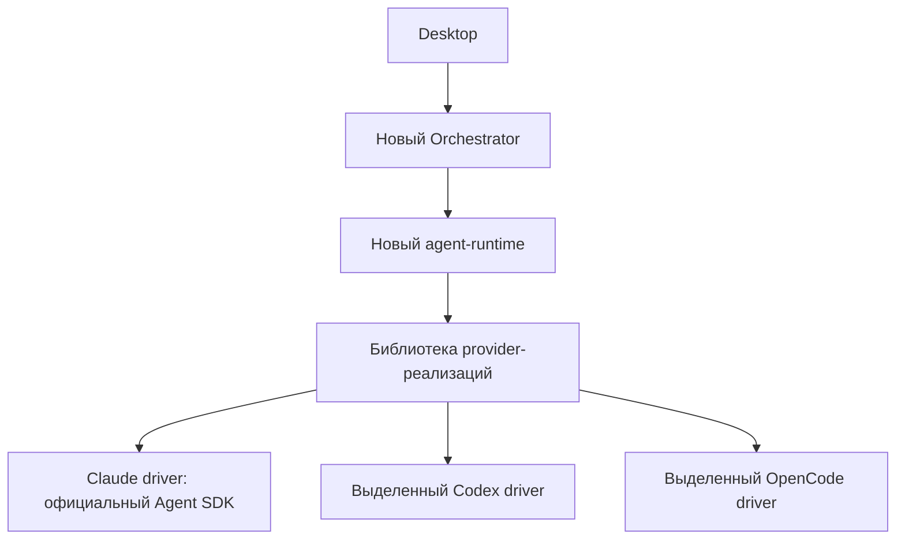

# Выделение provider-кода из форка и переход на Claude Agent SDK

> **Исторический план A–F; порядок исполнения заменён 21 октября 2026.**
> Актуальная точка входа: [двухэтапная программа](provider-migration/README.md).
> Сейчас: [этап 1 — совместимый legacy-host](provider-migration/stage-1-legacy-host.md)
> с сохранением `provider-implementations`, без зависимости от implementation
> нынешнего `agent-runtime`. [Этап 2](provider-migration/stage-2-new-cores.md) заменит
> legacy-модули будущими ядрами. Текст ниже сохранён как история решений,
> исходных оценок и проверенных checkpoint; это не параллельный backlog исполнения.
> Новая матрица приёмки находится [здесь](provider-migration/compatibility-matrix.md).

Обновлено: 21 октября 2026. Статус: B доставлен; C и выделенная provider-библиотека реализованы и проходят поставку. Первый E sandbox прошёл создание команды, инструменты SDK, чтение сообщений/логов, создание/изменение задачи и остановку через Electron. Продолжаются итоговые gates, поставка и следующие срезы совместимости. Полная совместимость команд и F ещё не завершены.

Выбранное направление: собственное командное ядро в `agent-teams-ai/agent-teams-orchestrator`, новый `agent-teams-ai/agent-runtime`, отдельная библиотека наших provider-реализаций. Claude сначала работает через официальный Agent SDK. Из старого форка сохраняем полезные реализации OpenCode/Codex и проверенное поведение команд, постепенно прекращая использование его executable.

Документ задаёт миграцию из старого frontend и не заменяет принятые контракты/ADRs целевых репозиториев. LOC — прогноз будущей работы. ИИ-агенты ускоряют написание, но concurrency, recovery и совместимость требуют проверки.

**Текущий checkpoint B:** actual SDK/CLI с локальным Anthropic API fixture проверил две независимые сессии, последовательные turns, MCP, permission reply, targeted interrupt и explicit resume. Это synthetic-provider integration; реальный Anthropic/auth не проверен. По прямому указанию владельца доступ к Claude пока отсутствует: C–F продолжаются на fixtures/mocks, production qualification реального провайдера остаётся отдельной недоказанной границей. Итоговые source/CI receipts фиксируются после обязательных gates; B не означает завершения всей миграции.

**Проверенный E checkpoint, пока без полной приёмки:** обычный Electron UI создал новую тестовую команду через Orchestrator → настоящий runtime Host → выделенный Claude driver → официальный SDK/CLI с локальным API. MCP создал задачу и сообщение агента в авторитетном PostgreSQL; UI показал их и 13 записей activity, включая итоговый текст. Изменение заголовка задачи и человеческий DM подтверждены отдельной сверкой API/БД как однократные эффекты после перезапуска desktop. DM пока только committed: получение агентом и ответ не заявляются. Ошибка разбора operation ID исправлена; свежий сценарий подтвердил создание задачи и её Run placement с закрытием формы. В прежнем сценарии истёкший результат честно остаётся UNKNOWN, без повторной отправки. Остановка через UI в обоих сценариях подтверждена owner API/БД, CLOSED runtime session и отсутствием дочерних процессов. Полноценные несколько участников, Work lifecycle/review и оставшаяся capability matrix остаются обязательными следующими срезами.

## 1. Результат и границы

Библиотека — обычный пакет с фабриками реализаций, без собственного daemon, очереди команд продукта или отдельной базы команд. В принятом runtime ADR-0092 выбрано размещение `packages/platform/provider-implementations` внутри workspace `agent-runtime`; это заменяет первоначальное предположение об отдельном репозитории и не меняет границу владения. Пакет не импортирует исходники форка и не ищет соседний checkout desktop по относительному пути.

Та же граница действует для чтения и подписок: живые команды, задачи, сообщения и activity desktop получает из публичного API Orchestrator. Прямое чтение provider-файлов в desktop не является обходным способом сохранить новый live workflow. Архив старых сессий остаётся явно отдельным read-only сценарием.

Сохраняются полноценные команды: создание и изменение состава, роли, запуск участников, задачи и зависимости, назначение/выполнение, личные и групповые сообщения, approvals, остановка, восстановление, логи и связь изменений с задачами. Это целевой критерий всей миграции. Первый sandbox-срез доказывает только перечисленные в нём сценарии и не означает достижения всей совместимости.

В первом выделении сохраняем технический transport и формат provider session storage OpenCode. Продуктовые записи задач, сообщений и readiness под это исключение не попадают: при подключении к новому ядру их writer должен смениться. Первой Claude-реализацией служит SDK; `ar` и прямой CLI добавляем при конкретной необходимости.

## 2. Владельцы поведения

| Область                                                                                                                  | Владелец            | Что не переносится в эту область                                     |
| ------------------------------------------------------------------------------------------------------------------------ | ------------------- | -------------------------------------------------------------------- |
| Команды, участники, Work/задачи, назначения, сообщения, product approvals, политика retry/completion                     | Orchestrator        | SDK session loop и управление дочерними процессами                   |
| Технические сессии и операции, custody, durable input/output, capability negotiation, permissions, interrupt/stop/resume | agent-runtime       | Канбан, правила назначения, продуктовый inbox                        |
| Вызов SDK/CLI/protocol, нормализация provider-событий, приватный checkpoint                                              | Provider driver     | Авторитетное состояние команды и самостоятельный retry бизнес-команд |
| Provider registry и wiring конкретных фабрик                                                                             | Composition runtime | Выбор поведения через проверки `provider === ...` в домене           |
| Представление, пользовательские действия и локальный transport adapter                                                   | Desktop             | Вторая запись бизнес-состояния или прямое управление агентом         |

Orchestrator владеет application ports к runtime; runtime владеет driver SPI. Его draft в B определяется потребностями runtime-потребителя: открыть связанную сессию, последовательно передавать inputs, наблюдать outcomes/interactions, прерывать и восстанавливать выполнение. Harness проверяет этот контракт, а SDK adapter реализует его; SDK методы не становятся публичным API автоматически. Библиотека импортирует только contracts entrypoint, конкретные фабрики подключает composition root. Отдельный contracts package создаётся лишь при необходимости в реальном графе зависимостей/поставке. Согласование runtime SPI не входит в Claude LOC как «бесплатная» работа.

Библиотека содержит provider-модули с публичными фабриками и один связный session API. Shared helpers выделяются по общему смыслу; base driver, plugin loader и интерфейсы для каждого метода не нужны. Vendor DTO переводятся внутри adapter; одинаковые нейтральные runtime-типы переиспользуются.

Изменения файлов технически наблюдает provider/runtime; продуктовую связь evidence с Work/задачей и пользовательскую activity projection строит Orchestrator. Driver передаёт observation через generic port, не открывает task store. Provider account custody принадлежит runtime, а экран подключения и onboarding остаются клиентским workflow.

SDK types, Claude session paths и типы `ar` приватны для adapter. Снаружи — принятый runtime контракт с явным `unsupported`. Новый backend не меняет задачи/сообщения продукта; переносимость его native checkpoint отдельно не предполагается.

При admission различаем запрошенные требования и подтверждённые возможности driver. Отсутствующая обязательная capability отклоняет запуск до provider execution; тестовый double не делает её доступной в реальном backend. Это проверка общего контракта, без provider-specific fallback внутри use case.

Один агентский процесс имеет одного технического владельца; одно изменение бизнес-состояния — одного writer. Старый и новый оркестраторы не обслуживают одновременно один и тот же run как writers.

## 3. Что действительно изменено в форке

Проверенный baseline форка: [`38c09970`](https://github.com/777genius/agent_teams_orchestrator/commit/38c09970c2925bb36a340c546ac53229f3d7bda5), 1 апреля 2026, совпадающий с исходным upstream snapshot. Измеренный head: [`969afc56`](https://github.com/777genius/agent_teams_orchestrator/commit/969afc56ec39d92c33dd5aabd15ef782da94dd87), 20 октября. Следующие 11 коммитов до `da60ff9d` просмотрены отдельно; цифры ниже остаются привязанными к `969afc56`, а не выдаются за точный размер более позднего head.

В production-коде: 293 новых файла / **89 981 строка**, 237 изменённых унаследованных файлов / **+16 720 −3 392**, 1 685 унаследованных файлов не менялись. Около 84% добавленных production-строк находится в новых файлах. Это благоприятно для выделения, но не означает отсутствия скрытых зависимостей. Git delta показывает отличие от baseline, а не доказывает авторство каждой строки: были и последующие upstream-синхронизации.

Подсчёт: `git diff --numstat`/`--name-status` между указанными SHA; production, tests/fixtures, generated/vendor, tooling и docs классифицируются отдельно. Физические строки включают comments/пустые строки. Новый snapshot требует пересчёта и обновления manifest.

| Донор                                          | Новых production-строк | Решение                                                                                    |
| ---------------------------------------------- | ---------------------: | ------------------------------------------------------------------------------------------ |
| `src/services/opencode`                        |                 50 146 | Выделять техническую реализацию, сохраняя текущий protocol/storage на первом шаге          |
| `src/services/codexNative`                     |                  5 972 | Брать app-server механизм; заменить привязку к Claude AppState/transcript                  |
| `src/services/runtimeBackends`                 |                  4 556 | Разобрать на runtime registry/composition и provider детали                                |
| `src/features` / provider management           |                  7 642 | Сохранить полезные use cases/ports; UI, account policy и wiring распределить по владельцам |
| `src/services/teamBootstrap`                   |                  4 327 | Использовать как спецификацию поведения, workflow реализовать в Orchestrator               |
| `src/services/taskChangeLedger`                |                  4 155 | Сохранить механику Git/изменений; task attribution и продуктовые записи отделить           |
| `src/services/boardTaskActivity`, `agentTeams` |                  2 684 | Продуктовые события и проекции перенести к владельцам Orchestrator                         |

Главные смешанные места — `useInboxPoller`, `spawnMultiAgent`, `spawnUtils`, `teammateMailbox`, `teamHelpers`. Сам `QueryEngine` изменён сравнительно мало: +100/−1. Поэтому перенос всего Claude engine не является хорошим способом сохранить наши дополнения.

TeamCreate/Task\*/SendMessage существовали в upstream и сейчас сами меняют локальные файлы/состояние. Нельзя считать их независимым готовым SDK команд и просто переподключить UI. Их поведение нужно покрыть новыми командами Orchestrator. Донорские примеры: [TaskUpdate](https://github.com/777genius/agent_teams_orchestrator/blob/969afc56ec39d92c33dd5aabd15ef782da94dd87/src/tools/TaskUpdateTool/TaskUpdateTool.ts), [SendMessage](https://github.com/777genius/agent_teams_orchestrator/blob/969afc56ec39d92c33dd5aabd15ef782da94dd87/src/tools/SendMessageTool/SendMessageTool.ts).

Для переносимого кластера составить компактный manifest: source file + SHA → `move mechanism` / `reimplement product behavior` / `replace legacy wrapper` / `retire with reason`, целевой владелец, внешние imports, релевантные тесты. Дополнять его по мере выделения, включая изменённые унаследованные участки; полный разбор форка не блокирует Claude sandbox. До удаления форка manifest должен охватить все сохраняемые возможности: «не попало в первые 60–75k» не является основанием удалить функциональность.

## 4. Claude: официальный SDK как первая реализация

Используем поддерживаемый `query()` со streaming input (`AsyncIterable`), не переписываем агентский loop Claude. SDK даёт выполнение инструментов и управление контекстом; наш driver переводит технические входы/выходы. Прежний preview API `createSession/send/stream` удалён, на него не опираемся. [Streaming input](https://code.claude.com/docs/en/agent-sdk/streaming-vs-single-mode), [sessions](https://code.claude.com/docs/en/agent-sdk/sessions).

Наш Orchestrator запускает отдельные управляемые member sessions. Он предоставляет team/task/message tools через MCP и остаётся владельцем их состояния. Это полноценная наша командная модель. Native Claude Agent Teams не используются как второе ядро: их teammate spawn не поддерживается в SDK/non-interactive mode. [Ограничение Anthropic](https://code.claude.com/docs/en/agent-teams#enable-agent-teams).

### Технический контракт driver

Ниже — семантика одного связного session API; окончательные имена следуют принятому runtime контракту:

- `open(config, trustedBinding, capabilities)` создаёт техническую сессию; runtime сохраняет её canonical identity.
- `submit(inputId, operationRef, content)` передаёт обычный input и возвращает результат handoff, не дожидаясь окончания turn; durable admission/retry и очередь принадлежат runtime. В driver только ограниченная volatile очередь к SDK.
- `observe()` выдаёт нормализованные text/tool/usage/result/permission факты с привязкой к сессии и подтверждённой operation correlation. Непривязанный background/session event явно сохраняет отсутствие operation reference; его нельзя приписывать последнему активному turn. Runtime владеет долговременным хранением и feed semantics.
- `respondToInteraction(interactionRef, reply)` переводит уже проверенный runtime ответ в текущий SDK callback; question answer и permission decision сохраняют разные типы. Это часть session API, без отдельного сервиса или копии approval policy.
- `interrupt(operationRef)` адресует конкретную активную operation в текущем поколении session; устаревший target возвращает typed stale/already-terminal, не прерывая следующую operation. `close()` закрывает session; `stop` и подтверждение освобождения процессов координирует runtime.
- `restore(opaqueCheckpoint, compatibleConfig)` восстанавливает только технически совместимую сессию или возвращает типизированный отказ. Checkpoint version, engine revision и session reference приватны для driver/runtime.

У сессии один SDK read loop. Inputs обрабатываются последовательно, result заканчивает provider turn, но не Work/задачу. Resume восстанавливает conversation, не файловую систему и не exactly-once внешних эффектов.

Для deltas/complete ключом служат доступные message/block identifiers выбранной SDK версии: complete подтверждает или обновляет тот же блок, а не дописывает второй экземпляр. Нельзя dedup по одному тексту — одинаковый текст двух разных сообщений допустим. Отсутствующие usage/cost значения остаются unknown, а не превращаются в ноль.

`open` сообщает техническую доступность session. Runtime queue admission, handoff SDK и provider acceptance различаются; неизвестный исход сохраняется явно. Result не вызывает `TaskUpdate(completed)`. После него read loop продолжает ждать следующий input до закрытия session.

Для первого среза у member один активный turn. Следующий обычный input хранится у runtime до terminal outcome предыдущего turn и завершения направленного ему control-вызова. Успешный ответ на запрос interrupt сам по себе не доказывает завершения turn. Проверка target и native interrupt упорядочиваются с завершением turn и следующим handoff, чтобы запоздалая отмена не затронула новый input. Если безопасное продолжение не подтверждено, session остаётся unavailable/unknown до recovery по правилам runtime.

Ответ на interaction, interrupt и close обслуживаются независимо от prompt queue, включая её переполнение или паузу из-за MCP. Session lock не удерживается на время ожидания authority или turn result: иначе ответ/отмена будут ждать завершения того самого turn, который ждёт их. Это различие scheduling внутри session API, не вторая очередь prompts или новый transport.

При close runtime сначала атомарно закрывает admission/handoff этой session; driver также запрещает новые handoffs до ожидания shutdown. Повторный close присоединяется к тому же завершению, а поздние submit/reply не открывают session заново. Runtime фиксирует disposition оставшихся queued inputs; driver освобождает callbacks и закрывает iterable. Логическое закрытие не выдаётся за подтверждённый cleanup процессов. Input/output limits задаёт runtime; переполнение даёт typed backpressure/failure, без молчаливого удаления команд. Уже завершённый input не становится причиной повторного dispatch.

| Точка сбоя                                  | Требуемое поведение                                                                                                                                                                     |
| ------------------------------------------- | --------------------------------------------------------------------------------------------------------------------------------------------------------------------------------------- |
| Подтверждённая отмена до handoff            | Владелец runtime атомарно исключил dispatch, provider input не получил. Простого отсутствия receipt после crash недостаточно для этого вывода                                           |
| После handoff без подтверждённого result    | Исход может быть unknown; новый SDK process не получает автоматический replay такого input                                                                                              |
| Result и interrupt одновременно             | Один terminal outcome turn; уже наблюдённый result не переписывается в «всё отменено», runtime отдельно учитывает cutoff intent                                                         |
| SDK error-result, затем исключение iterator | Второй terminal outcome не создаётся; исключение добавляет диагностику/факт состояния сессии                                                                                            |
| Runtime restart                             | Сначала исключить старого execution owner; сверить durable intent/outcome. Потерянный receipt не означает «не отправлено»: без доказательства остаётся unknown, без повторного dispatch |

SDK не обязан предоставлять durable replay cursor. Provider message IDs сохраняем, если они есть; runtime sequence — только порядок принятого runtime feed, не выдуманная гарантия provider replay. При gap/потере истории публикуется явное отсутствие evidence. Unknown informational event даёт ограниченную диагностику. Неизвестный control/result event не интерпретируется как успех: соответствующая операция получает typed unsupported/unknown и не продолжается автоматически. [Streaming output](https://code.claude.com/docs/en/agent-sdk/streaming-output).

`interrupt` не доказывает завершения process tree. SDK-spawned process регистрируется через уже готовый runtime-owned launcher/custody hook; bounded graceful close и дальнейшую остановку выполняет этот owner. Если подтверждения нет, остаётся cleanup failure/unknown. Общие process-group/Windows Job механизмы сюда не включаются и не заменяются `process-runtime`.

Stop/cancel направлен на конкретную session/operation binding. Для backend с общим host, особенно OpenCode, остановка одного member не даёт права завершать весь host или соседние сессии. Session handle и общий host PID не взаимозаменяемы; решение о завершении backing service остаётся у его технического владельца. Orchestrator и desktop не повторяют process discovery/kill алгоритмы runtime.

### Инструменты команд и approvals

В production используем общий MCP endpoint командных инструментов Orchestrator, пригодный для всех providers. Runtime передаёт driver generic endpoint config и scoped authority; SDK регистрирует их через `mcpServers`. Не создаём специально для Claude дополнительный proxy-service или дублирующие schemas Team/Work. В sandbox endpoint обслуживает минимальный fixture host по тому же формату tool-вызовов; существующий transport/helper переиспользуется. `tool`/`createSdkMcpServer` нужны только при обоснованной in-process интеграции. Driver не пишет `~/.claude/teams` как бизнес-хранилище. [MCP transports](https://code.claude.com/docs/en/agent-sdk/mcp).

Подключённый config не доказывает доступность tools. До рабочего input проверяется обязательный MCP endpoint и требуемый tool set: init с `pending` недостаточен; SDK может продолжить работу при `failed`/`needs-auth`. В B подтвердить способ проверки на выбранной версии через MCP status/tool discovery и read-only handshake fixture host, без business mutation. Ошибка или истечение runtime readiness timeout возвращают typed dependency failure. При потере MCP во время turn driver сообщает dependency-unavailable, runtime приостанавливает новые inputs до свежего подтверждения. Исход уже переданного вызова учитывается отдельно, без автоматического replay. Восстановление соединения SDK не объявляет product readiness и не заменяет reconciliation; второй reconnect loop не добавляется. [Статусы MCP и ошибки подключения](https://code.claude.com/docs/en/agent-sdk/mcp#error-handling).

SDK tool exposure и auto-approval настраиваются отдельно: `allowedTools` разрешает автоматическое выполнение перечисленного и не убирает остальные tools. Для исключения конфликтующих native team/task writers использовать явный набор exposed tools/`disallowedTools` выбранной SDK версии. Все продуктовые team/task/message действия идут через MCP; локальная execution checklist или SDK subagent не становится Work/участником команды. Имена/schema tools и ролевые инструкции задаёт Orchestrator, driver не содержит вторую копию этих правил. [Семантика allow/deny](https://code.claude.com/docs/en/agent-sdk/permissions#allow-and-deny-rules).

Member identity, scope и generation связываются в Orchestrator из доверенного binding/authority. На runtime-границе эта связь остаётся opaque: не требуется импортировать доменную Team model в driver. Переданные моделью `teamId`, `memberName` или `taskId` не доказывают право выполнить действие. Handler Orchestrator проверяет полномочия, состояние и idempotency; SDK bridge переводит transport config/результаты. Обновление roster или отзыв полномочий действует в authoritative handler, даже если список tools у SDK ещё закэширован.

`message_send` сначала фиксирует сообщение и адресатов у Orchestrator. Доставка recipient в runtime — отдельный шаг по правилам Orchestrator: durable message, input admission, provider consumption и ответ агента не являются одним статусом «доставлено». Текстовый output/result turn не доказывает чтение или ответ на конкретное сообщение. Для Claude нет второго inbox-file poller и relay через lead; runtime передаёт принятый input нужной member session. После restore неизвестный delivery не повторяется с новым ID автоматически.

Technical permission request из SDK уходит runtime → Orchestrator → authority, ответ возвращается в тот же pending request. Product approval и SDK enforcement учитываются отдельно. Late/duplicate/expired decision не разблокирует уже закрытый или сменивший поколение turn. `canUseTool` не вызывается для всех auto-approved tools; обязательную проверку доступа выполняет authoritative handler/обязательный hook, а не только этот callback. [Approval flow](https://code.claude.com/docs/en/agent-sdk/user-input).

Baseline B явно использует permission mode с callback (`default`), fixture authority отвечает программно. `dontAsk` нельзя копировать из contained-turn donor: он не вызывает `canUseTool` и не докажет permissions/questions bridge. Автоподтверждённый read-only tool и tool, требующий решения, проверяются раздельно; отсутствие callback у первого не считается ошибкой. Production mode выбирает runtime policy при сохранении этих объявленных capabilities. [Permission modes](https://code.claude.com/docs/en/agent-sdk/permissions#permission-modes).

Pending callback связан с technical request ID, session/operation generation и abort signal. Ответ authority приходит через публичный API Orchestrator в interaction/permission use case runtime и разрешает этот callback; он не попадает в `submit` как новый prompt. `AskUserQuestion` получает структурированный ответ, permission request — decision. Duplicate/late/expired reply не применяется к новому запросу; ответ после abort/close возвращает typed stale/unavailable без grant. После restart старый callback не восстанавливается из checkpoint: сохранённая product decision остаётся audit/evidence, а её применение к новой technical interaction отдельно проверяет runtime.

В первом новом mutating tool contract требуется явный `idempotencyKey`/command ID. Host валидирует key, связывает его с доверенным scope и видом операции и сохраняет canonical payload/result. Тот же key/payload возвращает прежний результат; другой payload даёт conflict. Key может передавать caller, но он не даёт полномочий. SDK tool-use ID и JSON-RPC request ID остаются transport/observation references и не подменяют этот key. При потерянном ответе lookup выполняется по исходному key, без новой мутации и автоматического replay; новый key означает новый intent, а не гарантированно тот же запрос.

Это развитие существующего подхода [task creation idempotency](/Users/belief/dev/projects/agent-teams-ai/old-agent-teams-frontend/mcp-server/src/utils/taskCreationIdempotency.ts), где key сейчас optional. Новый host применяет свой принятый command contract, без копирования старого store и без специального SDK proxy. В B fixture проверяет replay/conflict/lost response; в E тот же сценарий проходит через реальный authoritative handler. Для legacy caller compatibility adapter назначает request identity до dispatch согласно принятому migration contract.

### Config, credentials и поставка

Фиксируем exact SDK/CLI revision и поддерживаемые platform tuples при реализации; исследованный ориентир — [SDK 0.3.304 / CLI 2.1.304](https://github.com/anthropics/claude-agent-sdk-typescript/releases/tag/v0.3.304). SDK dependency и пути executable скрыты в реализации. Credentials получает runtime, driver получает ограниченную private projection окружения; secrets и raw checkpoint не попадают в события desktop.

`cwd`, model, tools, MCP endpoints, settings sources и environment передаются явно согласно runtime policy. Из parent environment не наследуются старые team/bootstrap bindings и конфликтующий MCP writer. Обычные skills/hooks/project settings сохраняются только через выбранные и проверенные settings sources, без молчаливого изменения их пользовательской семантики. Конфликт конфигураций отклоняется до запуска. SDK tools для локальных подзадач не объявляют нового управляемого member и не обходят Orchestrator.

Restore проверяет engine/checkpoint version, cwd/workspace binding, account/config compatibility и наличие session storage. Используется explicit `resume: sessionId`, без `continue: true`. При смене SDK на CLI/другой engine возможен новый technical session с заново собранным продуктовым контекстом; это отдельное продолжение run, не обещание нативного переноса history.

Сначала отдельно подтверждаем допустимую auth-модель продукта. Документация Anthropic требует предварительного одобрения для предложения claude.ai login/limits сторонним продуктом; API-key путь документирован отдельно. Выбор SDK сам по себе не сохраняет нынешний subscription onboarding. Это блокирует соответствующий способ поставки, но не проектирование driver и тесты на fixtures. Не меняем незаметно весь продукт на API keys. [Условия auth в SDK overview](https://code.claude.com/docs/en/agent-sdk/overview#get-started).

## 5. Порядок работ

### A. Зафиксировать первый срез и источник поведения

1. Зафиксировать immutable source SHA для первого переносимого кластера. Manifest отделяет нашу механику, upstream-код и продуктовые правила. Незакоммиченные изменения не включаются автоматически.
2. Взять существующие описания/тесты как основу общей capability matrix: roster/roles, запуск/ready, задачи/dependencies/claim/update, DM/group/cross-team, approvals, cancel/restart, compaction context, logs/task refs/change attribution, provider auth/detection. Не повторять полное исследование каждой возможности перед первым SDK proof.
3. Зафиксировать для B только необходимые наблюдения: две Claude sessions, последовательные inputs, tool/text events, fixture task и сообщение, permission/question, interrupt и explicit resume. Это test-only scope, без обещания product readiness.

Выход: manifest, capability matrix и воспроизводимый сценарий. Все остальные текущие возможности остаются в backlog совместимости с владельцем; их нельзя объявить поддержанными по успешному smoke первого среза.

Начальный [source manifest](./runtime-provider-extraction-source-manifest.json) фиксирует Codex native cluster на выбранном SHA: 20 production-файлов / 5 972 физических строки, blob/hash, imports, donor tests и disposition. Это inventory, не доказательство build closure или готового переноса. [Capability matrix](./runtime-provider-extraction-capabilities.md) сохраняет полный backlog поведения и отдельно отмечает недоказанные C–F; оба артефакта обновляются по фактическому переносу.

### B. Доказать SDK без изменения форка

Первый B разместить в canonical runtime как private test-only package `experiments/interactive-provider-contract`: curated entrypoints `./draft-contracts` с runtime-owned draft SPI и `./claude` с driver factory, один harness. Это обычная библиотека с явной experimental quality boundary; production packages её не импортируют. Такое размещение позволяет проверить контракт до admission нового runtime-пути, без второго contracts package. При C/D driver subtree перемещается в отдельную provider-библиотеку, а SPI — в принятый runtime contracts entrypoint; две редактируемые копии не сохраняются.

Использовать `query()` и принятый test MCP transport, разные native session IDs в одном disposable workspace и общую test config, изолированную от пользовательской. Доверенный member binding у каждой session свой. Это позволяет проверить explicit resume среди нескольких sessions одного cwd. Driver-код развивается в C; нормализованные SDK fixtures сохраняются без второго wrapper.

Первый reviewable checkpoint B: две sessions с разными IDs, два последовательных inputs одной из них, text/tool/result через read-only fixture MCP и подтверждённый close. В комплекте driver, focused tests, harness и команда запуска; следующий input работает после первого result. Это самостоятельный test-only PR. Permissions/questions, interrupt races и resume доводятся в том же пакете до полного baseline B/C. Review budget учитывает production **и tests/harness**; 2k production LOC — не размер одного PR.

Fixture host хранит только состояния сценария, без копии durable runtime или командного ядра. Scripts/README пакета фиксирует exact SDK и команду запуска. Выход B — assertions раздела 8, redacted trace, подтверждённые capabilities и ограничения.

Обязательный baseline B/C: serial multi-turn, text/tool events, MCP, permissions/questions, interrupt и explicit resume. Провал — результат исследования, не приёмка driver. После проверки config/SDK version недоступная обязательная capability требует пересмотра backend; превращать её в optional нельзя.

### C. Принять SPI и подключить driver к runtime

Runtime принимает уточнённый по evidence B session/input/event/permission/checkpoint контракт с типизированными результатами и владением lifecycle. Vendor limitations уточняют capability/result, а не заставляют consumer API повторять `Query`. SDK driver и управляемый test double проходят один focused contract suite; double воспроизводит сбои и не доказывает совместимость реального `ar` или CLI.

Prerequisites runtime-интеграции: input admission/очередь, session/operation identity, checkpoint store, process launcher/stop и обработка interaction replies независимо от prompt queue. Эти механизмы оцениваются отдельно от Claude LOC; допустимый scope фиксируется в runtime. До его admission B остаётся test-only. Выход C — contracts entrypoint, подключённая фабрика и тот же suite на runtime integration, без SDK imports в core.

До handoff runtime сохраняет input/operation identity и delivery intent у своего durable owner. После crash отсутствие receipt не разрешает повторную отправку: исход сверяется с provider evidence либо остаётся unknown до явной recovery по контракту. Подтверждённый not-sent учитывается retry policy; отменённая operation не переоткрывается, повтор работы требует successor operation. Driver не создаёт второй durable journal и не решает бизнес-политику retry.

Общий production MCP server Orchestrator для C не требуется: driver проверяется с contract-compatible fixture endpoint. Реальный авторитетный tools host подключается в E. Эта граница убирает цикл «для driver нужен готовый Orchestrator, а для Orchestrator нужен driver».

### D. Выделить свою provider-библиотеку

Первыми переносить независимые технические кластеры и их релевантные fixtures. OpenCode: внешний MCP endpoint/entrypoint передаётся явно вместо поиска sibling desktop; временно сохраняются storage keys `teamId::laneId::memberName` внутри приватного adapter binding. Разрешение старого ключа выполняется через opaque runtime binding, не через поиск актуальной команды по её имени. Codex: переносить app-server transport/executor mechanics, заменить зависимости на Claude AppState/transcript/cost globals узкими ports.

Сохранение формата не означает сохранения старого владельца. В частности, [OpenCodeLedgerBridgeService](https://github.com/777genius/agent_teams_orchestrator/blob/969afc56ec39d92c33dd5aabd15ef782da94dd87/src/services/opencode/OpenCodeLedgerBridgeService.ts) прямо вызывает импорт/подавление task ledger, а [OpenCodeBridgeCommandHandler](https://github.com/777genius/agent_teams_orchestrator/blob/969afc56ec39d92c33dd5aabd15ef782da94dd87/src/services/opencode/OpenCodeBridgeCommandHandler.ts) содержит desktop bootstrap/readiness semantics. Эти seams заменяются при подключении нового owner; целиком переносить их как «чистый transport» нельзя. До замены кластер можно проверять на fixtures, но подключать его writer к новой product-команде нельзя.

`teamBootstrap`, inbox poller и task lifecycle не копируются в provider library целиком. Продуктовые шаги реализует Orchestrator; driver сохраняет только delivery/protocol mechanics. TaskChangeLedger разделяет технический Git evidence capture и продуктовую attribution; существующие проверки review/apply сохраняются у соответствующего владельца. SDK file checkpoints не заменяют ledger изменений задачи, поскольку не покрывают все способы записи файлов агентом.

Выход: перенесённый пакет собирается и тестируется без checkout форка и desktop. Пока старое приложение ещё нуждается в прежних реализациях, оно использует зафиксированную старую поставку либо совместимый package entrypoint; не поддерживаем две редактируемые копии одних алгоритмов.

### E. Подключить Orchestrator и затем Desktop

После admission gates реализовать вертикальный срез командного ядра в каноническом репозитории. Его правила можно проверять с fake runtime параллельно C. Затем соединить реальный runtime и authoritative MCP tools. В конце подключить desktop adapter, отдельно от runtime command/event adapters.

Первое переключение — новая sandbox-команда с новым run и отдельным storage scope, целиком на новом owner. Активные legacy-команды не переносятся этим переключателем. Для новой команды все mutating desktop routes идут к выбранному ядру; неподдержанный метод возвращает явную ошибку, не обращается к legacy. Cross-team smoke использует только команды нового owner; bridge между legacy/new ядрами в этот план не входит.

Request identity и выбранный owner фиксируются до отправки. До acceptance можно отменить переключение, доказав отсутствие accepted/unknown mutations. После acceptance или потери ответа следует lookup/reconciliation у того же owner; automatic fallback в legacy запрещён. Возврат на старую версию не означает переноса незавершённого нового run: сначала его останавливает/согласует новый owner. Read-only archive/import старых данных рассматривается отдельно. [Migration boundary](https://github.com/agent-teams-ai/agent-teams-orchestrator/blob/dec970e19f9c71d388a7719d921ac3bb4af27a28/docs/architecture/migration-boundary.md).

Compatibility adapter переводит существующие DTO/статусы/ошибки в accepted public contract. Renderer получает feature API через app API abstraction и не выбирает transport/session reader по provider ID. Provider name и объявленные capabilities остаются допустимыми данными UI; SDK types и session storage paths ему не нужны. Совместимые DTO можно переиспользовать: не вводим копию каждого типа только ради нового слоя. После миграции конкретного API удалить его старый handler/translation, когда callers перешли; adapter не становится постоянным владельцем состояния.

Переключить нужно и read side. Сейчас [TeamDataService](/Users/belief/dev/projects/agent-teams-ai/old-agent-teams-frontend/src/main/services/team/TeamDataService.ts) объединяет filesystem readers, writers и runtime-зависимости, а [ClaudeMemberTranscriptStreamSource](/Users/belief/dev/projects/agent-teams-ai/old-agent-teams-frontend/src/features/member-log-stream/main/adapters/output/sources/ClaudeMemberTranscriptStreamSource.ts) строит логи из provider transcripts. Для каждой переносимой feature назначается один источник живых данных:

| Поверхность desktop                           | Источник новой команды                                              | Что остаётся в compatibility adapter                                    |
| --------------------------------------------- | ------------------------------------------------------------------- | ----------------------------------------------------------------------- |
| Team/roster, tasks, inbox и отправка          | Публичные resources/commands и feeds Orchestrator                   | Маппинг существующего feature API и typed errors                        |
| Member activity, task logs, usage и readiness | Проекции/контракты наблюдения Orchestrator с явными unavailable/gap | Преобразование в текущую UI-модель, без нового поиска transcript-файлов |
| Review и связь изменений с задачей            | Принятые evidence/task references и review use cases                | Сохранение навигации и представления изменений                          |

Существующие watchers, `TeamInboxReader`, `TeamTaskReader` и provider-log readers не подписываются на новую команду. Локальный UI cache допустим как производная проекция. После reconnect/expired cursor клиент действует по контракту соответствующего feed: rehydrate/resubscribe либо явный gap; не считает отдельные control/output feeds одним общим cursor. Поздний результат старого target/generation отбрасывается и на read side.

Focused compatibility fixtures сохраняют видимые/внутренние сообщения (`isMeta` в текущих DTO), границы chunks, task/subagent filtering и structured task refs. Product readiness выводится владельцем из актуальных фактов, а не из существования процесса или файла. До обычного использования новой команды её обязательные экраны/действия проходят capability matrix; sandbox-ошибка `unsupported` не превращается в незаметно урезанную production-функцию.

### F. Удалить зависимость от форка

Удаление разрешается после полной capability matrix: Claude SDK + выделенные Codex/OpenCode дают все необходимые текущие сценарии, новое ядро владеет командами, desktop использует его контракт для mutations, reads и subscriptions, package/runtime не импортируют и не запускают форк. Новая команда работает при недоступных legacy team/task/transcript readers; это отдельная приёмочная проверка в sandbox. Старые сессии либо читаются архивным reader, либо мигрируются явно; незавершённые legacy runs завершаются старым owner, не «подхватываются» двумя ядрами.

Выход: installer, launch scripts, environment discovery и smoke больше не требуют `agent_teams_orchestrator/cli*`. Сохранённый rollback artifact допустим; активный вызов его executable означает, что отказ от форка ещё не завершён.

### Зависимости и размер поставки

A и B можно вести параллельно. C использует B и требует готовых механизмов только соответствующего runtime scope. D исследуется независимо и переносится кластерами на принятом SPI. Командное ядро E проверяется с fake runtime после своих admission gates; реальный E2E требует C и authoritative tools host, а смешанный provider E2E — ещё и соответствующие кластеры D. F требует полной parity и data disposition. OpenCode не блокирует Claude SDK proof.

Каждый технический срез имеет одного владельца файлов и самостоятельный focused checkpoint. Цель — dependency-safe PR примерно до 2 000 changed LOC; механический перенос показывать отдельно от изменения поведения, с rename-aware diff. Если целостный перенос превышает budget, объяснить размер и выбрать минимальный связный кластер. Не резать один lifecycle-инвариант между несовместимыми PR и не делать один общий diff на все 60–75k.

## 6. Зависимости от принятых решений целевых репозиториев

В runtime snapshot [`efd3348f`](https://github.com/agent-teams-ai/agent-runtime/blob/efd3348f361fa6af84953325af5c0d2d8677d14a/docs/architecture/agent-runtime-architecture-program-plan.md) действующая программа ограничена Codex ordinary path, contained-turn frozen; Claude rewrite, streaming, session reuse/resume и approvals исключены из её implementation scope. Это дополнительная причина явного test-only B и scoped successor/admission перед C. Готовый contained-turn port нельзя незаметно превратить в interactive member runtime. Новый production scope требует согласованных контрактов, owners и предусмотренного репозиторием решения, а не переименования spike.

В каноническом Orchestrator пять [implementation readiness gates](https://github.com/agent-teams-ai/agent-teams-orchestrator/blob/dec970e19f9c71d388a7719d921ac3bb4af27a28/docs/architecture/implementation-readiness-gates.md) остаются `In review`. Production orchestration slice пока не допущен. Документация, contract fixtures и disposable spikes разрешены. План не выдаёт фазу B за production admission.

Текущий V1 — server-first; Fully Local deferred. Desktop не должен незаметно получить встроенный production core или собственный Host sidecar. Для ранней локальной поставки нужно отдельное принятое scoped изменение deployment/materialization решения и его evidence, а не обход под именем SDK prototype. См. [overview](https://github.com/agent-teams-ai/agent-teams-orchestrator/blob/dec970e19f9c71d388a7719d921ac3bb4af27a28/docs/architecture/overview.md).

Порты и single-writer правила согласуем с [runtime boundary](https://github.com/agent-teams-ai/agent-teams-orchestrator/blob/dec970e19f9c71d388a7719d921ac3bb4af27a28/docs/architecture/runtime-boundary.md). Слово `ar` в нём обозначает роль канонического runtime, а не обязательную зависимость на `777genius/ar`.

| Общий проект                                                                                                                                                         | Как использовать здесь                                                                                                                                                                                                         |
| -------------------------------------------------------------------------------------------------------------------------------------------------------------------- | ------------------------------------------------------------------------------------------------------------------------------------------------------------------------------------------------------------------------------ |
| [get-modular](https://github.com/agent-teams-ai/get-modular/tree/077434e34d75506a610bc9271f8b5b9d5718c876)                                                           | Явная сборка выбранных feature factories в composition; не runtime policy, supervisor или отдельный module на каждый helper. В Orchestrator adoption ещё нужно оформить; текущую сборку не считать автоматически мигрировавшей |
| [engineering-foundation](https://github.com/agent-teams-ai/engineering-foundation)                                                                                   | Dev-only quality/scaffold checks и dependency boundaries с exact reviewed pins; production не импортирует foundation                                                                                                           |
| [организационный engineering standard](https://github.com/agent-teams-ai/.github/blob/3a203362c25c5ebbe6e44b745ba3f8a5eecbaad0/docs/engineering-quality-standard.md) | Library-first для общей механики, один semantic owner, небольшие проверяемые срезы                                                                                                                                             |
| [process-runtime](https://github.com/agent-teams-ai/process-runtime/tree/46f0a8d5c4914e96589c4356ea9be7861eb422a5)                                                   | Конечные probes/version/Git commands. Не замена persistent stdin transport, PTY, session supervisor или гарантии завершения дерева процессов                                                                                   |

Соблюдаем уже принятый composition standard потребителя. Новая adoption ограничивается нужным scope; framework не импортируется в domain.

## 7. Объём: перенос и новая работа

`k` = тысяча физических строк рукописного production-кода; generated, lockfiles, docs и fixtures не входят. Modified existing — подмножество переносимого кода, а не дополнительные строки итогового пакета. Tests/harness считаются отдельно. Строки — ориентир размера работы, не процент готовности.

### Выделение из форка без редизайна OpenCode

| Работа                                                           | Перенос существующего production |                                                  Изменить существующего |     Новый production |       Tests/harness: изменить/добавить |
| ---------------------------------------------------------------- | -------------------------------: | ----------------------------------------------------------------------: | -------------------: | -------------------------------------: |
| Первый выбранный набор provider-механики и поддерживающих частей |                           60–75k |                                                                   5–10k |                 2–5k |                                   4–9k |
| Дополнительное замыкание необходимых helpers                     |                   Возможные 3–8k | Уточнить по manifest, не отдельная надбавка к строке выше автоматически | Внутри бюджета ports | Релевантные existing fixtures отдельно |

Итого изменяемый/новый production в extraction scope: ориентировочно **7–15k**, при сохранении технического protocol/storage и замене product seams ports/adapters. OpenCode даёт около 50k донорского кода и примерно 3–6k изменений/нового; остальные выбранные кластеры — около 10–25k переносимого и 4–9k изменений/нового. Перенос считается по программе выделения, не как гарантированный итоговый размер provider package: часть продуктового кода принадлежит Orchestrator, часть wrappers исчезнет. Реализация отсутствующих командных use cases сюда не входит. Если seam требует значимого нового поведения, его отдельно переоценить до переноса кластера, а не прятать в бюджет Claude.

Для полного disposition исходников держим ориентир 70–90k рассматриваемого кода. Это не означает переписывание 90k строк или обязательный перенос всех новых файлов; удаление определяется manifest и сохранением поведения.

### Только Claude SDK integration

Здесь считаем driver и его техническую интеграцию при уже определённых runtime ports и готовых host handlers инструментов. **Не входят:** командное ядро, runtime целиком, desktop/approval UI, account pools/login UI, storage/retention/feed platform, workspace provisioning, supervisor/containment, cross-platform release pipeline.

Production-декомпозиция после двух независимых аналитических оценок:

| Непересекающаяся часть                                           |   Low LOC | Likely LOC |  High LOC |
| ---------------------------------------------------------------- | --------: | ---------: | --------: |
| SDK options/config: cwd, model, env, tools, capabilities         |       130 |        220 |       350 |
| Query lifecycle: init, interrupt/close, terminal/error handling  |       220 |        360 |       550 |
| AsyncIterable input handoff/correlation/abort к готовой queue    |       120 |        200 |       320 |
| Stream/complete/tool/result/usage normalization, unknown events  |       280 |        450 |       700 |
| Checkpoint mapping/compatibility через готовый store port        |        90 |        160 |       260 |
| MCP registration и permissions/questions correlation             |       200 |        340 |       520 |
| Wiring tool observations в готовые evidence/change-capture ports |       100 |        180 |       300 |
| Factory/public exports/composition                               |        40 |         60 |       100 |
| **Итого production**                                             | **1 180** |  **1 970** | **3 100** |

Normalizer преобразует события; evidence wiring передаёт их готовым hooks/ports и не создаёт новое evidence storage. Lifecycle закрывает SDK query; общий process supervisor в этой строке отсутствует. MCP строка не включает разработку product tools server. Проекции Orchestrator, read-side compatibility desktop и перестройка его подписок относятся к E и в эту Claude-таблицу не входят.

| Непересекающаяся зона проверок                       | Tests/harness LOC |
| ---------------------------------------------------- | ----------------: |
| Transport/input tests                                |           100–180 |
| Event normalization fixtures/assertions              |           180–300 |
| Cancel/result/error/close races                      |           200–350 |
| Resume и checkpoint compatibility                    |           100–180 |
| MCP registration/results/errors                      |           130–220 |
| Permissions/questions, abort/late/duplicate response |           150–250 |
| Config и один package-consumer smoke                 |           140–240 |
| Disposable live harness и минимальный fixture host   |           250–450 |
| **Итого tests/harness**                              |   **1 250–2 170** |

Бюджет B/C вместе: **около 2k production**, диапазон **1.5–3.1k**, плюс **1.3–2.2k tests/harness**. Spike и production wrapper повторно не суммируются. Low 1 180 предполагает максимальный reuse; планировать на него не следует. Механизмы нового runtime из C оцениваются отдельно.

Неизменённый Claude helper-код: ориентировочно **0–300 LOC** отдельно. Основной reuse — behavioral fixtures/требования; QueryEngine/AppState не переносим. Tools host, ledger и custody не становятся бесплатной частью driver.

При объединении с extraction общие ports/composition/helpers учитываются один раз. Недостающие runtime custody/stop/storage и authoritative handlers — отдельные work packages.

### Позднейшая замена Claude backend

Новый backend принимается по тем же observable session capabilities и failure fixtures, а не по совпадению имён методов. Для отсутствующей capability — явный unsupported, без фиктивного `resume`/`approve`. Прямой официальный CLI является вариантом без SDK dependency, но использует тот же Claude engine; `777genius/ar` по исследованному [snapshot `5702c0f0`](https://github.com/777genius/ar/tree/5702c0f0d085b10dbb17c08bf3c1f79be79478cd) сам по умолчанию использует SDK и предоставляет иной bounded-task контракт. Реализация второго backend не входит в текущие deliverables.

У существующего `agent-teams-ai/agent-runtime` Claude SDK backend также рассчитан на contained turn: `maxTurns: 1`, пустой MCP, `persistSession: false`. Его [provider](https://github.com/agent-teams-ai/agent-runtime/blob/efd3348f361fa6af84953325af5c0d2d8677d14a/packages/contexts/agent-execution/src/features/contained-agent-turn/adapters/outbound/claude-agent-sdk/claude-agent-sdk-contained-turn-provider.ts) служит донором решений/fixtures, а не готовой persistent team integration.

## 8. Проверка и критерии приёмки

Каждый этап принимает только свой scope. Для B достаточно SDK proof и управляемых fixtures; task lifecycle и production deployment этим не считаются доказанными.

| Этап и способ                                                                     | Сценарий                                                                                                        | Наблюдаемый результат                                                                                                                                                                                         |
| --------------------------------------------------------------------------------- | --------------------------------------------------------------------------------------------------------------- | ------------------------------------------------------------------------------------------------------------------------------------------------------------------------------------------------------------- |
| B, live                                                                           | Две сессии; два последовательных inputs одной из них, text/tool events                                          | Conversation сохраняется, сессии не смешиваются; один result заканчивает turn, read loop остаётся доступен для следующего input                                                                               |
| B, fixtures; повторить на C boundary                                              | Deltas + complete; два разных сообщения с одинаковым текстом; unknown event                                     | Один блок не дублируется; разные сообщения не схлопываются; неизвестный control outcome не считается успехом                                                                                                  |
| B, live + fixtures                                                                | Доступный/недоступный MCP, missing required tool, fixture task и сообщение A → B                                | Только host подтверждает product mutation; отсутствие обязательного MCP/tool даёт typed failure, без native fallback и ложной readiness                                                                       |
| B, fixture; E, реальный handler                                                   | Same key/payload, conflicting payload и потеря response после commit                                            | Один committed effect при том же command key; conflict не меняет состояние; lookup восстанавливает исходный результат                                                                                         |
| B, fixtures + один live permission path                                           | Default-mode callback, auto-approved tool, несовместимый mode; question и late/duplicate response               | Callback проверен там, где ожидается; отсутствие его у auto-approved вызова нормально; отменённый callback освобождён и поздний decision не применён                                                          |
| B, существующий live permission path + fixture; C, contract suite                 | Первый turn ждёт approval/question, второй input уже в очереди; reply и вариант interrupt/close                 | Reply завершает текущий callback без ожидания turn result; второй input стартует после первого; отмена освобождает ожидание, поздний reply не применяется. Обычный prompt не считается ответом на interaction |
| B/C, fixtures                                                                     | Задержанный interrupt A после result A при queued B; close/submit/reply race; error-result и iterator exception | B не получает отмену A и не стартует до безопасного завершения control; close не допускает новых handoffs и повторного открытия; один turn outcome без автоматического replay unknown input                   |
| B, live; C, runtime store integration                                             | Restart и explicit resume при нескольких sessions в одном cwd; missing/incompatible checkpoint                  | Восстанавливается выбранная сессия либо typed failure; нет скрытого fresh session/continue latest                                                                                                             |
| B/C, fixtures и scoped cleanup proof                                              | Pending tool/approval на shutdown, SDK import/auth/binary failure, output limit                                 | Waiters освобождены, ошибки без secrets; stop подтверждён владельцем либо явно failed/unknown; буферы ограничены                                                                                              |
| C, contract suite                                                                 | Unsupported required capability; crash после handoff до receipt; background event без operation ID/cursor       | Неподдержанный запуск отклонён; отсутствие receipt не вызывает replay; неизвестные attribution/history остаются явными                                                                                        |
| D, existing focused fixtures + package smoke; stop proof при shared-host topology | Extracted OpenCode/Codex без checkout форка/desktop; две sandbox-сессии на общем backing host, остановка одной  | Нет старых product writers; останавливается только целевая session, соседняя продолжает обработку; технический protocol/storage сохранён                                                                      |
| E, integration + desktop E2E                                                      | Реальные task/message tools, revoke и подмена identity; target switch/late result                               | Host проверяет доступ; mutation не уходит в legacy; message committed не выдаётся за read/replied, нет дублирующего lead relay                                                                                |
| E, read-side compatibility + desktop E2E                                          | Team/tasks/inbox/logs/review новой команды; reconnect/gap; legacy readers для неё недоступны                    | UI работает через API/projections; старые watchers не используются; сохранены internal-message semantics, chunks/filtering/task refs, поздний target не меняет view                                           |
| F, capability matrix                                                              | Полный перечень сохраняемых возможностей и disposition legacy sessions                                          | Нет необходимых функций без преемника и активных путей запуска/import форка                                                                                                                                   |

Один live harness B запускается на exact SDK/CLI/platform в disposable workspace с отдельной test config. A делает два turns, вызывает fixture task tool и отправляет B сообщение; в live permission path второй input ставится в очередь, пока первый ждёт ответа; ответ передаётся через interaction API. Затем проверяются interrupt и explicit resume. В evidence — версии, session references, redacted trace, assertions и подтверждение cleanup. Вопросы, response loss и редкие гонки воспроизводятся fixtures, без попытки каждый раз случайно вызвать их у живой модели. Этот harness развивается в C/E, второй параллельный smoke framework не нужен.

Проверить один packed package consumer вне source checkout: SDK executable разрешается и нет скрытого sibling-path dependency. На B это квалификация выбранной dev-платформы. Electron signing/ASAR и release OS matrix относятся к отдельному delivery scope; production availability на них не заявляется до соответствующих проверок.

При реализации соблюдать gates затронутого репозитория: canonical runtime/Orchestrator — `pnpm check:changed`, focused tests и обязательный `pnpm check` при delivery; для admission документов Orchestrator также `pnpm docs:check` и `pnpm architecture:check`. Команды подтвердить по принятому rewrite scaffold и текущему `package.json`. Успешные проверки повторять только при релевантных изменениях, сохраняя обязательный CI на итоговом commit.

Для frontend TypeScript — `pnpm lint:fast:files -- <files>` и `pnpm typecheck`, focused tests и required broad gates при delivery. Desktop E2E — `pnpm dev:mcp` и CDP 9222. Все agent/team/runtime smoke — только в новых disposable sandbox-проектах. Cleanup ограничен процессами/run harness; пользовательские проекты не используются.

## 9. Сложность и риск

Claude driver: сложность **6/10**, риск lifecycle bugs до проверок **7/10**, confidence оценки **7/10**. Риск простой wiring-части ниже; основные ошибки — потерянная correlation, duplicate output, late permission, race cancel/result и ложное подтверждение shutdown.

Выделение provider-библиотеки с сохранением OpenCode internals: сложность **7/10**, риск регрессий **6–7/10**. Вся миграция командного ядра + runtime + desktop: сложность **8/10**, риск при одном большом переключении **8/10**. Последовательные срезы, один writer и capability matrix делают риск управляемым, но численную вероятность багов до sandbox evidence обещать нельзя.
